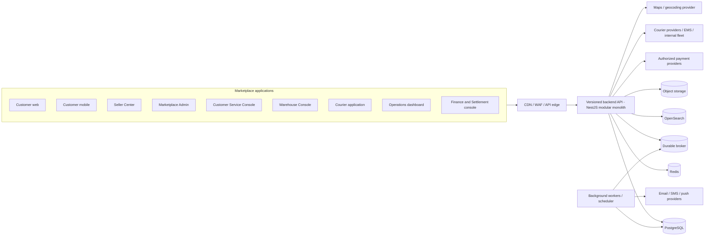

# Phase 0 System Architecture

Scope amendment (2026-10-06): [ADR-011](../decisions/ADR-011-seller-fulfilled-marketplace.md) and [revised scope](22-scope-phasing.md) control this historical baseline. Warehouse, fleet, platform-owned stock, platform goods/COD custody, and unconditional settlement requirements are OUT_OF_SCOPE. Seller stock reservations, seller order processing, delivery visibility, and applicable controls remain required. Authorized safe implementation may proceed; excluded capabilities and older blanket implementation stops do not create release blockers.

**Status:** historical architecture baseline with seller-fulfilled scope amendment  
**Scope:** production-target architecture for the seller-fulfilled Algerian marketplace; historical excluded components below are inactive reference designs  
**Implementation rule:** safe implementation is authorized by the owner under ADR-011; applicable real-provider and release approvals remain separate.

## 1. Architectural outcome

The initial backend will be a **TypeScript/NestJS modular monolith** backed by PostgreSQL, Redis, OpenSearch, S3-compatible object storage, and a durable message broker. It is one deployable API/worker codebase, but not one undifferentiated application: every business capability is a bounded context with owned tables, public application services, events, permissions, and adapter ports.

This choice provides transactional consistency for checkout, stock reservation, orders, payments, refunds, and seller finance while the business model is still evolving. It avoids premature distributed transactions and preserves a deliberate path to independently deployed services when scale or organizational ownership justifies extraction.

## 2. Architecture principles

1. **Domain ownership:** only the owning module writes its tables. Other modules use its application API or consume its published events.
2. **Product and offer separation:** a product is the marketplace-owned catalog record; an offer is a seller-specific commercial listing for a product variant.
3. **One checkout, multiple fulfillment groups:** one marketplace order contains seller orders, each of which can produce one or more shipments, cancellations, returns, and refunds.
4. **Server-enforced authorization:** customer ownership, seller scope, warehouse scope, courier assignment, and granular staff permissions are checked in the backend.
5. **Explicit state machines:** order, payment, shipment, return, seller onboarding, product moderation, settlement, and support transitions go through domain services. UIs and direct SQL cannot assign arbitrary states.
6. **Immutable financial history:** order pricing snapshots, payment events, seller ledger entries, settlement entries, and reconciliation records are append-only or corrected with compensating entries.
7. **Deterministic money:** all DZD amounts use integer minor units plus an ISO currency code. No binary floating point is permitted.
8. **Reliable asynchronous work:** database changes and integration events are committed together through a transactional outbox. Consumers are idempotent, retry with bounded backoff, and route exhausted messages to a dead-letter queue.
9. **Provider independence:** payment, courier, messaging, maps, search, object storage, malware scanning, and push services sit behind application-owned ports.
10. **Localization by contract:** persisted business data is language-neutral or explicitly localized. API error codes are stable; Arabic and French presentation text is resolved at the client or notification-template boundary. Arabic rendering uses RTL-aware clients.
11. **Auditability:** privileged changes, risk decisions, financial actions, state transitions, provider callbacks, and access to sensitive data carry actor, reason, timestamp, source, and correlation identifiers.
12. **Graceful degradation:** search, recommendations, analytics, and outbound notifications cannot corrupt checkout or order state when unavailable.

## 3. System context

The diagram preserves the original broader architecture. Only Customer Web, Seller Center, and Marketplace Admin/Support are required release surfaces under ADR-011. Those applications use one controlled API surface; they do not connect to the database, search cluster, broker, storage bucket, or providers directly. Public assets and transformed product images may be served through a CDN using signed or public cache-safe URLs according to asset classification.

## 4. Runtime topology

### 4.1 Synchronous request path

1. The edge terminates TLS, applies WAF and volumetric protections, propagates a correlation ID, and enforces coarse request limits.
2. The API authenticates the session or access token and resolves customer, seller, staff, warehouse, or courier scope.
3. A controller validates the versioned DTO and calls one application service.
4. The application service enforces permissions, policy, invariants, and state transitions.
5. A transaction writes owned tables, audit/state history where required, and outbox messages.
6. The API returns a stable response envelope or standardized error without exposing an internal exception.

### 4.2 Asynchronous path

1. An outbox dispatcher reads committed, unpublished outbox rows using `FOR UPDATE SKIP LOCKED`.
2. It publishes a versioned event envelope to the broker and records the publish result.
3. Consumers claim work with an inbox/idempotency record, perform the side effect, and atomically mark completion.
4. Transient failures retry with exponential backoff and jitter; terminal or exhausted failures move to a dead-letter queue and create an operational alert.
5. Operators can inspect and safely replay a message by event ID. Replays never bypass the consumer's idempotency check.

### 4.3 Data plane responsibilities

| Component      | Authoritative responsibility                                                                                  | Explicit non-responsibility                          |
| -------------- | ------------------------------------------------------------------------------------------------------------- | ---------------------------------------------------- |
| PostgreSQL     | Transactional system of record, constraints, state history, ledgers, outbox/inbox                             | Full-text storefront search, raw analytics workloads |
| Redis          | Short-lived cache, rate-limit counters, distributed leases where unavoidable, revocation/session acceleration | Financial balances, inventory truth, durable jobs    |
| OpenSearch     | Multilingual catalog/search documents, facets, suggestions, popularity inputs, zero-result reporting feed     | Product truth, offer truth, stock reservation        |
| Object storage | Product media, seller documents, return evidence, generated documents, shipping labels                        | Authorization decisions; raw upload trust            |
| Broker         | Durable event and command delivery, retries, dead-letter routing                                              | Source of truth for current domain state             |
| Analytics sink | Product and operational event analysis outside OLTP                                                           | Checkout decisions and transactional reporting truth |

## 5. Bounded contexts

| Context               | Owns                                                                                              | Primary invariants                                                                             | Publishes                                                                   |
| --------------------- | ------------------------------------------------------------------------------------------------- | ---------------------------------------------------------------------------------------------- | --------------------------------------------------------------------------- |
| Identity & Access     | Users, credentials, sessions, MFA, roles, permissions, user-role assignments                      | Unique verified identities; rotated refresh tokens; backend RBAC                               | `user.registered`, `user.phone_verified`, `identity.session_revoked`        |
| Customers             | Profiles, addresses, preferences, privacy requests                                                | Customer owns address; Wilaya and commune combination is valid                                 | `customer.address_changed`, `customer.preferences_changed`                  |
| Sellers               | Seller legal identity, onboarding, users, documents, bank references, status history              | Seller cannot trade until approved; all status changes are reasoned and audited                | `seller.submitted`, `seller.approved`, `seller.suspended`                   |
| Catalog               | Category tree and attributes, brands, products, variants, images, moderation                      | Category is centrally managed; variant SKU is unique; restricted product follows review policy | `product.submitted`, `product.approved`, `product.changed`                  |
| Offers & Pricing      | Seller offers, price, condition, warranty, commercial status, price history                       | One active offer per seller/product variant where policy requires; non-negative price          | `offer.activated`, `offer.price_changed`, `offer.deactivated`               |
| Inventory             | Stock positions, reservations, movements, serialized units                                        | Available = on hand - reserved - safety stock; no over-reservation; serial ships once          | `inventory.reserved`, `inventory.released`, `inventory.low_stock`           |
| Search                | Search documents, queries, suggestion and zero-result projections                                 | Index is a rebuildable projection; unavailable search cannot mutate commerce records           | `search.indexed`, analytics search events                                   |
| Cart & Wishlist       | Carts, cart items, saved items, wishlists                                                         | Cart price is indicative until checkout; seller/product access is scoped                       | `cart.item_added`, `wishlist.item_added`                                    |
| Promotions            | Promotion definitions, rules, priorities, stacking, usage                                         | Eligibility and usage limits are deterministic; incompatible promotions do not stack           | `promotion.redeemed`, `promotion.exhausted`                                 |
| Checkout              | Address, delivery, payment selections; priced checkout intent; idempotent placement orchestration | Explicit confirmation required; totals, availability, and policies revalidated                 | `checkout.started`, `checkout.expired`                                      |
| Orders                | Marketplace order, seller orders, items, address/price snapshots, transitions                     | One idempotent placement result; transition matrix enforced; history appended                  | `order.created`, `order.confirmed`, `order.cancelled`                       |
| Payments              | Payment intents/transactions, provider events, status transitions, reconciliation references      | Authentic idempotent webhook processing; sensitive card data never stored or logged            | `payment.completed`, `payment.failed`, `payment.reconciliation_discrepancy` |
| COD Risk              | COD assessment, reason codes, verification and review                                             | Explainable policy outcome; no protected or irrelevant traits                                  | `cod.verification_required`, `cod.accepted`, `cod.rejected`                 |
| Shipping              | Rates, pickup points, shipments, labels, tracking events, delivery estimates                      | Provider callbacks are idempotent; shipment total cannot change order total                    | `shipment.created`, `order.shipped`, `shipment.delivered`                   |
| Courier Operations    | Courier assignments, stops, proof of delivery, COD collection                                     | Courier acts only on assigned package; expected COD is immutable to courier                    | `delivery.attempted`, `cod.collected`                                       |
| Warehousing           | Warehouses, bins, inbound, putaway, picking, packing, manifests, inspections                      | Scan-based quantity/location verification; handoff is timestamped                              | `warehouse.receipt_completed`, `package.packed`, `return.inspected`         |
| Returns               | RMA, items, evidence, eligibility, logistics and inspection outcome                               | Item-level quantity cannot exceed delivered quantity; return state machine enforced            | `return.requested`, `return.approved`, `return.received`                    |
| Refunds               | Refund requests, approvals, provider/manual execution                                             | Cumulative refund cannot exceed refundable captured amount; idempotent execution               | `refund.initiated`, `refund.completed`, `refund.failed`                     |
| Reviews & Q&A         | Reviews, media references, votes, reports, replies, moderation                                    | Verified-purchase badge only for eligible delivered purchase; seller cannot delete review      | `review.submitted`, `review.published`, `review.reported`                   |
| Seller Finance        | Commission rules, ledger, settlement, payout and adjustments                                      | Ledger is immutable; settlement uses ledger entries, never current order reconstruction        | `ledger.entry_posted`, `settlement.generated`, `settlement.paid`            |
| COD Reconciliation    | Collection, remittance, deposit batches, discrepancies                                            | Expected/collected/remitted amounts are traceable to shipment and batch                        | `cod.remitted`, `cod.reconciled`, `cod.discrepancy_opened`                  |
| Support               | Tickets, messages, attachments, internal notes, SLA                                               | Private notes never exposed externally; access follows assignment/permission                   | `support.ticket_created`, `support.ticket_escalated`                        |
| Notifications         | Templates, preferences, deliveries, provider callbacks                                            | Required transactional notices override marketing opt-out only by policy; sends idempotent     | `notification.sent`, `notification.failed`                                  |
| Fraud & Trust         | Configurable rules, evaluations, cases, enforcement and counterfeit reports                       | Decision reasons retained; enforcement requires permissions and audit                          | `fraud.case_opened`, `policy.enforcement_applied`                           |
| CMS & SEO             | Localized content blocks, schedules, campaign pages, metadata                                     | Publication windows and locale variants validated                                              | `content.published`, `content.expired`                                      |
| Configuration & Flags | Typed configuration, feature flags, rollout rules                                                 | Sensitive values remain in secrets manager; changes audited and validated                      | `configuration.changed`, `feature_flag.changed`                             |
| Audit                 | Tamper-evident privileged action records and correlation trail                                    | Application actors cannot update historical audit entries                                      | none                                                                        |
| Analytics & Reporting | Event ingestion, read models, exports, scheduled reports                                          | Analytics is separated from OLTP; exports are authorized and traceable                         | `report.ready`, `report.failed`                                             |

## 6. Critical consistency boundaries

### 6.1 Checkout and order placement

Order placement is a synchronous orchestration inside the modular monolith because order snapshot creation, promotion redemption, inventory reservation, and the initial payment/COD decision require a clear outcome. The transaction locks or atomically updates affected inventory rows in a deterministic SKU order to avoid deadlocks. A client-provided idempotency key maps to a request hash and the resulting order; reuse with a different payload is rejected.

Electronic payment may require a provider redirect or later webhook. The order begins as `PENDING_PAYMENT`; it does not wait on notification, search, analytics, or seller-facing projection work. COD orders pass an explainable risk decision and can begin as `PENDING_CONFIRMATION` or `CONFIRMED`.

### 6.2 Inventory

PostgreSQL is authoritative. A reservation records SKU/stock position, quantity, owner order, expiry, and status. Reservation uses a conditional update or row lock so `reserved + requested <= on_hand - safety_stock`. Redis may cache availability for browsing but cannot confirm stock. Expiration, cancellation, and failed payment release through idempotent commands.

### 6.3 Payments and refunds

The platform stores provider tokens and non-sensitive references only. Provider calls use a platform idempotency key. Webhook authenticity is verified against raw bytes before parsing; the raw permitted payload, headers allowlist, verification outcome, and provider event ID are persisted. Status transitions are monotonic except for documented compensation paths. Reconciliation compares provider statements/callbacks to internal transactions and opens discrepancies without silently changing ledger history.

### 6.4 Seller finance

Order and refund events post balanced business entries to the seller ledger. Pending, available, reserved, and paid balances are projections over immutable entries. Settlement snapshots eligible entries, applies the configured hold period and adjustments, and locks membership before approval. A payout result creates new entries and reconciliation state; it never rewrites the underlying sale.

## 7. Security and trust boundaries

| Boundary                   | Controls                                                                                                                  |
| -------------------------- | ------------------------------------------------------------------------------------------------------------------------- |
| Public edge to API         | TLS, WAF, rate limits, request-size limits, bot/abuse controls, secure headers                                            |
| Customer session           | Strong password hashing, OTP where required, refresh rotation, session/device view, brute-force protection                |
| Seller/staff session       | Mandatory MFA, least-privilege roles, short-lived access, reason capture for sensitive actions                            |
| Application to data stores | Private networking, workload identity, separate credentials, least privilege, encrypted connections                       |
| File uploads               | Quarantine bucket, MIME/content inspection, size limits, malware scan, metadata stripping, derivative generation          |
| Provider callbacks         | Dedicated endpoint, authenticity verification, replay defense, IP policy only as supplemental control, persisted callback |
| Sensitive data             | Field classification, encryption at rest, access logging, redaction, retention and deletion workflows                     |
| Admin actions              | Permission plus current scope, reason, audit entry, correlation ID; step-up authorization for high-risk actions           |

No customer, seller, courier, or admin response exposes sequential internal identifiers when a UUID/ULID or public token is appropriate. Public tracking uses a revocable high-entropy token and returns only shipment-safe data.

## 8. Search and recommendation architecture

Catalog, offer, stock-availability summary, seller performance, and popularity events feed a denormalized multilingual OpenSearch document. Arabic and French analyzers, aliases/synonyms, prefixes, fuzzy matching, and category-defined facet fields are configured per index version. Reindexing writes a new versioned index and atomically switches an alias.

Search ranking combines textual relevance, availability, price quality, seller performance, delivery capability, product quality, popularity, and sales signals. Search query, result count, clicks, conversions, and zero-result searches are emitted to analytics. The database catalog remains reachable for known product URLs if OpenSearch is degraded.

Initial recommendations are rule-based projections using category, similarity, popularity, sales, browsing, cart, and wishlist signals. Recommendation failure never blocks product detail, cart, or checkout.

## 9. Availability and failure behavior

| Failure                         | Required behavior                                                                                                              |
| ------------------------------- | ------------------------------------------------------------------------------------------------------------------------------ |
| OpenSearch unavailable          | Return a controlled search-unavailable response or limited database-backed known-item lookup; do not mutate commerce records   |
| Courier API unavailable         | Persist order/shipment request, queue creation, retry, alert after threshold; do not lose order                                |
| Payment provider delayed        | Keep explicit pending status; status refresh and webhook processing remain idempotent; reconcile later                         |
| SMS/email/push unavailable      | Commit business transaction, queue delivery retry, expose notification status to operations                                    |
| Redis unavailable               | Fall back to database/session verification where safe; apply conservative local/edge rate limits; never infer stock from cache |
| Broker unavailable              | Business transaction and outbox commit succeed; dispatcher resumes publishing when broker recovers                             |
| Object storage scan unavailable | Keep upload quarantined and unavailable to customers/operators until scan completes                                            |
| Analytics unavailable           | Buffer/retry analytics events; no impact on order processing                                                                   |

## 10. Deployment model and environments

The same container artifacts are promoted through `LOCAL`, `DEVELOPMENT`, `TEST`, `STAGING`, and `PRODUCTION`; configuration and credentials are supplied per environment. Initial production units are:

- stateless API replicas;
- worker replicas split by queue class (commerce, integrations, notifications, search indexing, documents/reporting);
- scheduled-job leader with a distributed lease;
- managed or production-operated PostgreSQL with point-in-time recovery;
- highly available Redis, OpenSearch, broker, and object storage;
- CDN/WAF/API edge;
- observability collectors and alert routing.

Kubernetes is optional and adopted only when scale or operational capability requires it. Containers, health/readiness/liveness endpoints, infrastructure as code, backward-compatible migrations, rolling or blue/green release support, and tested rollback are required regardless of orchestrator.

## 11. Observability contract

Every inbound request, job, event, and provider call carries `correlationId`; event processing also carries `eventId` and causation identifiers. Logs are structured and redact passwords, OTPs, tokens, PAN, CVV, PIN, sensitive authentication data, seller documents, and private return evidence.

Minimum service-level telemetry covers HTTP error rate and latency, database saturation and slow queries, lock contention, queue lag and dead letters, outbox age, payment failures, webhook verification failures, courier errors, search latency/failure, checkout failure, inventory reservation conflicts, reconciliation discrepancies, notification failure, and storage scan backlog.

## 12. Evolution from modular monolith to services

Extraction is driven by measured load, availability isolation, regulatory boundary, or independent team ownership—not by table count.

1. Keep module public APIs, schemas, and events versioned from the start.
2. Prohibit cross-module writes and raw repository imports; enforce dependency rules in CI.
3. Place integration adapters and event consumers at module boundaries.
4. Before extraction, replace remaining in-process queries with owned read APIs or event-built projections.
5. Copy owned tables to the new service through snapshot plus change events; compare projections until consistent.
6. Route commands through a strangler adapter while the monolith remains the fallback owner.
7. Move ownership only after idempotency, retries, reconciliation, observability, and rollback have been proven.
8. Remove old write paths; retain event compatibility for the declared support window.

Likely early candidates are Search, Notifications, Analytics/Reporting, media processing, and document generation because they are asynchronous and weakly coupled. Payments, Shipping, and Recommendations may follow when provider isolation or load warrants it. Orders, Inventory, Promotions, and Seller Finance remain together until their consistency workflows and compensations are mature.

## 13. Architecture decision record summary

| Decision            | Choice                                                        | Consequence                                                                     |
| ------------------- | ------------------------------------------------------------- | ------------------------------------------------------------------------------- |
| Backend shape       | NestJS/TypeScript modular monolith                            | Faster coherent delivery; module boundaries must be mechanically enforced       |
| Transactional store | PostgreSQL                                                    | Strong constraints and transactions for commerce and finance                    |
| Cache               | Redis                                                         | Performance aid only; no transactional truth                                    |
| Search              | OpenSearch                                                    | Multilingual/faceted search isolated from OLTP                                  |
| Messaging           | Durable broker behind application event publisher             | Reliable async work without binding domain code to a vendor                     |
| Event reliability   | Transactional outbox plus consumer inbox                      | At-least-once delivery with idempotent effects                                  |
| Files               | S3-compatible object storage plus CDN and quarantine pipeline | Provider portability and controlled media/document lifecycle                    |
| IDs                 | UUID/ULID internally; separate human-readable references      | Non-sequential external identifiers and operator-friendly numbers               |
| Money               | Integer minor units plus currency                             | Deterministic calculations and explicit DZD handling                            |
| API                 | REST `/api/v1` plus OpenAPI and events                        | Broad client compatibility and explicit contracts                               |
| Integration model   | Hexagonal ports/adapters                                      | Replaceable payment, courier, communication, search, map, and storage providers |

## 14. Approval gates before implementation

- Bounded-context ownership and dependency rules accepted.
- ERD constraints, retention classifications, and money representation accepted.
- Order, payment, shipment, return, seller, product, and settlement state machines accepted.
- API, event, error, and provider adapter contracts reviewed by frontend, mobile, operations, finance, security, and QA owners.
- Algerian legal/accounting professionals review the compliance assumptions before production use.
- RPO/RTO, hosting location, `.com.dz`, payment-provider certification, data retention, and evidence/privacy decisions are resolved during infrastructure and compliance approval.
