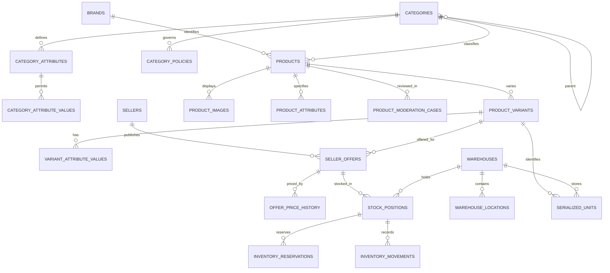
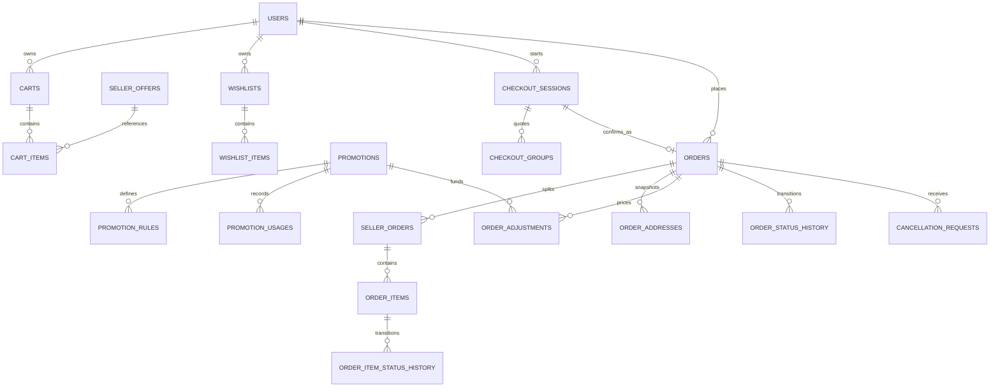
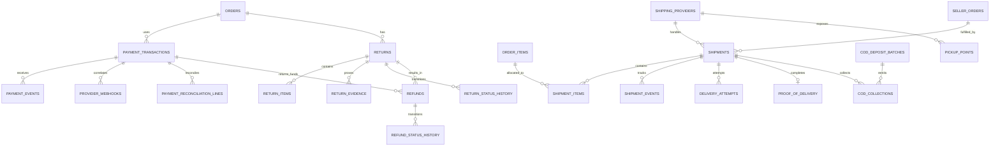
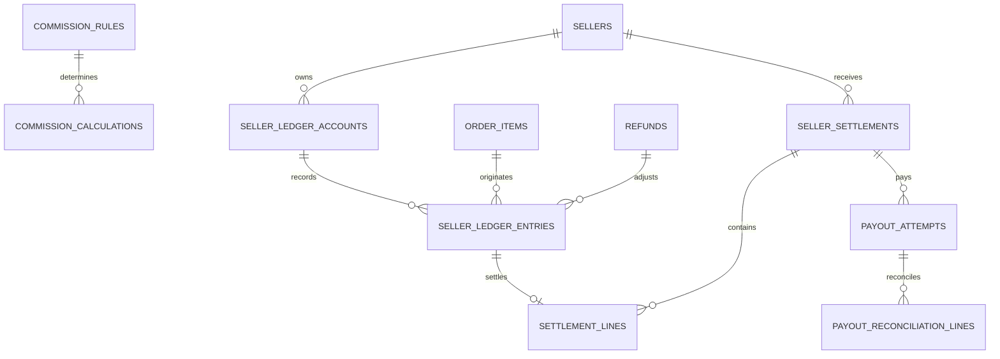

# Phase 0 Data Model and ERD

Scope amendment (2026-10-06): [ADR-011](../decisions/ADR-011-seller-fulfilled-marketplace.md) and [revised scope](22-scope-phasing.md) control this historical baseline. Warehouse, fleet, platform-owned stock, platform goods/COD custody, and unconditional settlement requirements are OUT_OF_SCOPE. Seller stock reservations, seller order processing, delivery visibility, and applicable controls remain required. Authorized safe implementation may proceed; excluded capabilities and older blanket implementation stops do not create release blockers.

**Status:** proposed logical data contract  
**Database:** PostgreSQL  
**Scope:** normalized transactional model, constraints, ownership, and extraction-safe references. Physical migrations follow only after architecture approval.

## 1. Modeling conventions

| Concern             | Contract                                                                                                                                                                                                                   |
| ------------------- | -------------------------------------------------------------------------------------------------------------------------------------------------------------------------------------------------------------------------- |
| Primary identifiers | UUID or monotonic ULID stored in a native/validated representation. Public resources use opaque IDs or purpose-specific tokens.                                                                                            |
| Human references    | Separate immutable references such as order number, seller-order number, RMA number, settlement number, shipment number, and ticket number. They are unique but are not primary keys.                                      |
| Time                | `timestamptz` in UTC; clients localize for Arabic/French and the user's timezone. Deadlines preserve the policy/timezone inputs used to calculate them.                                                                    |
| Money               | `amount_minor bigint` plus `currency char(3)`; DZD is the initial currency. No floating-point currency columns.                                                                                                            |
| Quantities          | Integer for discrete units; constrained decimal only for an explicitly divisible unit. Marketplace SKUs initially use positive integer quantities.                                                                         |
| Lifecycle           | `created_at`, `updated_at`, and optional `deleted_at` only where soft deletion is valid. Financial, state-history, audit, and provider-event records are append-only.                                                      |
| Concurrency         | Mutable aggregates carry `version bigint`; critical inventory and finance paths also use conditional updates or row locks.                                                                                                 |
| Localization        | Translatable content uses locale-keyed child rows or validated JSON objects limited to supported locales. Business rules store codes, not translated text.                                                                 |
| Actor attribution   | State histories reference actor type, actor ID where available, source, reason code/comment, correlation ID, and metadata.                                                                                                 |
| Sensitive data      | Classified fields are encrypted or tokenized as appropriate. Logs and analytics receive identifiers or redacted values, not raw credentials or financial authentication data.                                              |
| Module ownership    | Tables live in PostgreSQL schemas matching bounded contexts. Only the owning module writes them. Cross-schema foreign keys may enforce integrity while in the monolith, but code dependencies still use application ports. |

## 2. High-level marketplace ERD

```mermaid
erDiagram
  USERS ||--o| USER_PROFILES : has
  USERS ||--o{ USER_ADDRESSES : owns
  USERS ||--o{ USER_SESSIONS : opens
  USERS ||--o{ USER_ROLES : assigned
  ROLES ||--o{ USER_ROLES : grants
  ROLES ||--o{ ROLE_PERMISSIONS : contains
  PERMISSIONS ||--o{ ROLE_PERMISSIONS : maps

  SELLERS ||--o{ SELLER_USERS : authorizes
  USERS ||--o{ SELLER_USERS : joins
  SELLERS ||--o{ SELLER_DOCUMENTS : submits
  SELLERS ||--o{ SELLER_ADDRESSES : operates_at
  SELLERS ||--o{ SELLER_BANK_ACCOUNTS : settles_to
  SELLERS ||--o{ SELLER_STATUS_HISTORY : transitions

  CATEGORIES ||--o{ CATEGORIES : parent_of
  CATEGORIES ||--o{ CATEGORY_ATTRIBUTES : configures
  CATEGORY_ATTRIBUTES ||--o{ CATEGORY_ATTRIBUTE_VALUES : allows
  BRANDS ||--o{ PRODUCTS : brands
  CATEGORIES ||--o{ PRODUCTS : classifies
  PRODUCTS ||--o{ PRODUCT_VARIANTS : has
  PRODUCTS ||--o{ PRODUCT_IMAGES : illustrates
  PRODUCTS ||--o{ PRODUCT_ATTRIBUTES : describes
  PRODUCT_VARIANTS ||--o{ SELLER_OFFERS : offered_as
  SELLERS ||--o{ SELLER_OFFERS : sells

  SELLER_OFFERS ||--o{ INVENTORY : stocked_as
  WAREHOUSES ||--o{ INVENTORY : stores
  INVENTORY ||--o{ INVENTORY_RESERVATIONS : reserves
  INVENTORY ||--o{ INVENTORY_MOVEMENTS : moves
  WAREHOUSES ||--o{ WAREHOUSE_LOCATIONS : contains

  USERS ||--o{ CARTS : owns
  CARTS ||--o{ CART_ITEMS : contains
  SELLER_OFFERS ||--o{ CART_ITEMS : selected
  USERS ||--o{ WISHLISTS : owns
  WISHLISTS ||--o{ WISHLIST_ITEMS : contains

  USERS ||--o{ ORDERS : places
  ORDERS ||--o{ SELLER_ORDERS : splits_into
  SELLERS ||--o{ SELLER_ORDERS : fulfills
  SELLER_ORDERS ||--o{ ORDER_ITEMS : contains
  ORDERS ||--o{ ORDER_ADDRESSES : snapshots
  ORDERS ||--o{ ORDER_STATUS_HISTORY : transitions
  ORDERS ||--o{ PAYMENT_TRANSACTIONS : paid_by
  SELLER_ORDERS ||--o{ SHIPMENTS : ships_as
  SHIPMENTS ||--o{ SHIPMENT_ITEMS : contains
  SHIPMENTS ||--o{ SHIPMENT_EVENTS : tracks

  ORDER_ITEMS ||--o{ RETURN_ITEMS : returned_as
  RETURNS ||--o{ RETURN_ITEMS : contains
  RETURNS ||--o{ RETURN_EVIDENCE : supports
  ORDERS ||--o{ RETURNS : permits
  ORDERS ||--o{ REFUNDS : reimburses
  PAYMENT_TRANSACTIONS ||--o{ REFUNDS : funds

  USERS ||--o{ REVIEWS : writes
  ORDER_ITEMS ||--o{ REVIEWS : verifies
  REVIEWS ||--o{ REVIEW_VOTES : receives
  SELLERS ||--o{ SELLER_LEDGER : owns
  SELLERS ||--o{ SELLER_SETTLEMENTS : receives
```

This top-level view intentionally shows commerce relationships rather than every operational child table. The detailed diagrams and dictionary below are the authoritative ownership map.

## 3. Identity, customer, and seller model

```mermaid
erDiagram
  USERS ||--o| USER_PROFILES : has
  USERS ||--o{ USER_IDENTIFIERS : authenticates_with
  USERS ||--o{ USER_SESSIONS : opens
  USERS ||--o{ MFA_FACTORS : secures
  USERS ||--o{ USER_ADDRESSES : owns
  USERS ||--o{ USER_CONSENTS : grants
  USERS ||--o{ PRIVACY_REQUESTS : requests
  USERS ||--o{ USER_ROLES : assigned
  ROLES ||--o{ USER_ROLES : has
  ROLES ||--o{ ROLE_PERMISSIONS : has
  PERMISSIONS ||--o{ ROLE_PERMISSIONS : grants
  SELLERS ||--o{ SELLER_USERS : authorizes
  USERS ||--o{ SELLER_USERS : belongs_to
  SELLERS ||--o{ SELLER_DOCUMENTS : submits
  SELLERS ||--o{ SELLER_ADDRESSES : operates_at
  SELLERS ||--o{ SELLER_BANK_ACCOUNTS : paid_to
  SELLERS ||--o{ SELLER_STATUS_HISTORY : changes
  SELLERS ||--o{ SELLER_AGREEMENT_ACCEPTANCES : accepts
```

| Table                                  | Required fields and relationships                                                                                                                   | Key constraints                                                                                                                             |
| -------------------------------------- | --------------------------------------------------------------------------------------------------------------------------------------------------- | ------------------------------------------------------------------------------------------------------------------------------------------- |
| `identity.users`                       | `id`, `status`, `preferred_locale`, timestamps                                                                                                      | Locale in `ar`, `fr`, optional `en`; status transition controlled by Identity                                                               |
| `identity.user_identifiers`            | `user_id`, type (`PHONE`,`EMAIL`), normalized value, verified timestamp, credential hash reference                                                  | Unique active normalized identifier by type; password uses strong modern hashing                                                            |
| `identity.user_profiles`               | `user_id`, first name, last name                                                                                                                    | One-to-one; profile does not contain authorization roles                                                                                    |
| `identity.user_sessions`               | `user_id`, refresh-family ID, token hash, device data, IP metadata, issued/expiry/revoked times                                                     | Refresh rotation and reuse detection; only hashes stored                                                                                    |
| `identity.mfa_factors`                 | `user_id`, type, secret reference, verified/revoked times                                                                                           | Seller and staff access requires a verified active factor                                                                                   |
| `identity.roles`                       | role code, application scope, status                                                                                                                | Unique code; seeded roles from the approved role matrix                                                                                     |
| `identity.permissions`                 | permission code, description                                                                                                                        | Unique granular code such as `refund.approve`                                                                                               |
| `identity.user_roles`                  | `user_id`, `role_id`, optional seller/warehouse scope, validity                                                                                     | No duplicate active assignment in same scope                                                                                                |
| `identity.role_permissions`            | `role_id`, `permission_id`                                                                                                                          | Unique pair                                                                                                                                 |
| `customers.user_addresses`             | `user_id`, label, full name, phones, Wilaya, commune, postal code, street, building, unit, floor, landmark, notes, latitude/longitude, default flag | Address owner enforced; Wilaya/commune references maintained authoritative location data; one default per user through partial unique index |
| `customers.user_consents`              | `user_id`, consent type, policy version, decision, channel, captured time                                                                           | Append-only decisions; current consent is a projection                                                                                      |
| `customers.privacy_requests`           | `user_id`, type, status, requested/completed times, verification and result references                                                              | Explicit workflow for access/deletion; legal retention can block destructive deletion                                                       |
| `sellers.sellers`                      | public ID, legal/trade names, business type, commercial registration data, tax data, contact data, status, verification flags                       | Seller cannot activate offers until `APPROVED`; verification badges derive from actual fields                                               |
| `sellers.seller_users`                 | `seller_id`, `user_id`, seller role/status                                                                                                          | Unique membership; seller-scoped permission checks                                                                                          |
| `sellers.seller_documents`             | `seller_id`, document type, object key, checksum, review state, expiry                                                                              | Stored in private object storage; review action audited                                                                                     |
| `sellers.seller_addresses`             | `seller_id`, address type, Algeria address fields, geo coordinates                                                                                  | Types include business, warehouse, pickup, return where policy enables them                                                                 |
| `sellers.seller_bank_accounts`         | `seller_id`, tokenized/encrypted payout details, verification state                                                                                 | No plaintext secrets in logs; only approved active account can receive payout                                                               |
| `sellers.seller_status_history`        | previous/new status, actor, reason, source, metadata                                                                                                | Append-only; permitted transitions only                                                                                                     |
| `sellers.seller_agreement_acceptances` | `seller_id`, agreement version, accepted by, timestamp, IP/evidence                                                                                 | Unique acceptance per seller/version                                                                                                        |

## 4. Catalog, offers, inventory, and warehouse model

| Table                               | Required fields and relationships                                                                                                       | Key constraints                                                                                  |
| ----------------------------------- | --------------------------------------------------------------------------------------------------------------------------------------- | ------------------------------------------------------------------------------------------------ |
| `catalog.categories`                | parent, slug, localized name/SEO description, state, sort order                                                                         | Acyclic tree; centrally managed; unique active sibling slug                                      |
| `catalog.category_attributes`       | category, code, localized label, data type, required/filterable/variant flags, validation rules, sort order                             | Unique attribute code per category; validation schema versioned                                  |
| `catalog.category_attribute_values` | attribute, code, localized label, sort order, state                                                                                     | Unique code per attribute                                                                        |
| `catalog.category_policies`         | category, return policy reference, commission/shipping/restriction settings, effective range                                            | Non-overlapping effective policy versions for the same scope                                     |
| `catalog.brands`                    | slug, localized name/description, logo, official/verified state, document refs                                                          | Unique normalized name/slug; badge requires approved verification                                |
| `catalog.products`                  | category, brand, title/description/highlights, model, GTIN/EAN/UPC/MPN where present, moderation status, restricted classification, SEO | Duplicate-detection indexes; prohibited/restricted policy enforced before approval               |
| `catalog.product_variants`          | product, SKU, barcode, weight, dimensions, status, default image                                                                        | SKU unique; variant combination unique within product                                            |
| `catalog.product_images`            | product/variant, object key, media type, order, alt text locales, moderation state                                                      | Only scanned/approved derivatives can be public                                                  |
| `catalog.product_attributes`        | product, category attribute, typed value or allowed value                                                                               | Unique product/attribute; value conforms to definition                                           |
| `catalog.variant_attribute_values`  | variant, category attribute, typed/allowed value                                                                                        | Unique variant/attribute                                                                         |
| `catalog.product_moderation_cases`  | product, workflow state, validation findings, assignee, decision reason                                                                 | Append decision history; state follows catalog moderation workflow                               |
| `offers.seller_offers`              | seller, product variant, seller SKU, condition, price, currency, warranty, fulfillment method, handling SLA, state                      | Unique active seller/variant as configured; price non-negative; approved seller/product required |
| `offers.offer_price_history`        | offer, old/new amount, reason, actor, effective time                                                                                    | Append-only                                                                                      |
| `inventory.stock_positions`         | offer, warehouse or seller location, on-hand, reserved, damaged, inbound, safety stock, version                                         | All quantities non-negative; available computed, not independently edited                        |
| `inventory.inventory_reservations`  | stock position, order/order item, quantity, status, expiry, idempotency key                                                             | Active reserved sum cannot exceed reservable stock; unique reservation owner/key                 |
| `inventory.inventory_movements`     | stock position, type, quantity delta, before/after quantity snapshot, source reference, actor                                           | Append-only; delta and resulting quantities reconcile                                            |
| `inventory.serialized_units`        | variant, serial number, IMEI where applicable, warehouse/location, status, receipt, sold item, shipment, return, warranty refs          | Unique serial and IMEI; a unit cannot be assigned to two shipped items                           |
| `warehousing.warehouses`            | code, localized name, address, status, operating timezone                                                                               | Unique code                                                                                      |
| `warehousing.warehouse_locations`   | warehouse, parent location, type, code, scan barcode, status                                                                            | Unique path/code per warehouse; types zone/aisle/rack/shelf/bin                                  |
| `warehousing.inbound_shipments`     | ASN number, supplier/seller, warehouse, expected/received dates, status                                                                 | Unique ASN; receiving is scan/history based                                                      |
| `warehousing.inbound_items`         | inbound shipment, variant, expected/received/accepted/damaged counts                                                                    | Counts non-negative and reconciled                                                               |
| `warehousing.pick_tasks`            | seller order/shipment, warehouse, assignee, status, priority                                                                            | One active assignment per task; scan events retained                                             |
| `warehousing.packages`              | shipment, package number, dimensions, captured weight, packaging, label reference, status                                               | Positive dimensions/weight; immutable after handoff except controlled correction                 |
| `warehousing.manifests`             | warehouse, courier, manifest number, handoff time, status                                                                               | Unique manifest number; handoff evidence retained                                                |
| `warehousing.return_inspections`    | return item, serial verification, condition, packaging/accessories/damage, disposition, inspector                                       | One final outcome: restock, refurbish, return-to-vendor, dispose                                 |

## 5. Cart, checkout, promotion, and order model

| Table                              | Required fields and relationships                                                                                                                      | Key constraints                                                                              |
| ---------------------------------- | ------------------------------------------------------------------------------------------------------------------------------------------------------ | -------------------------------------------------------------------------------------------- |
| `cart.carts`                       | customer or anonymous token, currency, state, expiry                                                                                                   | At most one active cart per authenticated customer/currency                                  |
| `cart.cart_items`                  | cart, offer, variant snapshot, quantity, added price, saved-for-later flag                                                                             | Unique active offer per cart; positive quantity                                              |
| `cart.wishlists`                   | user, name, default flag                                                                                                                               | One default per user                                                                         |
| `cart.wishlist_items`              | wishlist, product/variant/offer preference, added time                                                                                                 | Unique item identity per wishlist                                                            |
| `promotions.promotions`            | code/name, type, funding party, priority, stack group, schedule, status, usage limits                                                                  | Valid effective interval and non-negative limits                                             |
| `promotions.promotion_rules`       | promotion, rule type, typed configuration, order                                                                                                       | Validated schema; rules cover eligibility, reward, exclusions, maximum discount and stacking |
| `promotions.promotion_usages`      | promotion, customer, order, amount, state, idempotency key                                                                                             | Enforces global/per-customer usage limits transactionally                                    |
| `checkout.checkout_sessions`       | customer, cart, address/payment selections, currency, item/total quote snapshot, status, expiry, version                                               | Explicit confirmation; request hash bound to idempotency key                                 |
| `checkout.checkout_groups`         | checkout, seller/fulfillment owner, selected shipping option, quote/estimate, pickup point                                                             | One selected option per fulfillment group                                                    |
| `orders.orders`                    | order number, customer, order/payment/fulfillment summaries, currency, subtotal, discount, shipping, tax, total, terms/policy versions, confirmed time | Totals satisfy equation; non-negative components; immutable purchase snapshot                |
| `orders.seller_orders`             | order, seller or marketplace owner, seller-order number, fulfillment method, status, financial totals, SLA timestamps                                  | Unique number; items belong to one seller group                                              |
| `orders.order_items`               | seller order, offer/product/variant/seller snapshots, quantity, unit/list/net prices, discount/tax totals, warranty/return-policy snapshot, status     | Positive quantity; line totals deterministic                                                 |
| `orders.order_addresses`           | order, type, complete address/contact snapshot                                                                                                         | Immutable snapshot independent of later address edits                                        |
| `orders.order_adjustments`         | order/order item, type, funding party, promotion/rule reference, amount, currency, calculation metadata                                                | Append-only purchase calculation breakdown                                                   |
| `orders.order_status_history`      | order or seller order, previous/new status, actor/source/reason, timestamp, correlation, metadata                                                      | Append-only; transition matrix validated                                                     |
| `orders.order_item_status_history` | order item, previous/new status, actor/source/reason                                                                                                   | Supports item-level cancellation/return without changing unaffected items                    |
| `orders.cancellation_requests`     | order/item quantities, customer reason, decision, operational reason, timestamps                                                                       | Cannot cancel more than remaining cancellable quantity                                       |
| `platform.idempotency_records`     | scope, actor, key, request hash, state, response reference/body, expiry                                                                                | Unique scope/actor/key; payload mismatch rejected                                            |

### 5.1 Total equation

`order.total_minor = subtotal_minor - discount_minor + shipping_minor + tax_minor`

Every line and order adjustment stores its funding party and calculation source so marketplace-funded and seller-funded promotions remain financially reconstructable.

## 6. Payment, shipping, returns, and refund model

| Table                                   | Required fields and relationships                                                                                                                                 | Key constraints                                                                    |
| --------------------------------------- | ----------------------------------------------------------------------------------------------------------------------------------------------------------------- | ---------------------------------------------------------------------------------- |
| `payments.payment_transactions`         | order, method, provider, type, amount/currency, status, platform/provider refs, idempotency key, timestamps                                                       | Unique provider reference where present; allowed status transition; no PAN/CVV/PIN |
| `payments.payment_events`               | transaction, event type, previous/new status, provider event, amount, occurred/received times, correlation                                                        | Append-only and unique provider event application                                  |
| `payments.provider_webhooks`            | provider, provider event ID, headers allowlist, permitted raw body object/reference, signature result, processing state, attempts                                 | Unique provider/event ID; verified before state mutation                           |
| `payments.payment_reconciliation_runs`  | provider, period, source checksum/object, status, totals                                                                                                          | One run per provider/source checksum                                               |
| `payments.payment_reconciliation_lines` | run, provider ref, internal transaction, expected/actual amount/status, discrepancy code                                                                          | Every source line classified matched or discrepancy                                |
| `shipping.shipping_providers`           | code, adapter type/config reference, capabilities, status                                                                                                         | Credentials live in secrets manager                                                |
| `shipping.pickup_points`                | provider, external ID, localized name, Wilaya/commune/address/geo, hours, status                                                                                  | Unique provider/external ID                                                        |
| `shipping.shipments`                    | shipment number, seller order, provider, service/delivery type, origin/destination snapshot, status, tracking ref, quote, COD expected, estimate range, label ref | Idempotent provider creation key; totals cannot be courier-edited                  |
| `shipping.shipment_items`               | shipment, order item, quantity                                                                                                                                    | Sum shipped per item cannot exceed ordered minus cancelled quantity                |
| `shipping.shipment_events`              | shipment, status/event code, provider event ID, location, occurred/received times, source, payload metadata                                                       | Append-only; unique provider event where present                                   |
| `shipping.delivery_attempts`            | shipment, courier/assignment, outcome, reason, time, GPS permitted fields, notes                                                                                  | Courier must be assigned; controlled outcome codes                                 |
| `shipping.proof_of_delivery`            | shipment, evidence type/object, recipient name, timestamp, GPS, verification outcome                                                                              | Private access; one active final proof per delivery                                |
| `shipping.cod_collections`              | shipment/order/courier, expected and collected amounts, collection time, batch, status                                                                            | Collected amount cannot be silently overwritten; discrepancies explicit            |
| `shipping.cod_deposit_batches`          | courier/provider, batch number, expected/received totals, remitted time, reconciliation status                                                                    | Collection belongs to at most one active batch                                     |
| `returns.returns`                       | RMA number, order, customer, reason, status, eligibility policy snapshot, resolution, timestamps                                                                  | Unique RMA; allowed transition; return window evaluated from snapshot              |
| `returns.return_items`                  | return, order item, quantity, reason, condition claim, disposition/inspection ref                                                                                 | Cumulative accepted quantity <= delivered quantity minus prior accepted returns    |
| `returns.return_evidence`               | return/item, object key, media type, uploader, scan/moderation state                                                                                              | Only validated media; private by default                                           |
| `returns.return_status_history`         | return, previous/new status, actor/source/reason, metadata                                                                                                        | Append-only                                                                        |
| `refunds.refunds`                       | refund number, order/return/transaction, method, amount/currency, reason, approval and processor refs, status, idempotency key                                    | Cumulative completed/pending refund <= refundable captured amount                  |
| `refunds.refund_items`                  | refund, order item, quantity, amount breakdown                                                                                                                    | Sum equals refund total                                                            |
| `refunds.refund_status_history`         | refund, previous/new status, actor/source/reason                                                                                                                  | Append-only                                                                        |

## 7. Seller finance and commission model

| Table                                 | Required fields and relationships                                                                                                                                                                                       | Key constraints                                                                     |
| ------------------------------------- | ----------------------------------------------------------------------------------------------------------------------------------------------------------------------------------------------------------------------- | ----------------------------------------------------------------------------------- |
| `finance.commission_rules`            | scope dimensions (category/subcategory/seller plan/brand/campaign), fixed/percentage fees, effective range, priority, status                                                                                            | Effective deterministic precedence; no overlapping same-priority identical scope    |
| `finance.commission_calculations`     | order item, selected rule/version, input snapshot, commission, fulfillment/shipping/payment fees, funding amounts                                                                                                       | Immutable calculation evidence                                                      |
| `finance.seller_ledger_accounts`      | seller, currency, account type                                                                                                                                                                                          | Unique seller/currency/type                                                         |
| `finance.seller_ledger_entries`       | account, type (`SALE`, `COMMISSION`, `SHIPPING_FEE`, `FULFILLMENT_FEE`, `REFUND`, `RETURN_ADJUSTMENT`, `PROMOTION`, `MANUAL_ADJUSTMENT`, `PAYOUT`), amount, direction, effective/available times, source, reversal link | Append-only; unique source/event/type; manual adjustment requires permission/reason |
| `finance.seller_settlements`          | settlement number, seller/currency, period, hold cutoff, totals, status, approved/paid times, payout account snapshot                                                                                                   | Lines fixed before approval; allowed workflow; totals equal lines                   |
| `finance.settlement_lines`            | settlement, ledger entry, amount                                                                                                                                                                                        | Entry cannot be settled twice for same amount                                       |
| `finance.payout_attempts`             | settlement, provider/bank reference, idempotency key, amount, status, attempts                                                                                                                                          | Unique idempotency key and provider reference                                       |
| `finance.payout_reconciliation_lines` | payout attempt, external line, expected/actual, status, discrepancy                                                                                                                                                     | Every external amount classified                                                    |

Balances (`pending`, `available`, `reserved`, `paid`) are projections and may be cached. They are never hand-edited truth.

## 8. Reviews, support, trust, content, and platform records

| Schema/table                             | Required fields and relationships                                                                                                | Key constraints                                                                           |
| ---------------------------------------- | -------------------------------------------------------------------------------------------------------------------------------- | ----------------------------------------------------------------------------------------- |
| `reviews.reviews`                        | customer, product, optional variant/seller, eligible order item, rating/subratings, title/text, status, seller reply, moderation | One review per policy-defined purchase/product; verified flag derived from delivered item |
| `reviews.review_media`                   | review, object key, media type, scan/moderation state                                                                            | Validated private-to-public pipeline                                                      |
| `reviews.review_votes`                   | review, user, vote                                                                                                               | Unique review/user vote                                                                   |
| `reviews.review_reports`                 | review, reporter, reason, state, moderation decision                                                                             | Reporter cannot resolve own report                                                        |
| `support.support_tickets`                | ticket number, requester type/ID, customer/order/seller refs, priority/category/status, assigned agent, SLA timestamps           | Access scope enforced; valid status transitions                                           |
| `support.support_messages`               | ticket, sender, visibility (`EXTERNAL`,`INTERNAL`), body, timestamps                                                             | Internal messages never returned to customer/seller endpoints                             |
| `support.support_attachments`            | message/ticket, object key, media metadata, scan state                                                                           | Private and scanned                                                                       |
| `fraud.fraud_rules`                      | code, version, scope, conditions/actions, priority, schedule, state                                                              | Admin-configurable, validated, versioned                                                  |
| `fraud.fraud_evaluations`                | subject, rule version, signal snapshot, outcome, reason codes, score where used                                                  | Auditable reasons; excludes protected/irrelevant traits                                   |
| `fraud.fraud_cases`                      | subject, case type, status, assignee, decisions                                                                                  | Enforcement action linked and audited                                                     |
| `trust.infringement_cases`               | reporter, brand, product, seller, evidence, status, resolution                                                                   | Controlled access and full action history                                                 |
| `trust.enforcement_actions`              | seller/offer/product, action type, effective period, reason, actor                                                               | Warning/restriction/suspension/closure history retained                                   |
| `notifications.notification_templates`   | event/use case, channel, locale, version, subject/body, required variables, status                                               | Unique active event/channel/locale/version                                                |
| `notifications.notifications`            | recipient, template version, channel, payload reference, status, provider ref, idempotency key, attempts                         | Unique delivery intent/idempotency key                                                    |
| `notifications.notification_preferences` | user, channel/topic, enabled, source                                                                                             | Transactional policy can override marketing preference only by approved rule              |
| `cms.content_entries`                    | content type, slug/key, status, audience, schedule                                                                               | Unique active key and locale/scope                                                        |
| `cms.content_localizations`              | entry, locale, content, SEO metadata                                                                                             | Unique entry/locale                                                                       |
| `platform.feature_flags`                 | key, typed default, rollout conditions, state                                                                                    | Unique key; audited update                                                                |
| `platform.configuration`                 | key, type, validated non-secret value, scope, version, effective range                                                           | Secrets prohibited; unique active scope/key                                               |
| `platform.audit_logs`                    | actor/role, action, entity type/ID, previous/new permitted data, reason, IP, timestamp, correlation ID                           | Append-only; sensitive field redaction                                                    |
| `platform.outbox_events`                 | event ID/type/version, aggregate, payload, correlation/causation, occurred time, publish state/attempts                          | Written in domain transaction; unique event ID                                            |
| `platform.inbox_messages`                | consumer, event ID, status, first/last attempt, result reference                                                                 | Unique consumer/event ID                                                                  |
| `platform.file_assets`                   | owner/type, bucket/object key, checksum, MIME, size, scan/derivative state, retention class                                      | Unique checksum/object; public URL only for approved public derivative                    |
| `analytics.event_receipts`               | event ID, schema version, subject pseudonym, received time, sink state                                                           | No critical transaction depends on this table                                             |
| `reporting.report_jobs`                  | report type, filters, requester, status, output asset, expiry                                                                    | Authorization captured; generated file expires per policy                                 |

## 9. Required status domains

Statuses are database constraints or reference values owned by their module, not free-form text.

| Aggregate                     | Values                                                                                                                                                                                                                                                                                                                                                                                                                                                                                                    |
| ----------------------------- | --------------------------------------------------------------------------------------------------------------------------------------------------------------------------------------------------------------------------------------------------------------------------------------------------------------------------------------------------------------------------------------------------------------------------------------------------------------------------------------------------------- |
| Seller onboarding             | `DRAFT`, `SUBMITTED`, `UNDER_REVIEW`, `MORE_INFORMATION_REQUIRED`, `APPROVED`, `REJECTED`, `SUSPENDED`                                                                                                                                                                                                                                                                                                                                                                                                    |
| Catalog moderation            | `SUBMITTED`, `AUTOMATED_VALIDATION`, `MODERATOR_REVIEW`, `APPROVED`, `CHANGES_REQUIRED`, `REJECTED`                                                                                                                                                                                                                                                                                                                                                                                                       |
| Payment                       | `PENDING`, `REQUIRES_ACTION`, `AUTHORIZED`, `PAID`, `FAILED`, `CANCELLED`, `REFUND_PENDING`, `PARTIALLY_REFUNDED`, `REFUNDED`                                                                                                                                                                                                                                                                                                                                                                             |
| Marketplace/order fulfillment | `PENDING_PAYMENT`, `PAYMENT_FAILED`, `PENDING_CONFIRMATION`, `CONFIRMED`, `PROCESSING`, `ALLOCATED`, `PICKING`, `PACKED`, `READY_FOR_HANDOFF`, `SHIPPED`, `IN_TRANSIT`, `OUT_FOR_DELIVERY`, `DELIVERED`, `PARTIALLY_DELIVERED`, `DELIVERY_FAILED`, `RETURN_TO_SENDER`, `CANCEL_REQUESTED`, `PARTIALLY_CANCELLED`, `CANCELLED`, `RETURN_REQUESTED`, `RETURN_APPROVED`, `RETURN_REJECTED`, `RETURN_IN_TRANSIT`, `RETURN_RECEIVED`, `REFUND_PENDING`, `PARTIALLY_REFUNDED`, `REFUNDED`, `DISPUTED`, `CLOSED` |
| Return/RMA                    | `REQUESTED`, `UNDER_REVIEW`, `APPROVED`, `REJECTED`, `AWAITING_CUSTOMER_SHIPMENT`, `COURIER_ASSIGNED`, `IN_TRANSIT`, `RECEIVED`, `INSPECTION`, `REFUND_APPROVED`, `REFUND_REJECTED`, `REFUNDED`, `CLOSED`                                                                                                                                                                                                                                                                                                 |
| COD risk                      | `COD_ACCEPTED`, `COD_VERIFICATION_REQUIRED`, `COD_MANUAL_REVIEW`, `COD_REJECTED`                                                                                                                                                                                                                                                                                                                                                                                                                          |
| COD reconciliation            | `COLLECTED`, `AWAITING_REMITTANCE`, `REMITTED`, `RECONCILED`, `DISCREPANCY`                                                                                                                                                                                                                                                                                                                                                                                                                               |
| Support                       | `OPEN`, `IN_PROGRESS`, `WAITING_CUSTOMER`, `WAITING_SELLER`, `WAITING_COURIER`, `ESCALATED`, `RESOLVED`, `CLOSED`                                                                                                                                                                                                                                                                                                                                                                                         |

## 10. Critical database constraints and indexes

1. Unique normalized phone/email identifiers and provider event IDs.
2. Partial unique index for one default customer address and one default wishlist per customer.
3. Category parent cannot equal self; recursive validation rejects cycles.
4. Product SKU and applicable barcode/identifier uniqueness policies are enforced.
5. One active seller offer per seller/variant when marketplace policy disallows duplicates.
6. Check constraints keep monetary components and stock buckets non-negative, except signed ledger movements/entries where direction is explicit.
7. Inventory reservation is an atomic condition, not a read-then-write sequence.
8. Idempotency keys are unique within actor and operation scope; request hash is stored.
9. Order, seller order, shipment, RMA, refund, settlement, ASN, manifest, and support reference numbers are unique.
10. Shipped/returned/cancelled quantity sums cannot exceed order-item quantity; enforced in application transactions with locked aggregate rows and verified by reconciliation jobs.
11. Cumulative pending/completed refunds cannot exceed captured refundable amount.
12. Every state history row has `previous_status`, `new_status`, actor/source, timestamp, reason, and correlation ID.
13. Append-only tables deny update/delete to the application role; corrections use reversal/compensating rows.
14. Common indexes cover foreign keys, active status plus schedule, customer/order history, seller/status, SKU/warehouse, provider reference, tracking number, state queues, and outbox publish state/created time.
15. Search text is not served with unbounded `%LIKE%` queries from PostgreSQL; OpenSearch handles public search.

## 11. Deletion, retention, and partitioning

Privacy deletion pseudonymizes eligible customer data and revokes identifiers/sessions, but does not erase records that must be retained for transaction, accounting, fraud, dispute, contract, or legal obligations. The approved retention schedule decides each table/field class before production.

High-volume append-only tables—`audit_logs`, outbox/inbox records, provider webhooks, payment events, shipment events, status histories, inventory movements, notifications, and analytics receipts—are candidates for time partitioning after measured growth. Partitioning cannot weaken uniqueness or replay guarantees. Archival is encrypted, access-controlled, tested for restore, and tied to retention policy.

## 12. Migration and extraction rules

- Every schema change is an ordered migration reviewed with its owning module.
- Production migrations use expand/backfill/contract steps and remain backward-compatible during rolling deployment.
- Destructive column removal occurs only after all readers are migrated and retention requirements permit it.
- Backfills are resumable, observable, rate-limited, and idempotent.
- Service extraction preserves public IDs and event versions. Cross-module foreign keys may be replaced by local immutable references only after validation and reconciliation jobs exist.
- Seed data contains authoritative Wilaya/commune data and synthetic Algerian marketplace records; it contains no real personal information.
