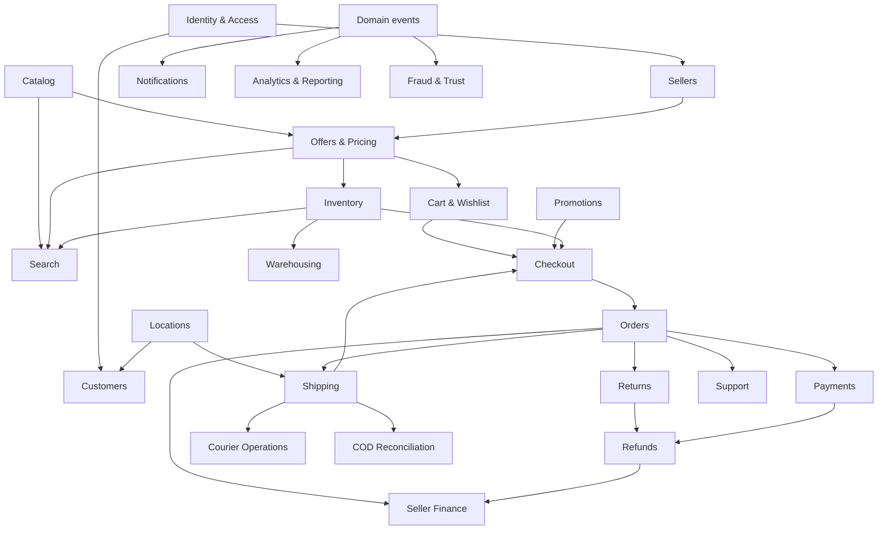
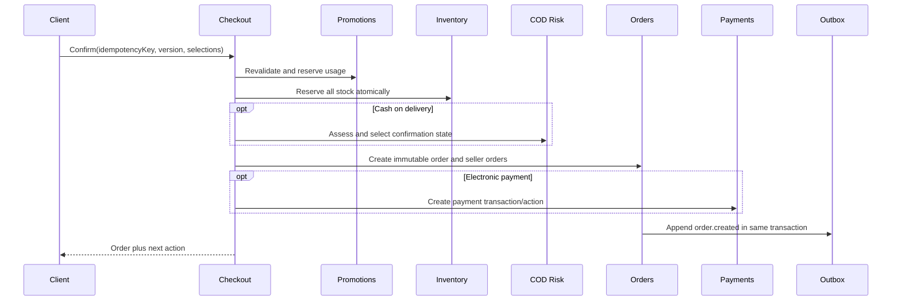

# Phase 0 Backend Module Architecture

Scope amendment (2026-10-06): [ADR-011](../decisions/ADR-011-seller-fulfilled-marketplace.md) and [revised scope](22-scope-phasing.md) control this historical baseline. Warehouse, fleet, platform-owned stock, platform goods/COD custody, and unconditional settlement requirements are OUT_OF_SCOPE. Seller stock reservations, seller order processing, delivery visibility, and applicable controls remain required. Authorized safe implementation may proceed; excluded capabilities and older blanket implementation stops do not create release blockers.

**Status:** proposed bounded-context contract  
**Runtime:** NestJS/TypeScript modular monolith with separate API and worker entry points

## 1. Module rulebook

Each business module contains four inward-facing layers:

1. **Domain:** aggregates, value objects, policies, state-transition rules, domain errors, and domain events. It imports no web framework, ORM, provider SDK, or another module's repository.
2. **Application:** commands, queries, transaction coordination, permission checks, ports, DTO-to-domain mapping, and event handlers.
3. **Infrastructure:** PostgreSQL repositories, Redis cache implementation, broker publisher/consumer, OpenSearch projections, object-storage implementation, and provider adapters.
4. **Interface:** versioned HTTP controllers, webhook controllers, event contracts, job entry points, and OpenAPI metadata.

Only a module's exported application facade and published contracts are callable by another module. Direct imports of another module's repositories or ORM entities are prohibited by lint/dependency rules. Every command accepts an actor/scope context and correlation ID. Commands that create money movement, external side effects, or customer commitments also accept an idempotency key.

## 2. Module map

Arrows indicate allowed information flow or use of a public application port. Cycles are broken through orchestration or events rather than mutual repository access.

## 3. Business module contracts

### 3.1 Identity & Access

**Owns:** users, identifiers, credentials, OTP challenges, sessions, MFA factors, roles, permissions, assignments.  
**Commands:** register by phone/email; verify phone/email; authenticate; rotate refresh token; revoke one/all sessions; start/complete password reset; enroll/verify MFA; assign/revoke scoped role.  
**Queries:** current principal; sessions/devices; effective permissions; identity lookup for authorized operations.  
**Invariants:** identifiers normalized and unique; refresh rotation detects replay; seller and staff principals require MFA; frontend visibility is never authorization.  
**Exports:** `PrincipalResolver`, `PermissionAuthorizer`, `IdentityReferenceReader`.  
**Events:** `user.registered`, `user.phone_verified`, `user.email_verified`, `identity.login_suspicious`, `identity.session_revoked`.  
**Background work:** OTP expiry, session cleanup, suspicious-login alert creation.

### 3.2 Customers

**Owns:** customer profile, Algeria-aware addresses, communication preferences, consent, privacy requests.  
**Commands:** update profile; add/update/delete address; set default; update preferences; request data export/deletion.  
**Queries:** profile; owned addresses; preference and consent state.  
**Invariants:** address belongs to principal; Wilaya/commune pair valid; phone verification policy applied; one default address.  
**Exports:** `CustomerReader`, `AddressSnapshotProvider`, `CommunicationPreferenceReader`.  
**Events:** `customer.profile_changed`, `customer.address_changed`, `customer.preferences_changed`, `privacy.requested`.

### 3.3 Locations

**Owns:** maintained Wilaya, commune, postal/reference data and configured holidays.  
**Commands:** import/version authoritative dataset; activate/deactivate location; configure holiday.  
**Queries:** list/search Wilayas and communes; validate pair; resolve delivery calendar inputs.  
**Invariants:** stable codes and version history; a commune belongs to exactly one active Wilaya version.  
**Exports:** `LocationValidator`, `HolidayCalendar`.

### 3.4 Sellers

**Owns:** legal/business identity, seller users, documents, addresses, settlement-account references, agreements, onboarding and enforcement status history.  
**Commands:** create draft; submit application; request information; approve/reject/suspend/reactivate; manage seller member; upload document; accept agreement; update payout reference.  
**Queries:** own onboarding; admin seller profile; seller verification/status; seller membership.  
**Invariants:** permitted state transitions; approval requires configured fields/documents/agreement; badges reflect approved state; every privileged decision has reason and audit.  
**Exports:** `SellerEligibility`, `SellerPublicReader`, `SellerScopeAuthorizer`.  
**Events:** `seller.submitted`, `seller.more_information_required`, `seller.approved`, `seller.rejected`, `seller.suspended`, `seller.reactivated`.

### 3.5 Catalog

**Owns:** centrally managed category tree/attributes/policies, brands, master products, variants, specifications, media links, product moderation, duplicate-merge records.  
**Commands:** manage category/attribute/brand; request product; validate; approve/reject/request changes; merge duplicate; activate/deactivate product; attach scanned media.  
**Queries:** category tree/configuration; product detail; product/variant lookup; moderation queue; duplicate candidates.  
**Invariants:** sellers never create arbitrary categories; category attributes type-check; variant combination/SKU unique; restricted categories enter compliance review or reject; only approved media becomes public.  
**Exports:** `CatalogReader`, `ProductEligibility`, `CategoryPolicyReader`.  
**Events:** `category.changed`, `brand.changed`, `product.submitted`, `product.approved`, `product.changes_required`, `product.rejected`, `product.changed`, `product.deactivated`.

### 3.6 Offers & Pricing

**Owns:** seller/marketplace offers, seller SKU, condition, current price, price history, warranty, fulfillment method, handling SLA, commercial status.  
**Commands:** create offer against approved variant; update price/terms; submit/activate/deactivate offer; apply enforcement hold.  
**Queries:** buyable offers; seller offers; competing offers; offer price snapshot.  
**Invariants:** approved seller and product; one active seller/variant under policy; non-negative deterministic price; false official-reseller claims blocked.  
**Exports:** `OfferReader`, `BuyabilityPolicy`, `PriceSnapshotProvider`.  
**Events:** `offer.created`, `offer.activated`, `offer.price_changed`, `offer.deactivated`, `offer.suspended`.

### 3.7 Inventory

**Owns:** stock positions, reservations, movements, safety stock, serialized-unit allocation.  
**Commands:** adjust/receive stock; create/confirm/release/expire reservation; allocate serial; ship stock; record damage/return.  
**Queries:** authoritative availability; seller low stock; reservation; movement history.  
**Invariants:** available = on hand - reserved - safety stock; no negative bucket; no oversell; reservation idempotent; one serial ships once.  
**Exports:** `AvailabilityReader`, `InventoryReservationPort`, `SerialAllocationPort`.  
**Events:** `inventory.changed`, `inventory.reserved`, `inventory.reservation_failed`, `inventory.released`, `inventory.decremented`, `inventory.low_stock`.

### 3.8 Search

**Owns:** OpenSearch mapping/index lifecycle, catalog read documents, suggestions/synonyms, query/click/zero-result ingestion. The index is a projection, not commerce truth.  
**Commands:** index/delete document; rebuild versioned index; update approved synonyms.  
**Queries:** autocomplete; multilingual search; facets; category browse search.  
**Invariants:** result visibility honors approved/buyable state; dynamic facets derive from category configuration; index can be rebuilt from events/snapshots.  
**Exports:** `ProductSearch`.  
**Consumes:** catalog, offer, inventory, seller-performance, popularity events.  
**Events:** `search.index_rebuilt`, `search.zero_results` plus analytics events.

### 3.9 Cart & Wishlist

**Owns:** carts, cart items, save-for-later state, wishlists and items.  
**Commands:** create/merge cart; add/update/remove item; save for later; create wishlist; add/remove/move item.  
**Queries:** enriched cart; wishlists.  
**Invariants:** positive quantity; customer ownership; cart price/availability clearly revalidated at checkout; multiple seller grouping preserved.  
**Exports:** `CartReader`, `CheckoutCartSnapshot`.  
**Events:** `cart.item_added`, `cart.item_removed`, `wishlist.item_added`, `wishlist.item_removed`.

### 3.10 Promotions

**Owns:** promotion definitions, rules, eligibility, priority/stack groups, usage reservations/redemptions.  
**Commands:** create/update/schedule/activate promotion; evaluate; reserve/redeem/release usage.  
**Queries:** eligible deals; promotion detail; usage and performance.  
**Invariants:** configured limits and customer eligibility; deterministic precedence; incompatible promotions do not stack; funding party recorded.  
**Exports:** `PromotionEvaluator`, `PromotionUsagePort`.  
**Events:** `promotion.activated`, `promotion.redeemed`, `promotion.exhausted`, `promotion.expired`.

### 3.11 Checkout

**Owns:** expiring checkout session, priced quote, fulfillment groups, selected address/shipping/payment method, explicit terms acceptance, placement orchestration result.  
**Commands:** start checkout; select address; quote/select delivery per group; select payment; preview review; confirm/place order.  
**Queries:** current checkout and validation issues.  
**Invariants:** place action is explicit; totals, stock, seller/product status, promotion, delivery, address, and payment eligibility revalidated; idempotency key binds payload to one result.  
**Uses:** Customers, Cart, Offers, Promotions, Inventory, Shipping, COD Risk, Orders, Payments through ports.  
**Events:** `checkout.started`, `checkout.updated`, `checkout.expired`, `checkout.placed`.

### 3.12 Orders

**Owns:** marketplace order, seller orders, item/address/price/policy snapshots, cancellation requests, status histories, customer and operations timelines.  
**Commands:** create from approved checkout; confirm; progress fulfillment; request/decide cancellation; apply shipment/return/refund outcomes; close/dispute.  
**Queries:** customer orders/detail; seller-scoped orders; admin complete timeline; public token tracking projection.  
**Invariants:** one marketplace order splits by fulfillment owner; unaffected items remain independent; totals immutable; every transition allowed and historical; admin override still uses business service/permission/reason.  
**Exports:** `OrderCommandFacade`, `OrderReader`, `RefundableAmountReader`, `VerifiedPurchaseReader`.  
**Events:** `order.created`, `order.confirmed`, `order.cancel_requested`, `order.cancelled`, `order.shipped`, `order.delivered`, `order.closed`.

### 3.13 COD Risk

**Owns:** versioned COD rules, assessment signal snapshots, reason codes, verification/manual-review state.  
**Commands:** assess; verify OTP/confirmation; submit/review case; accept/reject.  
**Queries:** customer verification requirement; authorized risk case.  
**Invariants:** only relevant operational signals; reasons auditable; no protected/irrelevant traits; thresholds configurable.  
**Exports:** `CodEligibilityEvaluator`.  
**Events:** `cod.verification_required`, `cod.manual_review_required`, `cod.accepted`, `cod.rejected`.

### 3.14 Payments

**Owns:** payment transaction/intent, provider references, webhook receipts, payment events, reconciliation runs/lines.  
**Commands:** create/authorize/capture/cancel; refresh provider status; process verified webhook; reconcile.  
**Queries:** customer-safe status; admin transaction; reconciliation/discrepancy.  
**Invariants:** hosted/certified flow; no raw card data; provider authenticity; event and action idempotency; transition matrix; captured amount consistency.  
**Exports:** `PaymentInitiationPort`, `PaymentStatusReader`, `CapturedAmountReader`.  
**Events:** `payment.requires_action`, `payment.authorized`, `payment.completed`, `payment.failed`, `payment.cancelled`, `payment.reconciliation_discrepancy`.

### 3.15 Shipping

**Owns:** provider catalog/config references, rate quotes, pickup-point projection, shipments/items, labels, estimates, tracking events.  
**Commands:** quote rates; create/cancel shipment; schedule pickup; refresh tracking; process webhook; estimate delivery.  
**Queries:** checkout options; shipment detail/tracking; labels/manifests; provider health.  
**Invariants:** adapter-independent request; idempotent shipment creation/webhook; valid item quantities; estimate uses origin, destination, SLA, courier, calendar and availability; courier cannot edit order value.  
**Exports:** `ShippingQuotePort`, `ShipmentCommandFacade`, `TrackingReader`, `DeliveryEstimateEngine`.  
**Events:** `shipment.creation_requested`, `shipment.created`, `shipment.creation_failed`, `shipment.tracking_updated`, `shipment.delivered`, `shipment.delivery_failed`, `shipment.return_to_sender`.

### 3.16 Courier Operations

**Owns:** courier profiles/scope reference, assignment, route stops, delivery attempts, proof of delivery, collected COD declaration.  
**Commands:** assign stop; mark arrived; deliver; record unavailable/refused/wrong-address/reschedule/return-to-depot; capture proof and COD.  
**Queries:** assigned route/packages/COD expected; delivery detail.  
**Invariants:** actor assigned; permitted transition; proof policy applied; expected COD immutable; privacy-limited evidence access.  
**Events:** `courier.stop_assigned`, `delivery.attempted`, `shipment.delivered`, `cod.collected`.

### 3.17 Warehousing

**Owns:** warehouses/locations, ASN/inbound, receipt/quality/putaway, pick tasks/scans, packages, packing, manifests/handoffs, cycle counts, return inspections.  
**Commands:** receive/inspect/put away; create/execute pick; pack/label; create/handoff manifest; count/adjust; inspect return/dispose.  
**Queries:** dashboards/queues; stock location; task; discrepancy.  
**Invariants:** location/item/quantity scan validation; serialized identity; package measured; handoff evidence; adjustment permission/reason.  
**Events:** `warehouse.inbound_received`, `warehouse.putaway_completed`, `warehouse.pick_completed`, `package.packed`, `shipment.handed_off`, `return.inspected`, `inventory.count_discrepancy`.

### 3.18 Returns

**Owns:** RMA, eligibility decision snapshot, items/reasons, evidence, return shipment link, review/inspection resolution, histories.  
**Commands:** request; evaluate; approve/reject; attach evidence; assign return transport; receive; record inspection; approve/reject refund; close.  
**Queries:** customer/seller/admin return; eligibility; warehouse queue.  
**Invariants:** only delivered eligible quantity; configurable category/product/seller/window/condition policy; evidence private/scanned; transition matrix; one item's return leaves others unchanged.  
**Exports:** `ReturnReader`, `RefundAuthorizationReader`.  
**Events:** `return.requested`, `return.approved`, `return.rejected`, `return.in_transit`, `return.received`, `return.inspected`, `return.refund_approved`, `return.closed`.

### 3.19 Refunds

**Owns:** refund request, allocation to items/fees, approval, method, processor execution and histories.  
**Commands:** create; approve/reject; execute; process callback/status; retry/reconcile.  
**Queries:** customer refund; finance queue; refundable balance.  
**Invariants:** permission separation for create/approve where configured; no over-refund; original-payment/manual/COD method follows policy; execution idempotent.  
**Events:** `refund.initiated`, `refund.approved`, `refund.rejected`, `refund.completed`, `refund.failed`.

### 3.20 Reviews & Q&A

**Owns:** reviews/subratings/media, verified-purchase derivation, votes, reports, seller replies, moderation; product Q&A if enabled.  
**Commands:** submit/update within policy; attach media; vote/report; moderate; seller reply.  
**Queries:** product reviews/Q&A; customer reviews; moderation queue.  
**Invariants:** verified badge only from eligible order item; seller cannot delete negative review; media scanned; moderation permission enforced.  
**Events:** `review.submitted`, `review.published`, `review.reported`, `review.moderated`.

### 3.21 Seller Finance

**Owns:** commission rules/calculations, seller ledger accounts/entries, settlement membership/state, payout attempts, statements and payout reconciliation.  
**Commands:** configure/version rule; calculate/post entries; release hold; generate/approve/pay settlement; post adjustment/reversal; reconcile payout.  
**Queries:** balances; transaction ledger; upcoming/history/detail/statement; discrepancies.  
**Invariants:** rules are effective-dated and deterministic; entries append-only; settlement sourced from eligible ledger entries; payout idempotent and reconcilable; manual action audited.  
**Events:** `commission.calculated`, `ledger.entry_posted`, `seller.balance_available`, `settlement.generated`, `settlement.approved`, `settlement.paid`, `settlement.discrepancy`.

### 3.22 COD Reconciliation

**Owns:** COD collection lifecycle, deposit/remittance batches, expected-versus-collected-versus-remitted comparison, discrepancy cases.  
**Commands:** record collection; create batch; mark remitted; reconcile; open/resolve discrepancy.  
**Queries:** courier expected/collected; finance batches; discrepancy dashboard.  
**Invariants:** shipment and expected amount fixed; changes use adjustment history; every collection belongs to at most one active batch.  
**Events:** `cod.collected`, `cod.remitted`, `cod.reconciled`, `cod.discrepancy_opened`, `cod.discrepancy_resolved`.

### 3.23 Notifications

**Owns:** localized/versioned templates, preferences, delivery intents, attempts and callbacks.  
**Commands:** render/queue; send through channel adapter; retry; process provider callback; manage preference/template.  
**Queries:** customer notifications/unread count; operations failures; template preview.  
**Invariants:** one intent per event/recipient/channel; required variables validated; transactional versus marketing policy; Arabic/French template support; no sensitive values in messages.  
**Consumes:** lifecycle events from Identity, Orders, Payments, Shipping, Returns, Refunds, Sellers, Inventory, Support and Finance.  
**Events:** `notification.sent`, `notification.failed`, `notification.delivery_updated`.

### 3.24 Support

**Owns:** tickets, external messages, internal notes, attachments, assignment, SLA/escalation.  
**Commands:** create/reply/assign/change status/escalate/resolve/close; attach validated file.  
**Queries:** requester tickets; agent queue; complete authorized order timeline through a read port.  
**Invariants:** internal notes never leak; requester scope verified; SLA state computed; sensitive actions audited.  
**Events:** `support.ticket_created`, `support.reply_added`, `support.ticket_escalated`, `support.ticket_resolved`.

### 3.25 Fraud & Trust

**Owns:** configurable fraud rules/evaluations/cases, seller performance enforcement, counterfeit/infringement cases and enforcement history.  
**Commands:** evaluate subject; open/assign/decide case; report infringement; warn/restrict/suspend/restore offer or seller.  
**Queries:** authorized fraud dashboard/case; seller performance; infringement status.  
**Invariants:** reasoned decisions; rules versioned; protected/irrelevant characteristics excluded; action requires permission/reason/audit; seller sees only permitted evidence.  
**Events:** `fraud.case_opened`, `fraud.case_resolved`, `infringement.reported`, `policy.enforcement_applied`, `policy.enforcement_lifted`.

### 3.26 CMS & SEO

**Owns:** localized homepage components, campaigns, text/image blocks, publication schedules, audience, SEO metadata and sitemap projection.  
**Commands:** draft/preview/publish/unpublish/schedule content.  
**Queries:** locale/audience storefront composition; metadata; sitemap entries.  
**Invariants:** publication windows valid; referenced product/category/brand visible; locale fallback explicit; admin permission/audit.  
**Events:** `content.published`, `content.unpublished`, `content.expired`.

### 3.27 Configuration & Feature Flags

**Owns:** typed non-secret business configuration, flag definitions, rollout targeting and history.  
**Commands:** validate/create/update/activate configuration; change flag rollout.  
**Queries:** resolved configuration by scope; evaluated flag.  
**Invariants:** configuration schema per key; effective dating; no secrets; sensitive operational change requires reason/audit.  
**Events:** `configuration.changed`, `feature_flag.changed`.

### 3.28 Audit

**Owns:** append-only privileged action records and sensitive-access records.  
**Commands:** append audit record from an authenticated action; export authorized trail.  
**Queries:** permission-scoped entity/actor/correlation timeline.  
**Invariants:** application role cannot alter history; before/after data redacted; reason mandatory for defined action classes.  
**Events:** none; audit must not recursively audit itself.

### 3.29 Analytics & Reporting

**Owns:** ingestion contracts, warehouse/sink loading status, operational read models, report jobs and export assets.  
**Commands:** ingest; aggregate; request/generate/expire report.  
**Queries:** approved dashboards and exported report status.  
**Invariants:** no heavy analytics on transactional request paths; pseudonymization and access controls; report filters/requester audited.  
**Events:** `report.ready`, `report.failed`.

## 4. Cross-module orchestration

### 4.1 Place order

Any failure before commit rolls back local writes. External hosted-payment setup is made idempotently and recorded; an uncertain provider outcome remains pending and is resolved by status query, webhook, and reconciliation rather than by blind duplicate creation.

### 4.2 Shipment delivery and finance

`shipment.delivered` is consumed independently by Orders (item delivery status), Inventory/Warehouse (completion), COD Reconciliation (expected collection workflow), Reviews (purchase eligibility), Seller Finance (hold/availability policy), Notifications, SLA tracking, and Analytics. A consumer failure does not roll back the recorded shipment event; it retries from the broker/inbox.

### 4.3 Return and refund

Returns owns eligibility and inspection; Refunds owns the monetary reimbursement; Payments executes an original-payment refund through its adapter; Seller Finance posts seller adjustments; Orders updates item-level summary. Each step emits a fact and supports resume/replay without duplicate money movement.

## 5. Dependency policies

| Rule                                                                       | Enforcement                                                                                      |
| -------------------------------------------------------------------------- | ------------------------------------------------------------------------------------------------ |
| Domain code imports only same-module domain and approved shared primitives | ESLint dependency boundaries plus architecture tests                                             |
| Controllers contain no business rules                                      | Controller tests and code review; controllers call one application command/query                 |
| Module A cannot query Module B tables                                      | Separate repository packages/schema credentials in tests; import restrictions                    |
| Shared package contains no marketplace policy                              | Shared package limited to IDs, money, time, result/error, event envelope and observability types |
| Read models do not become write authorities                                | Projection code exposes read interfaces only                                                     |
| Events are past-tense facts                                                | Contract review and schema registry checks                                                       |
| Provider SDK types do not cross adapter boundary                           | Adapter maps provider models to canonical port models                                            |

## 6. Jobs and queue classes

| Queue class           | Workloads                                                                       | Priority/isolation                                                 |
| --------------------- | ------------------------------------------------------------------------------- | ------------------------------------------------------------------ |
| `commerce-critical`   | reservation expiry, payment/refund status, shipment creation, financial posting | Highest; strict alerting and short retry intervals                 |
| `provider-webhooks`   | verified payment/courier/messaging callbacks                                    | High; partitioned by provider/aggregate where ordering matters     |
| `notifications`       | email, SMS, push, in-app delivery                                               | Medium; transactional messages before marketing                    |
| `search-indexing`     | product/offer/stock document updates, reindex                                   | Medium; coalescing allowed only without losing terminal visibility |
| `media-documents`     | image derivatives, malware scan result, invoices, labels, statements            | Medium; private outputs and expiring links                         |
| `analytics-reporting` | event export, aggregation, report generation                                    | Lower; isolated from commerce resources                            |
| `maintenance`         | retention, cleanup, projection reconciliation, backup verification hooks        | Scheduled; rate-limited                                            |

## 7. Service-extraction readiness

Every module exposes a facade that can be implemented in-process now and over authenticated network transport later. Extraction requires:

- owned schema and no cross-module write imports;
- versioned OpenAPI/event contracts and compatibility tests;
- consumer inbox/idempotency and reconciliation;
- independent health, telemetry, scaling profile and runbook;
- data snapshot plus change-stream migration plan;
- timeout, retry, circuit-breaker and fallback policy at the new network boundary;
- no distributed transaction assumption; orchestration must use explicit compensation.

Search, Notifications, media/document processing, and Analytics/Reporting are the safest initial extractions. Orders, Inventory, Promotions, and Seller Finance require the highest bar because they share critical transaction and financial consistency paths.
