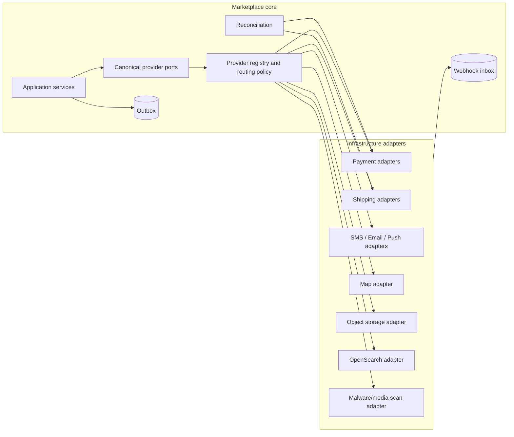
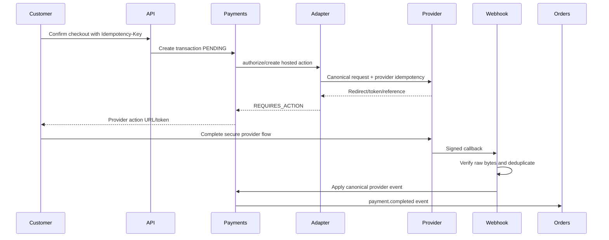
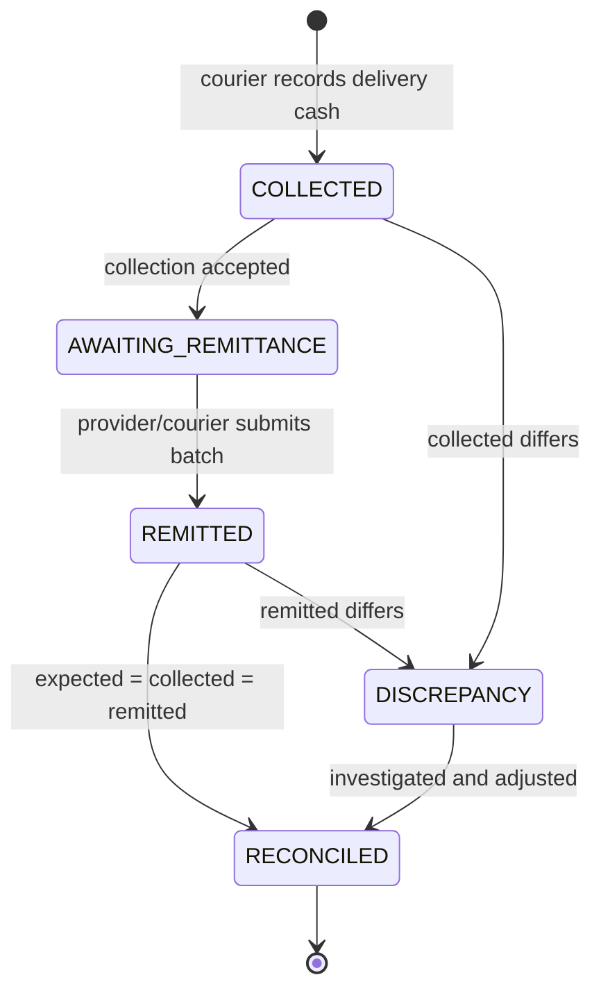
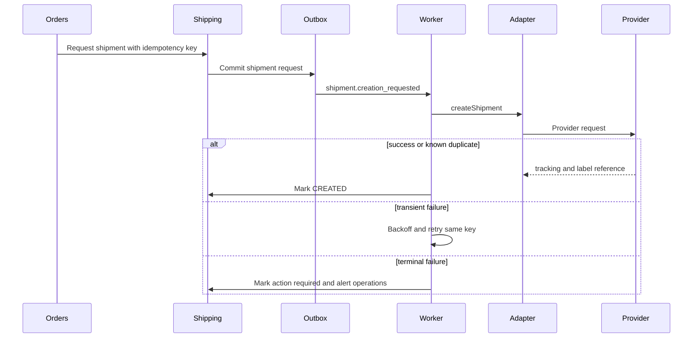
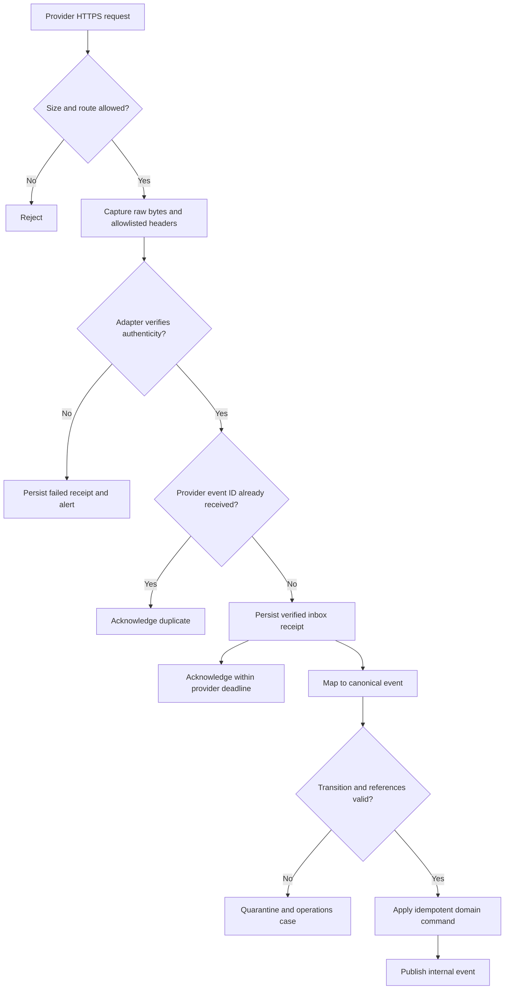

# Phase 0 Integration Architecture

Scope amendment (2026-10-06): [ADR-011](../decisions/ADR-011-seller-fulfilled-marketplace.md) and [revised scope](22-scope-phasing.md) control this historical baseline. Warehouse, fleet, platform-owned stock, platform goods/COD custody, and unconditional settlement requirements are OUT_OF_SCOPE. Seller stock reservations, seller order processing, delivery visibility, and applicable controls remain required. Authorized safe implementation may proceed; excluded capabilities and older blanket implementation stops do not create release blockers.

**Status:** proposed provider-boundary contract  
**Goal:** external failures are expected, isolated, observable, idempotent, and reconcilable without corrupting marketplace state.

## 1. Integration principles

1. Domain/application code depends on marketplace-owned ports, never provider SDKs or response types.
2. Adapters map canonical commands/results to one provider and are selected through configuration/capability registry.
3. Credentials and signing material live in a secrets manager, are scoped per environment/provider, and never enter source control, events, error responses, or general logs.
4. Money-moving and shipment-creating calls carry a stable platform idempotency key. An uncertain timeout is `PENDING/UNKNOWN`, not an automatic second transaction.
5. Provider callbacks are authenticated against raw request bytes, persisted, deduplicated, mapped to canonical events, and processed asynchronously where acknowledgement deadlines require it.
6. Every external financial amount and status is reconciled against internal records.
7. Retry applies only to classified transient failures. Permanent validation/policy failures move to operations or customer resolution.
8. Circuit breakers protect platform resources, but do not discard durable work. Queued work remains visible and retryable.
9. Sandbox/fake adapters are enabled only in `LOCAL` and `TEST`. Staging uses provider sandbox/certification environments where available; production uses approved real adapters/configuration.
10. Adding a provider does not change checkout/order domain models. A capability matrix determines which methods, locations, services, and flows can be offered.

## 2. Hexagonal boundary



## 3. Shared canonical types

Every outbound command includes:

```ts
type IntegrationContext = {
  correlationId: string;
  idempotencyKey: string;
  requestedAt: string;
  environment: 'LOCAL' | 'DEVELOPMENT' | 'TEST' | 'STAGING' | 'PRODUCTION';
  actorType: 'SYSTEM' | 'CUSTOMER' | 'SELLER' | 'STAFF' | 'COURIER';
  dataClassification: 'PUBLIC' | 'INTERNAL' | 'CONFIDENTIAL' | 'RESTRICTED';
};

type ProviderError = {
  category:
    | 'VALIDATION'
    | 'AUTHENTICATION'
    | 'AUTHORIZATION'
    | 'RATE_LIMIT'
    | 'TIMEOUT'
    | 'UNAVAILABLE'
    | 'DUPLICATE'
    | 'NOT_FOUND'
    | 'CONFLICT'
    | 'UNKNOWN';
  safeCode: string;
  retryable: boolean;
  retryAfterSeconds?: number;
  providerRequestReference?: string;
};
```

Raw provider errors are retained only in protected integration telemetry with redaction and retention controls. Customer/API responses use the marketplace error catalog.

## 4. Payment integration

### 4.1 Canonical port

```ts
interface PaymentProvider {
  getCapabilities(context: ProviderContext): Promise<PaymentCapabilities>;
  authorize(command: AuthorizePayment, context: IntegrationContext): Promise<ProviderPaymentResult>;
  capture(command: CapturePayment, context: IntegrationContext): Promise<ProviderPaymentResult>;
  cancel(command: CancelPayment, context: IntegrationContext): Promise<ProviderPaymentResult>;
  refund(command: RefundPayment, context: IntegrationContext): Promise<ProviderRefundResult>;
  getStatus(query: ProviderPaymentQuery): Promise<ProviderPaymentStatus>;
  verifyAndParseWebhook(request: RawWebhookRequest): Promise<VerifiedPaymentEvent>;
  reconcile(source: ReconciliationSource): AsyncIterable<ProviderFinancialRecord>;
}
```

The architecture supports authorized Algerian electronic payment paths, including SATIM/CIB and an Edahabia-supported pathway where an approved integration permits it. Exact certification, hosted-page/token mechanism, callback signing, settlement-file format, production endpoints, permitted stored references, and contractual SLAs are provider-onboarding decisions and cannot be assumed in code before provider documentation and security/legal approval.

### 4.2 Hosted-payment flow



The marketplace does not collect or log PAN, CVV, PIN, or full sensitive authentication data. Redirect/action URLs are short-lived and sent only to the owning session. A customer return URL is never proof of payment; only verified callback, authoritative status query, or reconciliation can finalize payment.

### 4.3 Payment state and uncertainty

| Provider result                          | Internal action                                                                |
| ---------------------------------------- | ------------------------------------------------------------------------------ |
| Definitive success                       | Apply allowed transition, append payment event, publish event                  |
| Customer action required                 | Set `REQUIRES_ACTION`, persist expiry and safe action reference                |
| Definitive decline/failure               | Set `FAILED` with safe code; apply order policy                                |
| Timeout/connection loss after submission | Keep `PENDING`; query by idempotency/reference; await callback/reconciliation  |
| Duplicate acknowledgement                | Return original internal result; no second authorization/capture/refund        |
| Auth/signature failure                   | Open integration alert, reject/quarantine, no financial state mutation         |
| Provider unavailable                     | Open circuit after threshold; offer eligible alternate method or pending retry |

### 4.4 Refund and reconciliation

Refund calls use refund ID as stable idempotency scope and never exceed the captured refundable amount. Provider callback and polling converge on one refund state transition. Reconciliation imports a checksummed provider statement/API period, classifies each line as matched, missing internal, missing external, amount mismatch, currency mismatch, status mismatch, or duplicate, and opens a discrepancy without overwriting ledger history.

## 5. COD integration and reconciliation

COD is an order, delivery, cash, and finance workflow rather than a payment-gateway adapter. The Shipping/Courier adapter supplies delivery result and collection data; the marketplace owns expected amount, risk/confirmation state, collection record, deposit batch, remittance, reconciliation, discrepancy, and seller-ledger timing.



Courier users cannot change expected order/COD totals. They submit amount collected and controlled outcome. Any difference creates an auditable discrepancy.

## 6. Shipping and courier integration

### 6.1 Canonical port

```ts
interface ShippingProvider {
  getCapabilities(context: ShippingContext): Promise<ShippingCapabilities>;
  getRates(query: ShippingRateQuery, context: IntegrationContext): Promise<ShippingRate[]>;
  createShipment(command: CreateShipment, context: IntegrationContext): Promise<ProviderShipment>;
  cancelShipment(
    command: CancelShipment,
    context: IntegrationContext,
  ): Promise<ProviderShipmentStatus>;
  getTracking(query: TrackingQuery): Promise<TrackingSnapshot>;
  createLabel(command: CreateLabel, context: IntegrationContext): Promise<PrivateDocumentRef>;
  schedulePickup(command: SchedulePickup, context: IntegrationContext): Promise<PickupBooking>;
  getPickupPoints(query: PickupPointQuery): Promise<PickupPoint[]>;
  verifyAndParseWebhook(request: RawWebhookRequest): Promise<VerifiedShipmentEvent>;
}
```

Adapters can represent Algerian national delivery companies, EMS, future courier companies, an internal fleet, and approved seller delivery. The registry records capability by provider/service: home delivery, pickup point, express, standard, COD, label, cancellation, pickup scheduling, tracking webhook, status polling, weight/dimension range, Wilaya/commune coverage, and supported fulfillment owner.

### 6.2 Quote and shipment creation

The marketplace shipping engine computes canonical inputs: origin/destination Wilaya and commune, package weight/dimensions, COD amount, delivery type, seller/warehouse, configured shipping rule, and free-shipping promotion funding. Provider rates are normalized to DZD money, service code, promise inputs, expiry, and terms. The delivery estimate engine combines provider transit range with seller/warehouse handling SLA, current time, weekend, configured holiday, and product availability.

Shipment creation is asynchronous when a provider outage should not fail a valid order:



### 6.3 Tracking normalization

Provider statuses map to canonical shipment events without losing the original provider code. Unknown codes are quarantined for mapping review, not guessed. Stale/out-of-order callbacks are stored but cannot regress a terminal state. Polling supplements callbacks based on capability and shipment age. Public tracking exposes only order-safe timeline, estimate and package count.

## 7. Communication integrations

```ts
interface SmsProvider {
  send(command: SendSms, context: IntegrationContext): Promise<MessageSubmission>;
  verifyAndParseWebhook(request: RawWebhookRequest): Promise<VerifiedMessageEvent>;
}

interface EmailProvider {
  send(command: SendEmail, context: IntegrationContext): Promise<MessageSubmission>;
  verifyAndParseWebhook(request: RawWebhookRequest): Promise<VerifiedMessageEvent>;
}

interface PushProvider {
  send(command: SendPush, context: IntegrationContext): Promise<MessageSubmission>;
  verifyAndParseWebhook(request: RawWebhookRequest): Promise<VerifiedMessageEvent>;
}
```

The Notifications module renders versioned Arabic/French templates before the adapter. Adapters receive already authorized recipient/channel data and a stable notification idempotency key. SMS/email/push outage never rolls back registration, order, payment, shipment, return, refund, seller or settlement state. Transactional messages retry ahead of marketing messages; permanent invalid-recipient outcomes update the delivery record and preference/contact-health projection.

OTP delivery is separately rate-limited and stores only challenge hashes and safe delivery metadata. Logs never include OTP values or full message bodies containing private order data.

## 8. Map and geocoding integration

```ts
interface MapProvider {
  geocode(query: GeocodeQuery): Promise<GeocodeCandidate[]>;
  reverseGeocode(point: GeoPoint): Promise<ReverseGeocodeResult>;
  createNavigationLink(destination: GeoPoint): string;
}
```

Wilaya/commune validation uses the marketplace's maintained authoritative dataset, not a third-party map response. Coordinates and geocoding candidates assist address entry, delivery operations and navigation. They do not silently replace customer-entered legal/delivery address fields. Location access and courier GPS are minimized and retained according to approved privacy policy.

## 9. Object storage, media, files, and documents

```ts
interface ObjectStorage {
  createUploadIntent(command: CreateUploadIntent): Promise<UploadIntent>;
  headObject(ref: ObjectRef): Promise<ObjectMetadata>;
  copyToApprovedLocation(command: ApproveObject): Promise<ObjectRef>;
  createDownloadUrl(command: CreateDownloadUrl): Promise<SignedUrl>;
  deleteObject(command: DeleteObject): Promise<void>;
}

interface ContentScanner {
  scan(ref: ObjectRef, context: IntegrationContext): Promise<ScanResult>;
}
```

Upload sequence:

1. API authorizes owner, workflow, declared MIME/size and creates a short-lived intent for a quarantine prefix.
2. Client uploads directly using the bounded intent.
3. Worker verifies checksum, detected MIME, image/video/document limits, malware result and workflow-specific content rules.
4. Image pipeline strips unsafe metadata and produces thumbnail, small, medium, large, WebP and AVIF derivatives where compatible.
5. Approved public product media moves to public/CDN-safe storage; seller documents, return evidence, proof of delivery, invoices, statements, packing slips and labels remain private.
6. Downloads use short-lived signed URLs after authorization; retention workers delete only when legal/business policy permits.

Arabic/French PDF generation embeds fonts capable of Arabic shaping and RTL layout. Generated artifacts are render-tested before production templates are approved.

## 10. Search integration

```ts
interface SearchIndex {
  search(query: ProductSearchQuery): Promise<ProductSearchResult>;
  autocomplete(query: AutocompleteQuery): Promise<AutocompleteResult>;
  index(document: ProductSearchDocument, version: number): Promise<void>;
  remove(productId: string, version: number): Promise<void>;
  switchAlias(fromIndex: string, toIndex: string): Promise<void>;
}
```

OpenSearch stores a rebuildable document built from approved product/variant content, buyable offers, availability summary, seller performance, delivery capability, category facets and popularity. Arabic/French/English analysis, synonyms, fuzzy/prefix matching and transliteration rules are index configuration. Index updates consume domain events and compare entity version so late events cannot overwrite newer documents. Reindex writes a new versioned index, validates counts/sample queries, then atomically switches the read alias.

Search failure returns `SEARCH_UNAVAILABLE` or a deliberately limited known-item fallback. Checkout never trusts indexed stock or price and revalidates through authoritative modules.

## 11. Analytics and reporting sink

Product analytics (`page_view`, search, click, product view, cart, checkout, payment and purchase lifecycle) flows to a separate sink/warehouse through a buffered adapter. Events use pseudonymous subject/session identifiers and avoid raw contact/address/payment/evidence data. Delivery to analytics can lag or retry without affecting marketplace transactions.

Operational reports that require financial truth read controlled OLTP replicas/projections or reconciled finance read models, not ungoverned analytics approximations. CSV/XLSX exports are permission-scoped, audited, stored privately and expire.

## 12. Webhook ingress



Signature verification occurs before JSON transformation and uses the exact raw bytes when required. Timestamp/nonce windows prevent replay where supported; unique provider event ID is still enforced. Source IP allowlisting can supplement but never replace cryptographic/provider authentication. Provider acknowledgement semantics are adapter-specific and tested against certification requirements.

## 13. Provider registry and routing

| Registry data                                   | Purpose                                                                          |
| ----------------------------------------------- | -------------------------------------------------------------------------------- |
| Provider code and adapter version               | Stable internal routing independent of SDK package                               |
| Environment and credential secret references    | Prevent configuration/credential mixing                                          |
| Enabled methods/services                        | Avoid offering unsupported capability                                            |
| Wilaya/commune, package, value and COD coverage | Shipping/payment eligibility                                                     |
| Priority and controlled failover policy         | Route eligible new requests without moving an in-flight transaction              |
| Timeout, retry and circuit settings             | Provider-specific resilience within safe bounds                                  |
| Webhook authentication profile                  | Select secret/key/certificate and replay window                                  |
| Data residency/classification approval          | Limit data shared with provider                                                  |
| Certification/contract state                    | Block production routing until approved                                          |
| Health and maintenance state                    | Remove provider from new selection while preserving status/reconciliation access |

An in-flight payment, shipment, refund or payout remains bound to its original provider. Failover creates a new operation only after the original is definitively cancelled/failed or an authorized operator follows a reconciliation-backed recovery workflow.

## 14. Resilience policy

| Operation class                  | Timeout/Retry                                                                                        | Circuit/fallback                                                          | Required recovery                                            |
| -------------------------------- | ---------------------------------------------------------------------------------------------------- | ------------------------------------------------------------------------- | ------------------------------------------------------------ |
| Payment authorize/capture/refund | Short connection timeout; never blind retry after uncertain submission; retry same provider key only | Open circuit for new requests; offer eligible alternate before submission | Status query, callback and statement reconciliation          |
| Shipping rate quote              | Bounded parallel queries; safe transient retry                                                       | Omit failed provider and show remaining valid options                     | Provider-health alert if error threshold crossed             |
| Shipment creation                | Durable queued retry using same provider idempotency key                                             | Keep order; operations visibility; manual authorized fallback             | Query by reference, then retry or controlled provider change |
| Tracking                         | Webhook first plus bounded polling                                                                   | Display last known event and safe delay message                           | Backfill when provider recovers                              |
| SMS/email/push                   | Durable retry; channel-specific backoff                                                              | Alternate channel only when preference/policy permits                     | Failure queue and provider delivery callback                 |
| Search query                     | Tight timeout                                                                                        | Controlled unavailable response or limited known-item fallback            | Index/cluster health recovery and replay                     |
| Search indexing                  | Durable retry/coalesce by entity version                                                             | Continue transactional writes                                             | Rebuild/replay projection                                    |
| Object upload/scan               | Resumable upload where supported; scan retry                                                         | Keep asset quarantined                                                    | Operator rescan/delete according to policy                   |
| Maps/geocoding                   | Tight timeout and cached public reference results                                                    | Manual address entry remains available                                    | Retry only on user request/background enrichment             |
| Analytics                        | Buffered batched retry                                                                               | Drop only under declared advisory-event policy after durable intake       | Replay from retained event stream/outbox where applicable    |

Retries use exponential backoff with jitter and a maximum attempt/age. Exhaustion creates a dead-letter item and alert. No retry loop is unbounded or hidden.

## 15. Security and data-sharing matrix

| Integration            | Minimum shared data                                                                                      | Prohibited data                                                        |
| ---------------------- | -------------------------------------------------------------------------------------------------------- | ---------------------------------------------------------------------- |
| Payment                | Order/payment reference, amount/currency, return URL, permitted customer contact if provider requires it | CVV/PIN in platform, unrelated profile/history, seller documents       |
| Courier                | Shipment/package reference, delivery address/contact, delivery notes, COD amount, package attributes     | Passwords, payment credentials, unrelated order history, fraud reasons |
| SMS/email/push         | Destination, locale, rendered minimum message, message ID                                                | Credentials, private evidence, raw financial authentication data       |
| Maps                   | Address fragment or coordinates needed for selected function                                             | Order/payment details, identity credentials                            |
| Search                 | Public catalog/offer fields, coarse availability/performance signals                                     | Customer PII, seller legal documents, private prices/costs             |
| Object storage/scanner | Object bytes, declared workflow/MIME, opaque owner reference                                             | Database credentials, provider secrets, unrelated customer record      |
| Analytics              | Pseudonymous subject/session, event/entity refs, coarse context                                          | Raw phone/email/address, OTP, token, PAN/CVV/PIN, private uploads      |

Provider subprocessor/privacy review, contractual purpose, retention, incident process, hosting/residency compatibility, and Algerian legal review are production gates.

## 16. Observability and operations

Every adapter exposes request count, success/error category, latency, timeout, retry, circuit state, rate-limit response, webhook verification result, duplicate count, reconciliation mismatch, queue age and last-success time. Metric labels use provider/method/safe code, never order/customer/payment IDs. Traces carry opaque internal references and correlation ID; logs redact secrets and restricted fields.

Runbooks are required for payment outage/delay, courier outage, notification failure, search outage, storage/scan failure, unknown webhook event, reconciliation mismatch, duplicate callback, uncertain provider submission, and credential rotation. Provider status changes and manual replays require permissions and audit reasons.

## 17. Adapter certification checklist

An adapter cannot route production traffic until it passes:

- canonical port contract tests and provider sandbox/certification cases;
- success, decline, cancellation, duplicate, timeout-before-submit, timeout-after-submit and malformed-response tests;
- webhook valid/invalid signature, replay, out-of-order and unknown-event tests;
- idempotency and concurrent retry tests;
- redaction and forbidden-data tests;
- Arabic/French customer-safe error/notification mapping;
- rate-limit, circuit-breaker, queue and dead-letter tests;
- reconciliation import, mismatch, duplicate and recovery tests;
- observability dashboard, alert and runbook verification;
- security, privacy, legal/accounting, contractual and data-residency approval.

## 18. Evolution to services

Adapters are packaged by port/provider and invoked through application interfaces, so extraction does not change domain contracts. Payments or Shipping can move to independent services by moving their owned tables, webhook ingress, workers, provider registry slice and reconciliation jobs together. The monolith facade becomes an authenticated client; outbox/events remain the integration contract. Cutover uses shadow status reads, idempotent command routing, reconciliation comparison and a reversible route flag. Provider callbacks must never be split between old and new owners for the same routing interval.
