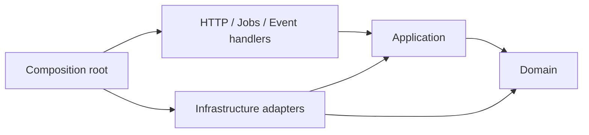

# Phase 0 Repository and Folder Structure

Scope amendment (2026-10-06): [ADR-011](../decisions/ADR-011-seller-fulfilled-marketplace.md) and [revised scope](22-scope-phasing.md) control this historical baseline. Warehouse, fleet, platform-owned stock, platform goods/COD custody, and unconditional settlement requirements are OUT_OF_SCOPE. Seller stock reservations, seller order processing, delivery visibility, and applicable controls remain required. Authorized safe implementation may proceed; excluded capabilities and older blanket implementation stops do not create release blockers.

**Status:** historical target monorepo contract, scoped by ADR-011  
**Implementation note:** current implementation is recorded in the readiness ledger. The target tree preserves historical design options; excluded applications/packages need not be scaffolded for this release.

## 1. Repository strategy

Use the established TypeScript monorepo with `pnpm` workspaces and Turborepo. The monorepo keeps the in-scope web applications, backend modular monolith, workers, shared contract artifacts, infrastructure, tests, and documentation version-aligned. Package boundaries mirror bounded contexts so a module can later move to its own repository/service without changing business contracts. The historical nine-application tree is not a launch checklist.

The root does not contain application business logic. Deployable entry points live under `apps/`; reusable or bounded packages live under `packages/`; infrastructure lives under `infra/`; product/architecture/runbook material lives under `docs/`.

## 2. Top-level tree

```text
marketplace/
├── apps/
│   ├── customer-web/                 # Next.js customer responsive marketplace
│   ├── customer-mobile/              # React Native customer application
│   ├── seller-center/                # Next.js seller operations application
│   ├── marketplace-admin/            # Next.js marketplace administration
│   ├── support-console/              # Next.js customer service console
│   ├── warehouse-console/            # Next.js warehouse management console
│   ├── courier-mobile/               # React Native delivery/courier application
│   ├── operations-dashboard/         # Next.js operations and SLA dashboard
│   ├── finance-settlement-console/   # Next.js finance/reconciliation/settlement console
│   ├── api/                          # NestJS HTTP composition root
│   ├── worker/                       # Queue consumers and asynchronous jobs
│   ├── scheduler/                    # Time-based job composition root/leader
│   └── contract-docs/                # OpenAPI/event/error documentation site artifact
├── packages/
│   ├── backend/                      # Bounded-context implementation packages
│   ├── contracts/                    # API, event and error schemas
│   ├── frontend/                     # UI/design/i18n/client packages
│   ├── mobile/                       # Mobile-native shared packages
│   ├── platform/                     # Narrow technical primitives and adapters
│   ├── testing/                      # Test builders, fixtures and harnesses
│   └── config/                       # Shared lint/type/build/test configuration
├── database/
│   ├── migrations/                   # Ordered reviewed PostgreSQL migrations
│   ├── seeds/                        # Synthetic data and reference-data loaders
│   ├── reference-data/               # Versioned Wilaya/commune/holiday sources
│   └── checks/                       # Constraint/reconciliation verification SQL
├── infra/
│   ├── modules/                      # Reusable infrastructure-as-code modules
│   ├── environments/                 # Environment compositions, no secrets
│   ├── containers/                   # Production container definitions
│   ├── observability/                # Dashboards, alerts, collectors, SLO rules
│   ├── policies/                     # Network/IAM/runtime policy definitions
│   └── local/                        # Local PostgreSQL/Redis/OpenSearch/broker/storage stack
├── docs/
│   ├── phase-0/                      # Architecture approval set
│   ├── adr/                          # Immutable architecture decision records
│   ├── api/                          # API conventions and published references
│   ├── security/                     # Threat models and security architecture
│   ├── compliance/                   # Algeria compliance review records/checklists
│   ├── runbooks/                     # Production incident and recovery procedures
│   ├── operations/                   # Seller, support, warehouse, courier and finance SOPs
│   └── diagrams/                     # Diagram sources not embedded in documents
├── tests/
│   ├── e2e/                          # Cross-application business journeys
│   ├── performance/                  # Browse/search/flash-sale/checkout/callback load tests
│   ├── security/                     # AuthN/AuthZ/IDOR/injection/upload/rate tests
│   ├── resilience/                   # Provider, queue, database, search failure tests
│   └── contract/                     # Cross-package API/event/provider compatibility tests
├── tools/
│   ├── generators/                   # Approved module/schema/client generators
│   ├── codegen/                      # OpenAPI/event schema generation commands
│   ├── data/                         # Synthetic data/reference validation commands
│   ├── ci/                           # CI-only checks and changed-project selection
│   └── release/                      # Version, migration and artifact promotion commands
├── .github/
│   ├── workflows/                    # PR, merge, release and scheduled verification
│   └── CODEOWNERS
├── .editorconfig
├── .gitignore
├── package.json
├── pnpm-lock.yaml
├── pnpm-workspace.yaml
├── nx.json
├── tsconfig.base.json
├── eslint.config.mjs
├── README.md
├── ARCHITECTURE.md
├── DATABASE.md
├── API.md
├── SECURITY.md
├── DEPLOYMENT.md
├── RUNBOOK.md
├── PAYMENTS.md
├── SHIPPING.md
├── SELLER_SYSTEM.md
├── ORDER_LIFECYCLE.md
├── RETURN_LIFECYCLE.md
├── ALG-ECOMMERCE-COMPLIANCE.md
├── TESTING.md
└── CONTRIBUTING.md
```

## 3. Backend bounded-context packages

```text
packages/backend/
├── identity/
├── customers/
├── locations/
├── sellers/
├── catalog/
├── offers-pricing/
├── inventory/
├── search/
├── cart-wishlist/
├── promotions/
├── checkout/
├── orders/
├── cod-risk/
├── payments/
├── shipping/
├── courier-operations/
├── warehousing/
├── returns/
├── refunds/
├── reviews-qa/
├── seller-finance/
├── cod-reconciliation/
├── notifications/
├── support/
├── fraud-trust/
├── cms-seo/
├── configuration-flags/
├── audit/
└── analytics-reporting/
```

Every package has the same internal shape:

```text
packages/backend/orders/
├── src/
│   ├── domain/
│   │   ├── aggregates/                # Order and seller-order behavior
│   │   ├── entities/                  # Order item and owned domain entities
│   │   ├── value-objects/             # Money snapshots, order number, status
│   │   ├── policies/                  # Transition/cancellation rules
│   │   ├── events/                    # Internal domain event definitions
│   │   └── errors/                    # Typed domain failures
│   ├── application/
│   │   ├── commands/                  # Create/confirm/cancel/transition use cases
│   │   ├── queries/                   # Customer/seller/admin read use cases
│   │   ├── handlers/                  # Application command/query handlers
│   │   ├── ports/                     # Repository and collaborating-module interfaces
│   │   ├── policies/                  # Actor/scope orchestration policy
│   │   └── dto/                       # Internal application DTOs
│   ├── infrastructure/
│   │   ├── persistence/               # PostgreSQL repository/mappers only
│   │   ├── projections/               # Read model writers/readers
│   │   └── messaging/                 # Outbox event mappers and consumers
│   ├── interface/
│   │   ├── http/                      # Controllers and HTTP schema mapping
│   │   ├── events/                    # Published/consumed event mapping
│   │   └── jobs/                      # Queue/scheduled entry handlers
│   ├── public-api.ts                  # Only supported imports for other packages
│   └── module.ts                      # NestJS composition for this context
├── test/
│   ├── unit/
│   ├── integration/
│   ├── contract/
│   └── fixtures/
├── package.json
├── project.json
└── tsconfig.json
```

### 3.1 Layer dependency direction



`domain` imports nothing outside its package except approved platform primitives. `application` may import domain and contracts, never a provider SDK. `infrastructure` implements application ports. `interface` maps transport data and calls application use cases. The composition root supplies implementations.

## 4. API, worker, and scheduler composition

```text
apps/api/src/
├── bootstrap/
│   ├── http.ts                         # HTTP server, validation, headers, filters
│   ├── openapi.ts                      # Contract publication
│   └── observability.ts                # Logging, tracing and metrics bootstrap
├── composition/
│   ├── modules.ts                      # Explicit bounded-context assembly
│   ├── adapters.ts                     # Environment/provider binding
│   └── transactions.ts                 # Unit-of-work binding
├── middleware/
│   ├── authentication/
│   ├── authorization/
│   ├── correlation/
│   ├── idempotency/
│   ├── localization/
│   ├── rate-limit/
│   └── security/
├── health/
└── main.ts

apps/worker/src/
├── bootstrap/
├── queues/
│   ├── commerce-critical.ts
│   ├── provider-webhooks.ts
│   ├── notifications.ts
│   ├── search-indexing.ts
│   ├── media-documents.ts
│   ├── analytics-reporting.ts
│   └── maintenance.ts
├── composition/
└── main.ts

apps/scheduler/src/
├── jobs/
│   ├── expire-checkouts.ts
│   ├── expire-reservations.ts
│   ├── refresh-tracking.ts
│   ├── run-reconciliation.ts
│   ├── release-seller-balances.ts
│   ├── generate-settlements.ts
│   ├── expire-content.ts
│   ├── generate-sitemaps.ts
│   ├── enforce-retention.ts
│   └── verify-projections.ts
├── leader-election/
└── main.ts
```

The API, worker, and scheduler import the same bounded modules but expose different process surfaces. Business logic remains in packages, not in entry points.

## 5. Contract packages

```text
packages/contracts/
├── openapi/
│   ├── source/                         # Modular reviewed OpenAPI source
│   ├── generated/                      # Generated merged specification
│   └── compatibility/                  # Breaking-change baseline/config
├── api-types/
│   ├── generated/                      # Generated TypeScript DTO/client types
│   └── adapters/                       # App-friendly mapping, no business rules
├── events/
│   ├── envelope/
│   ├── identity/
│   ├── sellers/
│   ├── catalog/
│   ├── inventory/
│   ├── checkout/
│   ├── orders/
│   ├── payments/
│   ├── shipping/
│   ├── warehousing/
│   ├── returns/
│   ├── refunds/
│   ├── finance/
│   ├── support/
│   └── notifications/
├── errors/
│   ├── catalog.ts                     # Stable error-code registry
│   ├── ar.json                        # Approved Arabic safe messages
│   ├── fr.json                        # Approved French safe messages
│   └── en.json                        # Optional English safe messages
├── permissions/
│   ├── permissions.ts
│   └── role-baselines.ts
└── analytics/
    ├── event-envelope/
    └── event-schemas/
```

Generated files carry a header and are never manually edited. CI regenerates and fails on diff. OpenAPI/event compatibility checks prevent accidental breaking changes.

## 6. Provider adapter packages

```text
packages/platform/
├── primitives/                        # ID, Money, Clock, Result, pagination
├── database/                          # Pool, transaction/outbox/inbox infrastructure
├── cache/                             # Redis implementation and safe cache helpers
├── messaging/                         # Broker-neutral publisher/consumer contracts
├── observability/                     # Structured logs, traces, metrics, redaction
├── security/                          # Hashing, encryption, signed-token primitives
├── files/                             # Object-storage, scan and derivative ports
├── search/                            # Search port and OpenSearch adapter
├── payments/
│   ├── port/
│   ├── provider-registry/
│   ├── satim-cib-adapter/             # Created only after approved provider contract
│   └── test-adapter/                  # LOCAL/TEST only
├── shipping/
│   ├── port/
│   ├── provider-registry/
│   ├── internal-fleet-adapter/
│   ├── seller-delivery-adapter/
│   └── test-adapter/                  # LOCAL/TEST only
├── communications/
│   ├── sms-port/
│   ├── email-port/
│   ├── push-port/
│   └── test-adapters/                 # LOCAL/TEST only
├── maps/
│   ├── port/
│   └── test-adapter/                  # LOCAL/TEST only
└── documents/                         # Arabic/French PDF rendering infrastructure
```

Provider-specific shipping/payment adapters are added only when the provider's approved specification, credentials, certification and data-sharing review are available. Domain packages import the `port` package, not an adapter package.

## 7. Frontend package structure

```text
packages/frontend/
├── design-tokens/                     # Original brand color/type/spacing/motion tokens
├── ui-web/                            # Accessible RTL-aware web components
├── icons/                             # Original/relicensed icon assets and registry
├── i18n/
│   ├── runtime/
│   ├── locales/ar/
│   ├── locales/fr/
│   └── locales/en/
├── api-client/                        # Generated client wrapper, auth/idempotency hooks
├── auth-client/                       # Session/MFA/permission primitives
├── analytics-client/                  # Consent-aware analytics event emitter
├── forms/                             # Shared validation/presentation helpers
├── commerce/                          # Product, money, cart display primitives
├── admin-tables/                      # Permission-aware admin table primitives
└── testing/                           # Rendering, RTL and accessibility harnesses

packages/mobile/
├── ui-native/                         # Accessible RTL-aware native components
├── navigation/                        # Deep-link and route contracts
├── secure-session/                    # Secure token storage/biometric bridge
├── offline-cart/                      # Conflict-aware offline cart representation
├── push/                              # Push token/deep-link handling
├── camera-scanning/                   # Optional barcode capture boundary
└── testing/                           # Device/network/localization harnesses
```

Feature-specific UI stays in the owning application. A shared package is created only after two applications need the same stable behavior. Shared UI packages contain presentation/accessibility behavior, not checkout, refund, seller, or warehouse business rules.

### 7.1 Web application shape

```text
apps/seller-center/src/
├── app/                               # Next.js routes/layouts/error/loading boundaries
├── features/
│   ├── dashboard/
│   ├── onboarding/
│   ├── catalog-requests/
│   ├── offers/
│   ├── inventory/
│   ├── orders/
│   ├── returns/
│   ├── performance/
│   ├── finance/
│   └── settings/
├── components/                        # Application-only composed components
├── server/                            # SSR/BFF-safe data access and session helpers
├── telemetry/
├── tests/
└── public/
```

Customer Web has route segments for public discovery, auth, account, cart, checkout and public tracking. Admin applications use their complete approved screen inventories and permission-gated route definitions. Every route provides loading, empty, error, success and offline/network handling where relevant.

### 7.2 Mobile application shape

```text
apps/customer-mobile/src/
├── navigation/
├── screens/
├── features/
│   ├── authentication/
│   ├── discovery/
│   ├── search/
│   ├── product/
│   ├── cart/
│   ├── checkout/
│   ├── orders/
│   ├── tracking/
│   ├── returns/
│   ├── wishlist/
│   ├── notifications/
│   ├── account/
│   └── support/
├── storage/
├── networking/
├── telemetry/
└── tests/
```

Courier Mobile separates assigned route, stop detail, status actions, proof capture, COD collection, sync queue and offline/conflict handling. Customer and courier applications do not share domain-specific screen code merely because both use React Native.

## 8. Database organization

```text
database/migrations/
├── identity/
├── customers/
├── locations/
├── sellers/
├── catalog/
├── offers/
├── inventory/
├── cart/
├── promotions/
├── checkout/
├── orders/
├── payments/
├── shipping/
├── warehousing/
├── returns/
├── refunds/
├── reviews/
├── finance/
├── support/
├── fraud-trust/
├── notifications/
├── cms/
├── platform/
└── reporting/
```

Migration filenames contain a sortable sequence/timestamp, bounded-context name and precise action. A global manifest defines total order across context folders. Each migration declares forward behavior, realistic reversal or restoration plan, lock/runtime risk, backfill plan and compatibility window. Application startup never silently mutates production schema.

Seed groups are explicit:

- required roles and granular permissions;
- configuration and feature-flag definitions with safe defaults;
- maintained Wilaya/commune reference dataset version;
- approved category/attribute/policy baseline;
- LOCAL/TEST synthetic customers, sellers, products, offers, warehouses, shipping zones and orders;
- test provider capabilities and deterministic failure fixtures.

No seed contains real personal data or production credentials.

## 9. Test placement and responsibility

| Test type              | Location                                      | Purpose                                                                                                   |
| ---------------------- | --------------------------------------------- | --------------------------------------------------------------------------------------------------------- |
| Domain unit            | `packages/backend/<context>/test/unit`        | Business rules, money, transitions, promotion, commission, inventory, returns                             |
| Module integration     | `packages/backend/<context>/test/integration` | PostgreSQL constraints/transactions, Redis cache behavior, outbox/inbox                                   |
| Module contract        | `packages/backend/<context>/test/contract`    | Public facade, event schema, provider port behavior                                                       |
| App component/route    | `apps/<app>/src/**/tests`                     | UI state, forms, permissions, Arabic RTL, French, accessibility                                           |
| Cross-system E2E       | `tests/e2e`                                   | Required customer, seller, admin, warehouse, courier and finance journeys                                 |
| Provider certification | `tests/contract/providers`                    | Payment, courier, communication, storage, search and map adapter behavior                                 |
| Concurrency            | `tests/resilience/concurrency`                | Final unit, duplicate callback, double place, duplicate refund, concurrent inventory edit                 |
| Security               | `tests/security`                              | Authentication, authorization, privilege escalation, IDOR, injection, XSS, CSRF, upload and rate controls |
| Load                   | `tests/performance`                           | Browsing, search, flash sale, checkout and callbacks                                                      |
| Recovery               | `tests/resilience/recovery`                   | Broker/search/provider outage, retry/DLQ, backup restore, projection rebuild                              |

## 10. Infrastructure organization

```text
infra/modules/
├── network/
├── edge-waf-cdn/
├── container-runtime/
├── postgresql/
├── redis/
├── opensearch/
├── message-broker/
├── object-storage/
├── secrets/
├── observability/
├── backup-recovery/
└── iam/

infra/environments/
├── development/
├── test/
├── staging/
└── production/
```

Environment folders contain composition and non-secret references only. Secret values are injected by workload identity/secrets manager. Production infrastructure can satisfy the approved Algerian hosting/data-residency and `.com.dz` requirements once legal/infrastructure decisions are signed off. Local development uses containers with synthetic data and test adapters.

## 11. CI/CD task graph

### Pull request

1. Validate formatting, lint boundaries and TypeScript strict mode.
2. Validate OpenAPI, event/error schema and backward compatibility.
3. Run affected unit/component tests and required full architecture tests.
4. Run database migration lint and ephemeral-database migration/integration tests.
5. Build affected applications/packages.
6. Run SAST, dependency/license, secret and container/IaC scanning.
7. Run selected E2E, accessibility and Arabic RTL/French tests.

### Merge and promotion

1. Produce immutable signed artifacts once.
2. Deploy Development, then Staging with migrations in expand/backfill/contract order.
3. Execute smoke, integration, provider sandbox, reconciliation and rollback checks.
4. Require production approval and change record.
5. Use rolling or blue/green deployment with readiness gates and monitored rollback.
6. Contract/removal migrations happen only after old application versions are gone.

## 12. Ownership and change rules

- `CODEOWNERS` assigns every bounded context, application, contract family, infrastructure module, security/compliance document and runbook to accountable reviewers.
- A module owner approves its schema, commands, events and error codes. Consumers approve breaking contract migrations.
- Finance/security reviewers are mandatory for payment, refund, COD reconciliation, commission, ledger, settlement, payout and sensitive-data changes.
- Catalog/compliance reviewers are mandatory for category restrictions, seller/product moderation and counterfeit enforcement.
- Database code cannot import UI packages; UI packages cannot import backend persistence/domain implementation.
- Applications consume `packages/contracts/api-types` and supported frontend/mobile packages, not backend modules.
- A provider adapter may import its vendor SDK; no other package may import that SDK.
- Environment conditionals are isolated in composition/configuration; business rules use typed configuration/feature flags.
- Temporary cross-module exceptions require an ADR, owner, removal date and CI allowlist entry.

## 13. Naming and export rules

| Item                  | Convention                                                   |
| --------------------- | ------------------------------------------------------------ |
| Package               | `@marketplace/<area>-<name>` with kebab case                 |
| TypeScript source     | kebab-case filename; exported type/class names in PascalCase |
| Database schema/table | snake case; plural table names                               |
| API paths             | plural kebab-case resources under `/api/v1`                  |
| Error code            | stable `UPPER_SNAKE_CASE`                                    |
| Event                 | lower-case past-tense dot name such as `payment.completed`   |
| Permission            | lower-case resource/action such as `refund.approve`          |
| Feature flag          | stable `UPPER_SNAKE_CASE` such as `ENABLE_CIB_PAYMENT`       |
| Configuration key     | namespaced lower-case key with typed schema                  |

Each package exports from one `public-api.ts`/declared exports map. Deep imports into another package's internal folders fail CI.

## 14. Service extraction mapping

The repository boundary is already the future service boundary:

1. Move one `packages/backend/<context>` package and required adapter packages into a new deployable service composition.
2. Move only its owned migrations/data after snapshot plus change-event synchronization.
3. Preserve `packages/contracts` event/API schemas or publish them as versioned artifacts.
4. Replace the in-process facade binding in `apps/api` with an authenticated, timed, observable client.
5. Keep a strangler routing flag and rollback path until reconciliation proves parity.
6. Split CI/deployment ownership only after the service has independent SLO, runbook, scaling, backup and on-call responsibility.

Search, Notifications, media/documents and Analytics/Reporting can be extracted first. Orders, Inventory, Promotions and Seller Finance should remain colocated until distributed compensation and reconciliation have been demonstrated under failure tests.

## 15. Repository acceptance gates

- All nine required applications and three backend process entry points have named owners.
- Every backend domain maps to exactly one owning package and PostgreSQL schema.
- Dependency-boundary tests prevent repository/entity imports across modules.
- API/event/error/permission contracts are generated, versioned and compatibility-checked.
- Arabic RTL, French localization and accessibility test infrastructure is present before screen implementation.
- Provider test adapters are impossible to enable in Production configuration.
- Migrations, reference data, synthetic seeds, IaC, security scanning, observability and runbooks participate in CI.
- Root documentation set matches the Phase 0 approval documents and is updated as ADRs are accepted.
