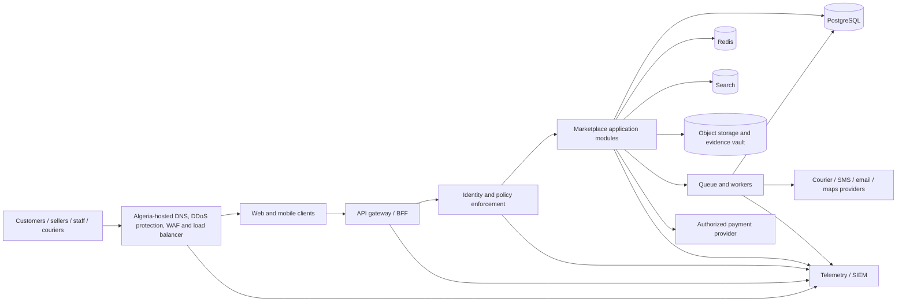

# Security Architecture

Scope amendment (2026-10-06): [ADR-011](../decisions/ADR-011-seller-fulfilled-marketplace.md) and [revised scope](22-scope-phasing.md) control this historical baseline. Warehouse, fleet, platform-owned stock, platform goods/COD custody, and unconditional settlement requirements are OUT_OF_SCOPE. Seller stock reservations, seller order processing, delivery visibility, and applicable controls remain required. Authorized safe implementation may proceed; excluded capabilities and older blanket implementation stops do not create release blockers.

**Phase:** 0 — architecture only  
**Status:** Draft; implementation begins only after architecture approval  
**Security baseline:** risk-based controls aligned to NIST CSF 2.0 and OWASP ASVS 5.0.0, with Algerian legal/privacy requirements taking precedence

## 1. Objectives and non-negotiable invariants

The security program protects customers, sellers, staff, couriers, money, inventory, evidence, and marketplace availability. Security is a property of every bounded context and deployment stage, not an edge appliance.

The following invariants are release blockers:

1. A seller can access only its organization, offers, inventory, seller orders, returns, statements, and delegated users.
2. A customer can access only their own account and resources, except public catalog data and a deliberately unguessable public tracking view with minimized data.
3. A courier can access only currently assigned work and the minimum delivery data needed for that assignment.
4. Staff access is explicitly granted, time-bounded where appropriate, reasoned, and audited; frontend visibility never substitutes for backend authorization.
5. No caller can mutate money, inventory, order status, settlement, or compliance status except through the owning domain service and an allowed state transition.
6. No payment credential such as PAN, CVV, PIN, or sensitive authentication data is stored or logged by the marketplace.
7. Every externally retried money/order/shipment mutation is idempotent and reconstructable.
8. Personal data does not leave approved locations or processors; no production personal data is placed in development, analytics, error reports, or vendor support tickets.
9. Security and business audit records are append-only/tamper-evident and separate from mutable operational records.
10. A denied authorization, failed validation, duplicate webhook, or downstream outage cannot partially commit a business transaction.

## 2. Governance model

Use the six NIST CSF 2.0 functions—Govern, Identify, Protect, Detect, Respond, Recover—as the program-level taxonomy. Use versioned OWASP ASVS requirement IDs for application verification, not the OWASP Top 10 alone. The Top 10 remains a threat-awareness lens.

| Role                                   | Accountability                                                                                          |
| -------------------------------------- | ------------------------------------------------------------------------------------------------------- |
| Board/executive sponsor                | Risk appetite, funding, material-risk acceptance, DPO and security independence                         |
| CTO                                    | Secure architecture, engineering capacity, availability, technical risk acceptance                      |
| Security lead/CISO                     | Security program, threat models, control library, incident command, independent release recommendation  |
| DPO/data-protection delegate           | Law 18-07/25-11 compliance, processing register, filings, rights, transfers, privacy incident decisions |
| Domain owner                           | Domain threat model, authorization policy, invariants, tests, runbook, residual risk                    |
| Platform/SRE                           | Infrastructure, identity, secrets, patching, telemetry, recovery, production access                     |
| Product/Design                         | Safe defaults, clear consent, anti-dark-pattern review, abuse-resistant journeys                        |
| Legal/Compliance                       | Regulatory interpretation, prohibited goods, evidence requirements, contractual controls                |
| Internal audit or independent reviewer | Evidence sampling, separation-of-duties review, control-effectiveness testing                           |

Risk acceptance must name the risk, affected assets, threat, impact, likelihood, compensating controls, expiry, owner, and approver. `Critical` and `High` risks affecting payments, personal data, authorization, seller isolation, or financial correctness cannot be accepted by the delivery team alone.

## 3. Security context and trust boundaries



Trust boundaries:

- **TB-1 Internet edge:** all client input is hostile, including headers, deep links, uploaded files, and translated text.
- **TB-2 client/server:** browsers and mobile apps are untrusted presentation layers; price, role, tenant, state, and risk decisions are recomputed server-side.
- **TB-3 workforce:** staff devices and sessions are not inherently trusted; privileged actions require strong authentication, device posture where available, and audit.
- **TB-4 seller tenancy:** each seller is an adversarial tenant relative to every other seller.
- **TB-5 service/data:** application identities receive narrowly scoped database, queue, object, and secret access; no shared superuser credential.
- **TB-6 provider:** callbacks and provider status are untrusted until authenticated, validated, deduplicated, and reconciled.
- **TB-7 analytics/telemetry:** observability is not an unrestricted data copy; it has an explicit allowlist and redaction boundary.
- **TB-8 administrative control plane:** deployment, cloud/hosting, secrets, and database consoles require phishing-resistant MFA where supported, separate admin identity, and break-glass controls.

## 4. Asset classification

| Class          | Examples                                                                                                                                                                                       | Minimum controls                                                                                                                                                |
| -------------- | ---------------------------------------------------------------------------------------------------------------------------------------------------------------------------------------------- | --------------------------------------------------------------------------------------------------------------------------------------------------------------- |
| `RESTRICTED`   | password verifiers, MFA secrets, recovery codes, identity documents, bank details, payment tokens, encryption keys, signed URLs, private evidence, precise courier GPS, security incident data | Field/object encryption where appropriate; strict need-to-know; no non-production copy; access and processing-operation logs; short retention; masked UI/export |
| `CONFIDENTIAL` | names, phone/email, addresses, orders, support messages, seller documents, internal prices/costs, fraud signals, ledger/settlement                                                             | Encryption; tenant/object authorization; data minimization; export controls; approved processors/locations; monitored access                                    |
| `INTERNAL`     | source code, architecture, runbooks, supplier terms, non-public catalog drafts, aggregate operational metrics                                                                                  | Workforce authorization; repository controls; no public link sharing; integrity/versioning                                                                      |
| `PUBLIC`       | approved products, published prices, public policies, verified seller facts approved for display                                                                                               | Integrity, provenance, moderation, cache invalidation, no inference that all related fields are public                                                          |

Data classification is attached to schemas, events, object prefixes, log fields, exports, and retention schedules. A composite object inherits the highest class of any included field.

## 5. Threat model

Each domain maintains a STRIDE-style threat model and misuse cases. The system-wide priorities are:

| Threat                             | Example                                               | Required prevention/detection                                                                                      |
| ---------------------------------- | ----------------------------------------------------- | ------------------------------------------------------------------------------------------------------------------ |
| Account takeover                   | credential stuffing against customer/seller/admin     | breached-password screening, adaptive throttling, MFA for seller/staff, session alerts, recovery hardening         |
| Broken object/tenant authorization | seller requests another seller’s order or statement   | policy enforcement at service/repository boundary, tenant derived from session, negative tests, anomaly alerts     |
| Privilege escalation               | support agent grants themselves refund approval       | immutable role administration, separation of duties, reauthentication, approval workflow, audit                    |
| Price/order tampering              | client submits a lower total or seller edits snapshot | server calculation, signed/versioned snapshot, database constraints, reconciliation                                |
| Inventory race                     | final unit sold twice                                 | transactional reservation, locking/version checks, invariant metrics, concurrency tests                            |
| Duplicate/replayed callback        | payment/courier webhook replays success               | signature/time validation, unique event ID, idempotent handler, state-transition guard                             |
| Refund/payout abuse                | insider redirects payout or repeats refund            | maker/checker, cooldown, verified destination, risk limits, ledger uniqueness, alerting                            |
| COD abuse/theft                    | altered collected amount or lost remittance           | frozen expected amount, courier permissions, collection evidence, deposit batch, daily reconciliation              |
| Malicious seller/content           | counterfeit, prohibited item, XSS, poisoned file      | central categories, moderation, output encoding, upload quarantine/scan, policy enforcement across search/checkout |
| SSRF and integration abuse         | crafted image URL reaches metadata/control plane      | no arbitrary server fetch; URL allowlist; egress proxy; metadata isolation; time/size limits                       |
| Supply-chain compromise            | malicious dependency or CI credential theft           | pinned dependencies, review, SCA, SBOM, signed provenance/artifacts, isolated runners, short-lived credentials     |
| Data exfiltration                  | bulk customer export or telemetry leak                | export permission/approval, query limits, DLP patterns, egress controls, canary records, alerting                  |
| Destructive compromise             | attacker deletes DB/backup/keys                       | immutable/offline backup, separate backup credentials/account, dual control, restore drills                        |
| Availability attack                | search bot, flash-sale spike, provider outage         | WAF/rate limits, caching, queues/backpressure, circuit breakers, graceful degradation, capacity tests              |

Threat models are updated for every new provider, new sensitive field, public endpoint, privileged action, automated risk model, and major data-flow change.

## 6. Identity and authentication

### 6.1 Customer accounts

- Support phone or email plus password, and approved OTP flows.
- Passwords are hashed with a memory-hard algorithm such as Argon2id using calibrated cost parameters and unique salts; a separate application pepper is held in the secrets service, not the database.
- Use minimum-length and compromised-password screening; allow password managers and paste; do not rely on arbitrary complexity rules or periodic rotation without evidence of compromise.
- Authentication, password reset, phone/email change, new payout/refund destination, and account deletion have separate rate limits and abuse controls.
- Recovery cannot be weaker than primary authentication. Recovery events revoke or step up affected sessions and notify the user through an independent verified channel when feasible.
- OTP values are random, single use, short lived, attempt limited, purpose bound, and never logged. Hash server-side OTPs at rest.

### 6.2 Seller, staff, warehouse, finance, and courier accounts

- Seller and staff MFA is mandatory. Prefer phishing-resistant WebAuthn/passkeys for privileged staff; TOTP may be a transitional fallback with protected recovery codes.
- High-impact actions require recent step-up authentication: seller bank change, role grant, refund/settlement approval, break-glass use, secrets/key operation, bulk export, compliance override.
- Workforce identity is separate from customer identity and ideally federated to a managed identity provider. Shared accounts are prohibited.
- Courier authentication balances device reality with risk: device binding, short sessions, remote revocation, least-data offline cache, and reauthentication before COD-sensitive actions.
- Offboarding disables identity first, revokes sessions/tokens/keys, removes group memberships, rotates shared emergency material, and is tested quarterly.

### 6.3 Sessions and tokens

- Browser sessions use `Secure`, `HttpOnly`, `SameSite` cookies; state-changing cookie-authenticated requests use CSRF defenses.
- Access tokens are short lived; refresh tokens rotate and form a reuse-detected family. A reused predecessor revokes the family and raises an alert.
- Store refresh-token verifiers/hashes, not bearer values; never put bearer tokens in URLs, analytics, or logs.
- Session records include account, device label, created/last-used time, approximate location where justified, assurance/MFA, expiry, and revocation reason.
- Users can view and revoke individual/all sessions. Privilege, password, or recovery changes invalidate affected sessions.
- Public order tracking uses high-entropy opaque tokens, expiration/revocation, response minimization, throttling, and no enumeration.

Use the current [NIST SP 800-63 Revision 4 resources](https://pages.nist.gov/800-63-4-Implementation-Resources/index.html) as an engineering reference, adapted to marketplace risk and local law rather than treated as Algerian law.

## 7. Authorization and separation of duties

Authorization is centralized as policy code but enforced in every owning module. A request context carries verified `actor_id`, actor type, organization/tenant, roles, permissions, authentication assurance, session, and correlation ID. Object ownership and scope come from trusted storage, never a client-provided role or seller ID.

Required policy dimensions:

- role and granular permission;
- seller organization and delegated scope;
- resource ownership and sensitivity;
- warehouse/region/assignment where relevant;
- order/return/payment state;
- amount/risk threshold;
- recent MFA/reauthentication;
- maker/checker relationship;
- support/compliance reason and case reference;
- feature flag and legal/category restriction.

Separation-of-duties examples:

| Action                       | Initiator                           | Independent approver                                | Additional control                                   |
| ---------------------------- | ----------------------------------- | --------------------------------------------------- | ---------------------------------------------------- |
| Large/manual refund          | authorized support/finance operator | finance approver                                    | amount threshold, evidence, recent MFA               |
| Seller activation/suspension | seller compliance reviewer          | seller manager for high risk                        | reason, documents, policy version                    |
| Settlement release           | finance preparer                    | finance approver                                    | bank destination lock/cooldown, reconciliation clean |
| Bank-detail change           | seller owner                        | marketplace verification workflow                   | old/new channel notice, hold period, step-up MFA     |
| Category policy change       | compliance author                   | legal/compliance approver                           | effective date, impacted-offer simulation            |
| Break-glass access           | incident commander                  | security approval or retrospective emergency review | short TTL, recorded command/session, automatic alert |

Authorization denial is the default. Test matrices include same-role cross-tenant access, guessed IDs, nested resources, exports, indirect references, GraphQL/batch-style expansion if introduced, and background jobs.

## 8. Service and infrastructure identity

- Workloads receive unique service identities and short-lived credentials; no credential is baked into an image.
- Mutual TLS or authenticated encrypted channels protect service-to-service traffic where the platform supports it.
- Database roles are per application/worker purpose with least privilege. Migrations use a distinct, time-limited identity.
- Queue publish/consume permissions are topic/queue specific. Producers cannot impersonate arbitrary event types.
- Object storage uses private buckets/prefixes, narrowly scoped service access, short-lived upload/download grants, and server-side encryption.
- CI/CD uses workload identity/short-lived deployment credentials. Human cloud/hosting API keys are not normal deployment mechanisms.
- Production administrative access is through a hardened access path with MFA, device controls, session recording/audit, approval for sensitive systems, and no public database/SSH exposure.

## 9. Data protection and cryptography

- TLS is mandatory externally and internally across untrusted networks. Configure modern protocol/cipher policy, automated renewal, expiry alerting, HSTS after domain/certificate readiness, and certificate inventory.
- Storage encryption covers database volumes/backups, object storage, search, queue persistence, snapshots, and workstation/server disks.
- Encrypt or tokenize especially sensitive fields separately where it materially reduces exposure: bank-account details, identity-document identifiers, MFA material, provider secrets, recovery codes.
- Use an approved key-management system or HSM-backed service available in the validated Algeria-hosted environment. Separate data-encryption keys by purpose/environment and wrap them with controlled key-encryption keys.
- Keys have owner, purpose, algorithm, creation, rotation, expiry, allowed operations, backup/recovery policy, and revocation record. Rotation must not make historic financial/evidence records unreadable.
- Application cryptography uses maintained libraries and authenticated encryption. Never design a custom algorithm or use reversible “encoding” as protection.
- Sensitive comparisons use constant-time library primitives where appropriate; random IDs/tokens use a cryptographically secure generator and sufficient entropy.
- Data deletion includes indexes, caches, derived stores, exports, and provider copies subject to approved retention/legal holds. Backup expiry is documented rather than pretending immediate erasure from immutable media.

Privacy controls, ANPDP formalities, processing-operation logging, and transfer restrictions are defined in [16-algeria-compliance-checklist.md](./16-algeria-compliance-checklist.md).

## 10. Application and API security

Minimum controls:

- Schema-validate and normalize every request at the trust boundary; reject unknown fields for security-sensitive DTOs.
- Parameterized queries/ORM-safe bindings; no string-built SQL, search DSL, shell, template, or path.
- Contextual output encoding and safe templating; sanitize intentionally supported rich content with a restrictive allowlist.
- Strong Content Security Policy with nonces/hashes, no unsafe inline script, framing restrictions, secure referrer policy, permissions policy, MIME sniffing protection, and safe cache controls.
- Origin/CSRF protection for browser state changes; CORS is an explicit allowlist and never an authentication control.
- Resource-specific rate limits plus global abuse protection. Return safe retry metadata without disclosing account existence.
- Server recomputes catalog eligibility, stock, price, discount, tax, shipping, commission, risk outcome, and transition validity.
- Idempotency keys bind actor, endpoint, normalized request hash, and bounded lifetime; a mismatched reuse is rejected.
- Pagination and export limits prevent bulk scraping and database exhaustion; expensive filters have cost limits.
- Errors use stable localized public codes plus a correlation ID; stack traces, SQL, secrets, provider payloads, and internal hostnames remain private.
- Outbound calls use allowlisted destinations, DNS/IP validation, egress controls, timeouts, bounded response size, retry budgets, circuit breakers, and redacted telemetry.
- Webhooks are authenticated before parsing into business actions, stored as evidence with secret fields removed/encrypted, and processed idempotently.

Verification target: OWASP ASVS 5.0.0 Level 2 for all applications, with selected Level 3 controls for identity, admin, finance, payments, seller onboarding documents, and other high-value flows. The exact control profile is versioned and mapped to tests.

## 11. File and media security

All user/seller/support uploads follow a quarantine pipeline:

1. Client requests a short-lived, purpose-bound upload grant with declared size/type.
2. Upload goes to a private quarantine prefix, never the public delivery bucket.
3. Server validates actual MIME/magic bytes, size, dimensions/duration, decompression limits, and expected file count.
4. Malware scan and file-type-specific processing run in an isolated worker with no general network/data-plane access.
5. Images are decoded/re-encoded and unsafe metadata is stripped; active formats are rejected unless explicitly required and safely transformed.
6. Moderator access is through an authenticated viewer; documents are not rendered inline with marketplace origin privileges.
7. Clean derived assets move to the approved private/public prefix according to classification. Original restricted documents remain encrypted and private.
8. Rejected/malicious files are isolated, recorded, and expired according to incident/evidence policy.

Filenames and paths are generated server-side. Downloads use authorization checks and short-lived grants, safe content disposition, and anti-sniffing headers.

## 12. Payment, ledger, settlement, and COD security

- Prefer provider-hosted payment pages/components to minimize card-data scope. Obtain the acquirer/provider’s written integration and PCI responsibility matrix before implementation.
- Provider references are not authorization by themselves. Verify callback authenticity, expected merchant/account, amount, currency, order, and legal state.
- Payment commands and callbacks produce immutable events. Database constraints prevent duplicate provider event, capture, refund, or payout.
- Ledger entries are append-only; corrections are reversing/adjusting entries. No direct balance edit.
- Reconciliation detects internal-versus-provider-versus-bank differences independently of the transactional happy path.
- Seller payout destination change triggers step-up MFA, old/new notifications, re-verification, time delay, and heightened review before release.
- COD expected amount is frozen in the shipment handoff manifest. Courier devices cannot alter order totals. Collection, custody transfer, remittance, bank deposit, and reconciliation are distinct signed/audited events.
- Risk models use relevant features, documented versions and reasons, controlled overrides, drift/outcome monitoring, and human review for adverse/high-impact decisions. Do not use protected or irrelevant personal characteristics or unexplained proxies.
- Logs and support interfaces mask all sensitive payment/bank fields. Screens use reveal permissions and generate a sensitive-view audit event where justified.

PCI DSS scope and validation method must be confirmed with the acquirer and a qualified assessor; hosted payment does not justify declaring the entire platform “out of scope” without evidence. Refer to the [PCI Security Standards Council document library](https://www.pcisecuritystandards.org/document_library/) for the current standard.

## 13. Network, host, and data-store controls

- Public exposure is limited to the edge/load balancer and explicitly approved webhook endpoints. Databases, caches, queues, search, object administration, telemetry, and control planes use private networks.
- Separate production from non-production accounts/projects/networks and credentials. Staging is not a route into production.
- Default-deny ingress and egress; documented flows become code-reviewed firewall/security-group rules.
- Hardened minimal base images, non-root containers/processes, read-only filesystems where possible, dropped capabilities, resource limits, and host-level mandatory controls.
- Automated vulnerability scanning and patch SLAs: actively exploited/critical internet-facing exposure immediately triaged and mitigated; other critical/high items within risk-based deadlines defined by policy.
- PostgreSQL uses TLS, role separation, connection limits, statement timeouts, audited privileged access, encrypted backups, and tested point-in-time recovery.
- Redis is private, authenticated, encrypted where crossing hosts, namespace-separated, and never authoritative for money/order/inventory truth.
- Search is treated as a derived store; no unnecessary restricted fields, public access, or authorization decision based solely on search documents.
- Queue messages carry minimal data and references, not whole identity/support records; dead-letter access is restricted and retention bounded.
- Administrative interfaces are not published on the customer domain.

## 14. Audit, security logging, and privacy-safe telemetry

Security audit records include actor/service, effective role/tenant, action, resource type/opaque ID, outcome, reason/case, before/after field names or approved snapshots, time, source, correlation/trace ID, session, approval, and policy version. Record at least:

- login, MFA, recovery, session, and identity changes;
- role/permission and seller-user changes;
- seller approval/suspension and compliance/category decisions;
- price/commission/promotion/tax/configuration changes;
- order, payment, refund, payout, settlement, inventory, COD, and reconciliation state changes;
- personal-data view/export/rights/deletion/transfer operations where required;
- upload scan/moderation decisions;
- secrets/key/break-glass/deployment/migration/backup/restore operations.

Never log credentials, OTPs, bearer/session tokens, raw cookies, signed URL query strings, PAN/CVV/PIN, full bank details, identity documents, message bodies by default, or provider secrets. Phone/email/address are redacted or represented by approved stable pseudonymous identifiers. Security logs and Law 25-11 processing-operation logs may have different legal schemas/purposes; the DPO must approve any combined implementation.

Audit storage is append-only and access-separated from application administrators. Daily integrity checkpoints are copied to a separately controlled evidence location. Clock synchronization and alerting are mandatory.

## 15. Secure delivery and supply chain

Pull-request gates:

- protected branches, peer review, CODEOWNERS for security/finance/IaC/migrations;
- lint, strict type checking, unit/invariant tests, secret scanning, SAST, SCA/licence policy, IaC scanning, container/base-image scanning;
- generated SBOM for deployable artifacts;
- dependency lockfile integrity and allowlisted registries;
- reproducible/versioned build where practicable;
- artifact/image signing and provenance attestation;
- no production secret or personal data available to untrusted CI jobs or forked contributions.

Release gates:

- deploy only immutable digest-addressed artifacts promoted from the tested build;
- verify signature/provenance and approved source revision before deployment;
- migration compatibility and rollback review;
- configuration/feature-flag diff review;
- independent security test for material changes to auth, authorization, payments, uploads, admin, cryptography, tenancy, or data flows;
- documented exception with expiry for any waived control.

## 16. Vulnerability management and verification

| Activity                                      | Minimum cadence/trigger                                        | Output                                                           |
| --------------------------------------------- | -------------------------------------------------------------- | ---------------------------------------------------------------- |
| Automated dependency/container/IaC/SAST scans | Every PR/build and daily against deployed inventory            | Deduplicated findings with owner/SLA                             |
| Dynamic API/web scan                          | Each staging release and scheduled                             | Authenticated coverage report; false-positive decisions retained |
| Authorization/tenant regression               | Every relevant PR and nightly full suite                       | Negative matrix by role/tenant/resource/action                   |
| External attack-surface review                | Continuous or daily                                            | Unexpected host/service/certificate alerts                       |
| Independent penetration test                  | Before public launch; annually; after material boundary change | Re-test evidence; no open Critical/High launch finding           |
| Payment integration review                    | Before enabling provider or materially changing flow           | Provider/acquirer acceptance and security responsibility matrix  |
| Phishing/social-engineering exercise          | Risk-based, at least annually for privileged teams             | Training/control improvements, no shaming metrics                |
| Tabletop incident exercise                    | Before launch; at least twice yearly                           | Actions, owners, due dates, updated runbooks                     |
| Access review                                 | Privileged monthly; all roles quarterly                        | Removed stale/excess access and signed review                    |

Targets are defined in the [testing strategy](./19-testing-strategy.md). No severity is closed without reproducible evidence or an explicitly approved, expiring risk exception.

## 17. Incident response

Use [NIST SP 800-61 Rev. 3](https://csrc.nist.gov/pubs/sp/800/61/r3/final) as the response-program reference. The operating lifecycle is preparation; detection/analysis; containment; eradication; recovery; and learning, integrated with NIST CSF 2.0.

Required capabilities:

- 24/7 path for declaring a security incident and contacting the incident commander, security lead, DPO, legal, platform, finance, communications, and provider contacts.
- Severity based on safety, data, money, tenant isolation, regulatory impact, integrity, and availability—not only host count.
- Evidence preservation with chain of custody, synchronized clocks, access control, hashes, and legal hold.
- Credential/session/key revocation, feature/provider kill switches, seller/offer/payment/payout holds, egress containment, and read-only/degraded modes.
- DPO/legal notification decision matrix based on current Algerian law and contract; timers begin at documented awareness points.
- Reconciliation after containment for orders, payments, refunds, ledger, inventory, COD, and messages before declaring recovery.
- Blameless post-incident review with root/contributing causes, missed signals, control/test/runbook changes, owners, and deadlines.

Detailed operational playbooks appear in [20-observability-and-operations.md](./20-observability-and-operations.md).

## 18. Security control traceability

Each control has:

```text
control_id
objective and threat
owner
systems/data in scope
preventive/detective/corrective implementation
configuration or policy source
verification procedure and test ID
telemetry/alert/runbook
evidence location and retention
legal/ASVS/NIST mapping
exceptions and expiry
last and next review
```

The release evidence pack maps critical controls to OWASP ASVS 5.0.0, NIST CSF 2.0, applicable legal checklist IDs, automated/manual tests, and live monitoring. A spreadsheet with “implemented” cells and no evidence is not acceptance.

## 19. Security acceptance gates

Production remains `NO-GO` until:

- legal/privacy/payment/hosting gates in the Algeria checklist are signed;
- threat models exist for identity, seller tenancy, catalog moderation, checkout, orders, payments, refunds, settlement, COD, uploads, admin/support, and infrastructure;
- seller/staff MFA, object/tenant authorization, step-up, and break-glass are tested;
- no open Critical or High security finding lacks an approved exceptional risk decision;
- an independent penetration test and retest are complete;
- secrets/key rotation, backup restore, compromised-account recovery, provider callback replay, and audit integrity have been exercised;
- security telemetry and on-call alerts are live in the production topology before customer traffic;
- incident, ransomware/data-loss, mass account takeover, payment manipulation, and cross-seller exposure tabletops are complete;
- production access is minimal, reviewed, and all emergency access paths are tested;
- the DPO approves logging, processing-operation records, incident workflow, provider transfers, and retention.

## 20. References

- [NIST Cybersecurity Framework 2.0](https://www.nist.gov/publications/nist-cybersecurity-framework-csf-20)
- [NIST SP 800-63 Revision 4 implementation resources](https://pages.nist.gov/800-63-4-Implementation-Resources/index.html)
- [NIST SP 800-61 Rev. 3 — Incident Response Recommendations](https://csrc.nist.gov/pubs/sp/800/61/r3/final)
- [OWASP Application Security Verification Standard 5.0.0](https://owasp.org/projects/asvs)
- [OWASP Top 10:2025](https://top10.owasp.org/2025/en/)
- [PCI Security Standards Council document library](https://www.pcisecuritystandards.org/document_library/)
- [Law No. 18-07 — Official Journal No. 34](https://www.joradp.dz/FTP/JO-FRANCAIS/2018/F2018034.pdf)
- [Law No. 25-11 — Official Journal No. 48](https://www.joradp.dz/FTP/JO-FRANCAIS/2025/F2025048.pdf)
- [ANPDP portal](https://portail.anpdp.dz/)
