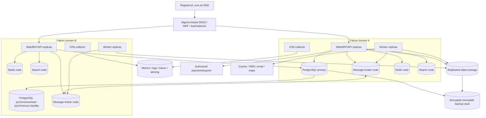

# Infrastructure and Deployment Architecture

Scope amendment (2026-10-06): [ADR-011](../decisions/ADR-011-seller-fulfilled-marketplace.md) and [revised scope](22-scope-phasing.md) control this historical baseline. Warehouse, fleet, platform-owned stock, platform goods/COD custody, and unconditional settlement requirements are OUT_OF_SCOPE. Seller stock reservations, seller order processing, delivery visibility, and applicable controls remain required. Authorized safe implementation may proceed; excluded capabilities and older blanket implementation stops do not create release blockers.

**Phase:** 0 — architecture and provider validation  
**Status:** Draft; no production provider has been selected  
**Primary constraint:** the production e-commerce site/page must be hosted in Algeria with `.com.dz`; production personal-data locations and transfers require DPO/legal approval

## 1. Architecture decision summary

| Decision                  | Phase 0 choice                                                                                        | Reason / reassessment trigger                                                                                                                  |
| ------------------------- | ----------------------------------------------------------------------------------------------------- | ---------------------------------------------------------------------------------------------------------------------------------------------- |
| Application shape         | Modular monolith plus independently scalable workers                                                  | Lowest operational complexity while preserving bounded contexts; extract a service only for demonstrated ownership, isolation, or scaling need |
| Runtime                   | Containerized, stateless web/API/worker processes                                                     | Repeatable deployment and horizontal scaling without requiring Kubernetes                                                                      |
| Orchestration             | Provider-neutral VM/container service initially; Kubernetes only after a written operating/scale case | Avoid an unnecessary control plane and scarce on-call expertise                                                                                |
| Transactional store       | PostgreSQL-compatible HA primary/standby with point-in-time recovery                                  | Transactions, constraints, locking, deterministic financial state                                                                              |
| Cache                     | Redis-compatible, non-authoritative                                                                   | Sessions/rate limits/cache/short coordination only; no source-of-truth money or orders                                                         |
| Search                    | OpenSearch/Elasticsearch-compatible derived index                                                     | Multilingual full-text/facets; rebuildable from catalog/outbox                                                                                 |
| Messaging                 | Durable RabbitMQ-compatible broker initially                                                          | Work queues, retries, DLQs, routing, manageable scale; re-evaluate streaming platform when replay/throughput needs justify it                  |
| Files                     | Private S3-compatible object storage with versioning/object lock where supported                      | Product media, seller/customer evidence, exports, invoices, backups; classification-specific buckets/prefixes                                  |
| Observability             | OpenTelemetry collection with locally approved metrics/logs/traces backends                           | Vendor neutrality and cross-signal correlation                                                                                                 |
| Infrastructure definition | OpenTofu/Terraform-compatible IaC plus configuration management                                       | Reviewable, repeatable, recoverable environments                                                                                               |
| Delivery                  | Signed immutable artifacts promoted through environments; rolling or blue/green per risk              | Same artifact tested and deployed, safe rollback                                                                                               |
| Production data location  | Algeria-first data plane and backup/DR design                                                         | Law 18-05 hosting requirement and Law 18-07 transfer controls; final topology is a legal launch gate                                           |

These are architectural choices, not vendor commitments. The provider-selection scorecard must test legal location, failure domains, connectivity, service maturity, support, security, audit evidence, backup/egress, capacity, and exit—not just unit price.

## 2. Legal and data-residency boundary

The baseline is defined in [16-algeria-compliance-checklist.md](./16-algeria-compliance-checklist.md):

- public production runs on the registered `.com.dz`;
- the origin site/page is hosted in Algeria;
- production databases, objects, search, queues, logs, backups, replicas, and administration paths remain in approved Algerian locations by default;
- an overseas CDN/WAF, DNS log, error tracker, analytics tool, CI artifact containing data, support session, or remote operator may be an international transfer even when the database is local;
- any transfer requires a mapped purpose/field/recipient/location and DPO/legal evidence, including ANPDP authorization or a confirmed lawful exception where applicable;
- non-production outside the approved boundary may contain only synthetic or irreversibly anonymized data and no production secrets.

“Data residency” is verified through contracts, data-centre/backup addresses, subprocessor lists, network tests, control-plane locations, support procedures, logs, and restore evidence. A provider region label is not sufficient.

## 3. Target topology



If the selected Algerian provider cannot supply independent zones, map A/B to demonstrably independent racks/power/network domains, and operate a warm recovery environment in a second approved Algerian data centre. Claims of independence require provider evidence and a failure exercise.

## 4. Network zones and flows

| Zone            | Public ingress                                  | Permitted peers                                                         | Notes                                                                                       |
| --------------- | ----------------------------------------------- | ----------------------------------------------------------------------- | ------------------------------------------------------------------------------------------- |
| Edge            | 80 only for redirect; 443                       | public clients, web/API ingress                                         | DDoS, WAF, bot/rate control, TLS, no business data persistence beyond approved minimal logs |
| Application     | None directly                                   | edge, internal service identities, data services, approved egress proxy | stateless replicas; separate web/API and worker security identities                         |
| Data            | None                                            | named application/worker/admin roles                                    | PostgreSQL, Redis, broker, search; private DNS/IP; default-deny                             |
| Object/evidence | None                                            | purpose-scoped service identities and approved admin                    | quarantine, media, restricted evidence, exports, backup use separate policies               |
| Observability   | No customer ingress                             | collectors and on-call/admin via protected access                       | redaction at source/collector; production telemetry stays approved/local                    |
| Management      | No direct internet service console if avoidable | identity-aware admin gateway/VPN, CI deploy identity                    | MFA, device and session audit, short-lived credentials                                      |
| Provider egress | N/A                                             | explicit FQDN/IP/port allowlist through proxy/NAT                       | timeouts, circuit breakers, DNS/SSRF controls, volume monitoring                            |

Firewall and route rules are generated from a versioned flow registry. A change needs owner, purpose, data class, direction, endpoint, port/protocol, environment, expiry if temporary, and review.

## 5. Environments

| Environment   | Purpose                                                                                       | Data                                                                                      | External providers                       | Availability/scale                      | Access                        |
| ------------- | --------------------------------------------------------------------------------------------- | ----------------------------------------------------------------------------------------- | ---------------------------------------- | --------------------------------------- | ----------------------------- |
| `LOCAL`       | Individual development, unit/component work                                                   | generated synthetic only                                                                  | local fakes or approved sandboxes        | single-node disposable                  | developer                     |
| `DEVELOPMENT` | Integrated mainline and preview validation                                                    | synthetic                                                                                 | fakes/sandboxes; no production callbacks | small, resettable                       | engineering                   |
| `TEST`        | deterministic integration, contract, migration, concurrency, performance harness coordination | versioned synthetic/seed factories                                                        | simulators and sandboxes                 | ephemeral or scheduled                  | engineering/QA                |
| `STAGING`     | production-like release candidate, UAT, provider certification, operational rehearsal         | synthetic; exceptionally purpose-built regulator/provider test identities approved by DPO | approved sandbox/certification endpoints | same topology classes, reduced capacity | restricted engineering/QA/ops |
| `PRODUCTION`  | real marketplace                                                                              | real data in approved locations only                                                      | production-certified endpoints           | HA, backup, monitoring, on-call         | least-privileged operations   |

Production and non-production use separate accounts/projects, networks, encryption keys, identity realms or tenants, secrets, databases, queues, buckets, domains, analytics properties, and provider credentials. “Staging with a production database clone” is prohibited.

Preview environments cannot receive production webhooks or access production data. They expire automatically and expose no privileged default credentials.

## 6. Compute and scaling model

Application processes are stateless. Sticky sessions are not required; session state is server-validated and stored in the authoritative session store/database as designed. Scale independently:

- customer web rendering/BFF;
- API/application replicas;
- general asynchronous workers;
- payment/shipping webhook workers;
- notifications workers;
- catalog/media processing workers;
- search indexing workers;
- report/export workers;
- reconciliation/settlement workers.

Separate queues and worker pools prevent a large export or image campaign from starving payment, order, inventory, or notification work. Each pool has concurrency, retry budget, timeout, resource limit, priority, and autoscaling signal.

Initial sizing is derived from a measured workload model, not a “large/medium” label. The model records:

```text
daily and peak active users
page/search/cart/checkout requests per active user
peak-to-average and event-campaign factor
orders, lines, seller splits and shipments per second
webhook/notification/event fan-out
catalog size and update rate
image/object volume and egress
data growth, retention and index amplification
target headroom and failure-domain loss
```

Minimum launch capacity: sustain forecast peak with one application replica/failure domain unavailable and at least 30% remaining application capacity; data/broker/search thresholds must have measured headroom. Scale tests and the forecast are refreshed before major campaigns.

## 7. Data services

### 7.1 PostgreSQL

- One logical cluster may host separate schemas/databases per bounded context initially, with ownership and migration boundaries enforced.
- Multi-AZ/failure-domain primary/standby, automated failover only after split-brain safeguards and application reconnect behavior are tested.
- Point-in-time recovery, encrypted full/incremental/WAL backups, checksums, and routine restore drills.
- Connection pool limits per workload; transaction/statement/lock timeouts; slow-query telemetry; online index strategy.
- Migrations are the sole schema-change path. Production application roles cannot execute DDL.
- Money, order, inventory, ledger, idempotency, and outbox invariants are database-constrained where possible.
- Read replicas are optional and never used for a decision requiring read-your-writes or financial/order correctness.

### 7.2 Redis

- Use for bounded caches, rate-limit counters, ephemeral coordination, and optional session acceleration.
- Every cache entry has explicit TTL/invalidation and a fallback when Redis is unavailable.
- Do not place unbounded personal objects, authoritative inventory, account balance, ledger, order state, or idempotency truth only in Redis.
- Cluster/sentinel choice follows measured availability and provider capabilities; backup is not a substitute for reconstructability.

### 7.3 Search

- Derived documents contain public catalog/search fields and only minimum operational metadata.
- Index through transactional outbox/events with version checks; a stale event cannot overwrite a newer document.
- Full rebuild, alias-based zero-downtime reindex, mapping version, and backfill checkpoint are mandatory.
- Search outage degrades browsing/search but cannot corrupt checkout; checkout revalidates against owning services/database.

### 7.4 Messaging

- Durable messages, publisher confirms, explicit acknowledgements, bounded prefetch, retry with jitter, and DLQ.
- Transactional outbox bridges database commit to publication; consumers use inbox/idempotency records.
- Event schema, version, producer, owner, partition/routing key, personal-data class, retention, retry, and compatibility are catalogued.
- Poison messages go to a restricted DLQ with alert and replay tooling; infinite retry loops are prohibited.

### 7.5 Object storage

- Distinct buckets/prefixes and policies for public derived media, private customer evidence, seller documents, quarantine, generated contracts/invoices, reports/exports, audit evidence, and backups.
- Versioning and object lock where required; lifecycle rules follow the approved retention schedule.
- Direct uploads are short-lived, size/type/purpose bound and land in quarantine. Public assets are served only after processing.
- Integrity hashes, malware scan state, classification, owner, legal hold, and retention metadata accompany objects.

## 8. Infrastructure as Code and configuration

All durable infrastructure is declared in version control. The repository layout may separate reusable modules from environment compositions, but each environment has an independently reviewable plan/state.

Controls:

- remote encrypted state with locking, backup, least privilege, and no secrets in state where avoidable;
- pinned provider/module versions and reviewed dependency updates;
- policy checks for public exposure, encryption, backup, tags/owners, approved locations, log sinks, and deletion protection;
- `plan` on pull request, human approval for production apply, and machine identity for apply;
- drift detection at least daily and alerting on security-relevant drift;
- emergency console change permitted only during incident, documented immediately, then reconciled into code;
- resource naming/tagging includes environment, system, owner, data class, criticality, cost centre, and retention where supported.

Application configuration is typed and validated at boot. Defaults are safe; missing critical production settings fail startup. Business configuration and feature flags are versioned separately from secrets, require permission/approval, emit audit events, and support scheduled effective dates.

## 9. Secrets and key management

- Central secret manager/KMS in the validated topology; encrypted configuration files are a bootstrap exception, not the normal runtime source.
- Unique secret per environment/provider/purpose; never reuse production credentials in staging.
- Workload identity and short-lived credentials preferred over static tokens.
- Secret access policy, rotation schedule, owner, expiry, last used, and emergency revocation are inventoried.
- CI masks secrets and never exposes them to untrusted branches/forks; build artifacts contain no runtime secret.
- Dual control for root/backup master/key-recovery material. Recovery is tested without making one individual a permanent single point of failure.
- Provider webhook keys and API credentials support overlap during rotation.
- Leakage response revokes first, then investigates; rotating only after an incident report is complete is too late.

## 10. CI/CD pipeline

```mermaid
flowchart LR
    PR[Pull request] --> V[Lint / types / tests / security / IaC plan]
    V --> B[Hermetic build]
    B --> S[SBOM + scan + sign + provenance]
    S --> R[Immutable artifact registry]
    R --> DEV[Deploy development]
    DEV --> INT[Integration / E2E / DAST / migration]
    INT --> STG[Promote same digest to staging]
    STG --> UAT[UAT / provider certification / performance / ops rehearsal]
    UAT --> APR[Production approval]
    APR --> CAN[Canary or blue/green]
    CAN --> VER[Automated verification]
    VER --> FULL[Progressive rollout]
```



Pull-request gates include unit/property tests, type/lint/build, contract/schema compatibility, secret/SAST/SCA/licence scans, IaC policy, container scan, and migration checks. Release gates are in [19-testing-strategy.md](./19-testing-strategy.md) and [21-production-rollout.md](./21-production-rollout.md).

The build produces immutable artifacts, SBOM, signatures, provenance, source revision, dependency lock hashes, and migration manifest. Environment promotion references the same artifact digest; production is never rebuilt from a branch.

## 11. Database and event migrations

Use expand/migrate/contract:

1. **Expand:** additive schema/API/event change backward compatible with the current and next application versions.
2. **Deploy writers/readers:** application tolerates old/new representation; dual write only when unavoidable and observed.
3. **Backfill:** resumable, throttled, idempotent job with checkpoint, error queue, progress/lag metric, and reconciliation.
4. **Switch:** feature flag or configuration changes read authority after verification.
5. **Contract:** remove old representation only after the rollback window and consumer confirmation.

Production migration requirements:

- preflight on production-like volume and schema;
- predicted lock/rewrite/disk/WAL/replication impact;
- timeout, pause/abort condition, owner, dashboard, and rollback/forward-fix plan;
- backup/restore readiness for destructive or high-risk operations;
- no mixed deployment in which an older replica corrupts the new schema/event;
- event consumers support at least the agreed compatibility window.

“Down” migrations are not automatically safe. For an irreversible data transformation, rollback means compatible application rollback plus retained old data or a tested forward correction.

## 12. Deployment patterns and rollback

| Change                    | Default pattern                                               | Verification                                                              | Rollback                                                                          |
| ------------------------- | ------------------------------------------------------------- | ------------------------------------------------------------------------- | --------------------------------------------------------------------------------- |
| Stateless web/API/worker  | rolling canary; blue/green for high-risk releases             | readiness, error/latency/saturation, business probes, queue and DB health | route to prior signed digest; disable new flag                                    |
| Auth/payment/order/ledger | dark deploy + internal cohort + small canary                  | synthetic transaction, callback replay safety, reconciliation, audit      | kill switch/provider disable; prior compatible digest; no destructive DB rollback |
| Search mapping/index      | build new versioned index and atomically switch alias         | counts, samples, latency, relevance, indexing lag                         | restore prior alias                                                               |
| Business rule/config      | versioned staged activation, optional shadow evaluation       | diff/simulation, audit, outcome metrics                                   | reactivate prior version                                                          |
| Database change           | expand/migrate/contract                                       | migration health, locks, lag, reconciliation                              | pause/forward fix or compatible app rollback                                      |
| Mobile                    | server-compatible staged store release + remote feature gates | crash/ANR, API errors, funnel/business invariants                         | server-side flag/API compatibility; expedited fixed build                         |

Rollback triggers are quantitative and predeclared: elevated error/latency, authorization anomaly, financial mismatch, inventory invariant, data loss/corruption, queue runaway, crash regression, or support-impact threshold. The deploy controller stops progression automatically for machine-detectable triggers. Only the incident/release commander resumes.

## 13. Provider integration resilience

Every adapter defines connect/read/overall timeout, retryable errors, max attempts/time budget, jitter, circuit breaker, rate limit, bulkhead, idempotency, reconciliation, health signal, and manual recovery.

- Courier down: accept valid order; queue shipment creation; expose `SHIPMENT_PENDING_PROVIDER`; retry; provide ops work queue and later reconciliation.
- SMS/email/push down: business transaction commits; notification outbox retries; use approved alternate channel for critical verification only according to policy.
- Payment initiation down: do not claim payment/order success; safely retry status or let customer choose another enabled method; no duplicate charge.
- Payment webhook delayed: authoritative polling/reconciliation path; customer refresh is safe and does not create another transaction.
- Search down: curated/category fallback or service-unavailable state; cart/checkout use catalog/order data, never stale search truth.
- Maps down: retain address form and configured Wilaya/Commune validation; manual coordinates are optional, not a checkout dependency.

Provider status is an input, not ground truth until authenticated, mapped to an allowed transition, and reconciled.

## 14. Backup and disaster recovery

Initial business-impact targets, subject to executive/legal validation:

| Data/service                                                           |                                                                       RPO target |            RTO target | Recovery method                                                               |
| ---------------------------------------------------------------------- | -------------------------------------------------------------------------------: | --------------------: | ----------------------------------------------------------------------------- |
| Orders, payments, refunds, ledger, settlements, inventory reservations |                                                                      ≤ 5 minutes |          ≤ 60 minutes | HA failover plus PITR; post-recovery provider/ledger/inventory reconciliation |
| Identity, seller/compliance, configuration, audit indexes              |                                                                     ≤ 15 minutes |             ≤ 2 hours | PITR/replica; key/identity recovery and access review                         |
| Private evidence/contracts/invoices                                    |                                                                         ≤ 1 hour |             ≤ 4 hours | versioned replicated object storage plus backup vault                         |
| Public product media                                                   |                                                                       ≤ 24 hours |             ≤ 8 hours | replicated objects; regenerate derivatives                                    |
| Search                                                                 |                                                  Rebuildable; event gap ≤ 1 hour |             ≤ 4 hours | snapshot or full rebuild from catalog/outbox                                  |
| Cache                                                                  |                                                            No durability promise | ≤ 30 minutes degraded | recreate/warm from authoritative stores                                       |
| Telemetry                                                              | ≤ 15 minutes for security/audit-required streams; best effort for sampled traces |             ≤ 2 hours | redundant collectors/backends; local buffering                                |

Backup controls:

- encrypted automated backups with separate credentials and deletion protection;
- immutable copy in a separate approved Algerian failure/security domain;
- catalogue showing asset, schedule, retention, location, encryption key, owner, last success, last restore;
- daily automated restore validation for representative backups where feasible;
- monthly application-level restore, quarterly service recovery, and at least annual full disaster-recovery exercise before/after material changes;
- restoration into an isolated environment, malware/compromise assessment, integrity/reconciliation, then controlled cutover;
- “backup succeeded” is not evidence until the data has been restored and business invariants verified.

Key, DNS/domain, certificates, IaC state, artifact registry, provider configuration, feature flags, and runbooks are included in recovery scope.

## 15. Health and graceful degradation

- **Liveness** only detects a process that must be restarted; it does not fail because a noncritical provider is down.
- **Readiness** removes a replica when it cannot safely serve its declared workload; dependency checks are bounded and do not create a thundering herd.
- **Startup** allows migrations/warm-up without repeated restart.
- Deep synthetic probes exercise browse, login test realm, cart, checkout quotation, order placement in a nonfinancial canary tenant, provider sandbox where approved, and telemetry receipt.

Degradation matrix:

| Dependency            | Allowed degradation                                  | Forbidden outcome                                      |
| --------------------- | ---------------------------------------------------- | ------------------------------------------------------ |
| Search                | category/curated fallback or clear unavailable state | checkout from stale price/stock                        |
| Recommendations       | omit module                                          | block page/checkout                                    |
| Notification provider | queue and delayed status; alternate approved channel | roll back committed order                              |
| Courier               | pending shipment and manual ops queue                | lose order or invent tracking ID                       |
| Electronic payment    | disable initiation or offer other approved method    | mark paid without verified provider evidence           |
| Redis                 | slower DB-backed behavior and tighter traffic limit  | lose authoritative session/order/money state silently  |
| Analytics             | buffer/drop according to policy                      | customer transaction failure or unapproved PII logging |

## 16. Operational ownership and change control

Every production component has a service card: owner/on-call, source, dependency map, data classes/locations, SLO, capacity limit, dashboards/alerts, runbooks, deployment/rollback, backup/recovery, secrets, vendor/escalation, cost, lifecycle, and last exercise.

Changes are classified:

- **Standard:** pre-approved, automated, low-risk, reversible, observed.
- **Normal:** peer reviewed, tested, scheduled/approved according to risk.
- **Emergency:** incident commander authorizes minimum containment/recovery; full evidence and follow-up review within one business day.

Manual production data repair requires a reviewed script/tool, dry run, bounded target list, backup/transaction, maker/checker, audit, reconciliation, and deletion of temporary access. Ad hoc console SQL is not a normal operating method.

## 17. Provider-selection acceptance criteria

A production host is not selected until it proves:

- physical/legal location and `.com.dz`/CNRC compatibility;
- independent power/network/failure domains and a viable second-site recovery option;
- private networking, DDoS/WAF/load balancing, TLS/certificate support, and controlled egress;
- encrypted storage/snapshots/backups, deletion protection, object versioning/lock where needed, and key-management options;
- capacity and predictable scaling for compute, PostgreSQL, object, network, and telemetry;
- security patching, vulnerability/incident notice, staff access controls, subprocessor transparency, audit evidence, and contractual responsibility;
- RPO/RTO capabilities demonstrated by a test, not a brochure;
- export/exit capability for database, objects, logs, keys, DNS, and IaC without proprietary lock-in;
- Arabic/French or operationally adequate support and critical escalation around the clock;
- contract clauses approved by Legal/DPO, including data location, support access, incident reporting, audit, deletion/return, continuity, and termination.

## 18. Phase 0 deliverables and open decisions

Before implementation begins, approve:

1. Qualified Algerian counsel’s interpretation of hosting, domain, transfer, and provider scope.
2. Host/data-centre shortlist and scored due-diligence results.
3. Whether independent local failure domains exist; if not, the two-data-centre design.
4. Container runtime/orchestrator, PostgreSQL HA method, broker, search, object storage, KMS/secrets, artifact registry, CI, and observability products available in the approved boundary.
5. Initial capacity model and cost envelope.
6. RPO/RTO and backup retention signed by business owners, Legal, DPO, Finance, and SRE.
7. Provider connectivity and allowlists for payment, courier, SMS, email, push, and maps.
8. Administrative-access model and break-glass procedure.
9. CI/CD, artifact signing, migration, canary, and rollback acceptance tests.
10. Exit/migration plan for the hosting provider.

## 19. References

- [Law No. 18-05 on electronic commerce](https://www.commerce.gov.dz/media/reglementation/source/commerce-electronique/f2018028.pdf)
- [Law No. 18-07 on personal-data processing](https://www.joradp.dz/FTP/JO-FRANCAIS/2018/F2018034.pdf)
- [Law No. 25-11 amending Law 18-07](https://www.joradp.dz/FTP/JO-FRANCAIS/2025/F2025048.pdf)
- [NIC-DZ registration documents](https://www.nic.dz/docs)
- [OpenTelemetry documentation](https://opentelemetry.io/docs/)
- [NIST SP 800-34 Rev. 1 — Contingency Planning Guide](https://csrc.nist.gov/pubs/sp/800/34/r1/upd1/final)

The final host, services, exact capacity, and geographic design remain explicit Phase 0 decisions. This document must not be read as evidence that a globally branded cloud region or SaaS product satisfies Algerian hosting or transfer rules.
