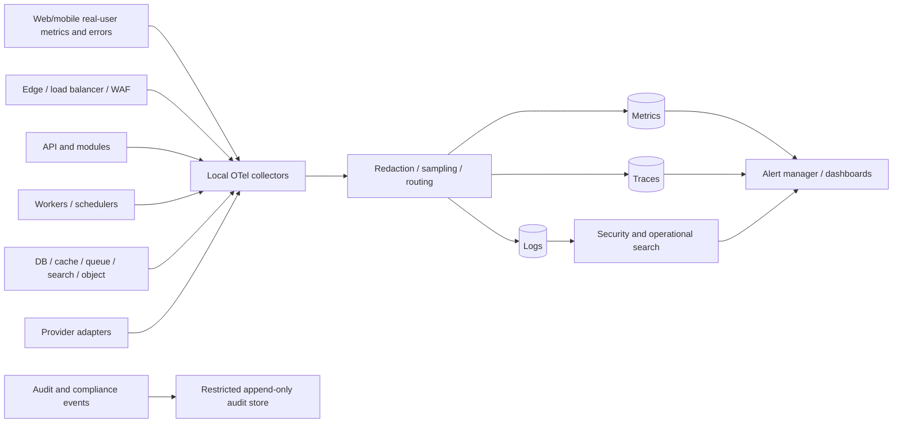

# Observability and Operations Strategy

Scope amendment (2026-10-06): [ADR-011](../decisions/ADR-011-seller-fulfilled-marketplace.md) and [revised scope](22-scope-phasing.md) control this historical baseline. Warehouse, fleet, platform-owned stock, platform goods/COD custody, and unconditional settlement requirements are OUT_OF_SCOPE. Seller stock reservations, seller order processing, delivery visibility, and applicable controls remain required. Authorized safe implementation may proceed; excluded capabilities and older blanket implementation stops do not create release blockers.

**Phase:** 0 — service-management architecture  
**Status:** Draft; targets require business approval and baseline measurement  
**Scope:** platform health, business correctness, security, privacy, payments, COD, logistics, seller operations, finance, support, backup, disaster recovery, and providers

## 1. Operating principles

1. Observe user and business outcomes, not only CPU and HTTP status.
2. Money, inventory, state, compliance, and tenant-isolation invariants are first-class operational signals.
3. An alert must indicate an actionable condition, an owner, a severity, and a runbook; dashboards without response ownership are not monitoring.
4. Telemetry must be useful without becoming a shadow personal-data store.
5. Correlation IDs and trace context connect client, edge, API, database, queue, worker, provider callback, audit, and support evidence.
6. Every asynchronous workflow exposes accepted, pending, retrying, dead-lettered, reconciled, and permanently failed states.
7. Provider success is provisional until authenticated and reconciled; provider outage must not corrupt internal truth.
8. Recovery ends only when financial, order, inventory, queue, evidence, and provider states reconcile.
9. SLOs drive release pace and engineering priority through error budgets.
10. Operations, Security, DPO, Finance, Logistics, Seller Ops, Support, and Legal share an incident process but retain decision authority in their domains.

## 2. Service catalogue and ownership

Every service/module/provider has a service card containing:

- name, purpose, customer/business criticality, owner, backup owner, on-call rotation;
- repository, deployable artifact, production endpoints, infrastructure resources;
- upstream/downstream dependencies and failure/degradation behavior;
- data categories, locations, processor/provider, retention, and DPO/legal status;
- SLI/SLO/error-budget policy;
- dashboards, alerts, logs/traces, audit events, synthetic probes;
- deploy/rollback, migration, backup/restore and DR method;
- runbooks and provider escalation/contract references;
- capacity limits, cost driver, quotas, expiry/certificate/secret dates;
- last production-readiness review, restore, failover, access review, and incident exercise.

Ownership follows bounded contexts even when deployed as a modular monolith. A shared executable does not mean every alert goes to Platform.

## 3. Initial service levels

These are internal launch objectives, measured over rolling 28-day windows unless specified. Legal/consumer promises use separately approved wording.

| Service/outcome                     | SLI                                                                                                         |              Initial SLO | Notes                                                                                                                      |
| ----------------------------------- | ----------------------------------------------------------------------------------------------------------- | -----------------------: | -------------------------------------------------------------------------------------------------------------------------- |
| Public browse/product/cart API      | good requests / eligible requests                                                                           |                   99.90% | Good = correct response within endpoint latency threshold; excludes proven client misuse, not internal dependency failures |
| Search                              | successful relevant response / eligible searches                                                            |                   99.50% | Fallback may count only if it meets defined user outcome                                                                   |
| Authentication/session              | successful eligible auth/session operations                                                                 |                   99.90% | Security denials/invalid credentials excluded only when correctly classified                                               |
| Checkout quote/review               | valid completed quote/review / eligible attempts                                                            |                   99.90% | Pricing/stock validation failure is product outcome, not platform error                                                    |
| Durable order placement             | confirmed requests producing one durable business outcome per idempotency key / eligible confirmed requests |                   99.95% | No duplicate/partial seller order; correctness objective is 100%                                                           |
| Electronic payment processing       | authenticated provider outcomes reflected within target time / received outcomes                            |  99.90% within 2 minutes | Provider availability reported separately; reconciliation covers missing/delayed callbacks                                 |
| Shipment creation                   | eligible confirmed fulfillment groups with shipment/reference or explicit pending state                     | 99.50% within 15 minutes | Provider outage may keep pending with ops visibility                                                                       |
| Transactional notification          | accepted messages delivered to provider or explicit permanent failure                                       |  99.00% within 5 minutes | Delivery beyond provider is separate where receipts exist                                                                  |
| Inventory reservation integrity     | reservations respecting available stock / all reservations                                                  |                     100% | Any negative/over-reserved state is an incident                                                                            |
| Payment/ledger/settlement integrity | internally consistent and reconcilable monetary effects                                                     |                     100% | Any unexplained mismatch is an incident, not an error-budget trade                                                         |
| Cross-tenant authorization          | unauthorized cross-tenant access prevented                                                                  |                     100% | Any confirmed breach is `SEV-0`                                                                                            |
| CNRC monthly export preparation     | validated report ready by internal deadline                                                                 |           100% by day 15 | Leaves remediation margin before statutory submission timetable; final cadence legally approved                            |
| Privacy-rights cases                | completed within approved legal/operational deadline                                                        |                     100% | Timer pauses/exceptions only if legally approved and recorded                                                              |

Latency thresholds come from [19-testing-strategy.md](./19-testing-strategy.md). An availability SLO never permits correctness, security, privacy, or regulatory violations.

### Error-budget policy

- > 50% of a monthly budget consumed in 7 days: freeze risk-increasing feature releases for that service; owner presents recovery plan.
- > 75% consumed or multi-window burn alert: restrict releases to reliability/security/compliance fixes.
- 100% consumed: executive/service-owner decision required to resume normal release; chronic external-provider error receives mitigation, not exclusion by default.
- Correctness/security/legal incidents do not become acceptable because availability budget remains.

## 4. Telemetry architecture

Use OpenTelemetry SDKs/bridges and locally approved collectors for metrics, traces, and structured logs. OpenTelemetry provides vendor-neutral collection and standardized correlation; see the [Collector](https://opentelemetry.io/docs/collector/) and [semantic conventions](https://opentelemetry.io/docs/concepts/semantic-conventions/).



Collectors are redundant, monitored, buffered within bounded limits, and incapable of blocking customer transactions when a telemetry backend fails. Audit/compliance records have their own reliable path; they are not reconstructed solely from sampled traces.

## 5. Telemetry schema and privacy

Required common fields:

```text
timestamp and observed_timestamp
environment, service.name, service.version, deployment.id, host/instance
trace_id, span_id, correlation_id, request_id
operation / route template (never raw URL with identifiers)
outcome, error.type/code, retry_count
actor_type and pseudonymous actor_ref only where approved
tenant/seller_ref as approved pseudonymous low-cardinality reference
aggregate_type and opaque aggregate_ref only where operationally necessary
provider, adapter operation, provider reference hash where approved
queue/topic and message/event type/version
feature-flag/config/rule version when relevant
duration and resource/saturation dimensions
data classification and redaction version for sensitive streams
```

Forbidden by default:

- passwords, OTPs, recovery codes, bearer/refresh/session tokens, cookies, API secrets, signing keys;
- PAN, CVV, PIN, full bank/postal account details, payment credentials;
- raw names, phone/email, full address, precise GPS, identity documents, signatures, support/chat bodies, uploaded evidence;
- request/response bodies and headers without an approved field allowlist;
- signed URLs and query strings carrying secrets/identifiers;
- arbitrary high-cardinality product/customer/order IDs as metric labels.

Redaction occurs at application source and collector defense-in-depth. Automated canary-secret and sensitive-pattern tests scan telemetry. Access, export, retention, processor/location, and international-transfer status are approved by Security/DPO. Operational logs, security audit, Law 25-11 processing-operation logs, and commercial transaction records are separately classified even if a common pipeline component is used.

## 6. Metric catalogue

### 6.1 Platform golden signals

For edge, web/API, workers, data services, and each adapter:

- traffic/throughput by operation and outcome;
- latency histograms with p50/p90/p95/p99;
- error rate by stable error class, not raw message;
- saturation: CPU, memory, event loop/thread pools, connections, file handles, disk/IOPS/space, network, quotas;
- restarts, crashes, OOM, readiness/liveness failures, deploy version;
- dependency request/latency/error/timeout/circuit state;
- rate-limit/bot/WAF outcome;
- certificate, domain, secret, key, licence, document and provider credential expiry.

### 6.2 Database/cache/search/object

- PostgreSQL connections/pool wait, transactions, slow queries, locks/deadlocks, WAL, replication lag, checkpoints, bloat, disk, backup/PITR health, failover state;
- Redis hit/miss, latency, memory/eviction, connection/error, replication/failover, hot keys where safely measurable;
- search query/index latency/error, indexing lag, document/version mismatch, shard/cluster health, disk, zero-result and timeout rate;
- object upload/download/scan/derivative latency/error, quarantine backlog, malware/invalid rejection, signed-grant misuse, bucket capacity, replication/lifecycle failure.

### 6.3 Queues and scheduled work

- publish/consume/ack/nack, ready/unacked depth, oldest-message age, retry attempts, DLQ depth/rate;
- outbox unpublished age/count, inbox duplicate count, replay rate, poison-message type;
- worker concurrency/utilization, job latency, schedule missed/late, batch progress, backfill checkpoint and ETA;
- notification, media, report, settlement, reconciliation and CNRC export backlog separately.

### 6.4 Business and correctness

- product/offer publication and compliance decision rates;
- price/stock freshness and catalog-to-search lag;
- add-to-cart and checkout funnel with stable reason codes;
- order placement success, idempotency replay/mismatch, marketplace-to-seller split count;
- invalid state-transition attempts and state dwell/aging;
- inventory available/reserved/on-hand invariant failures, reservation expiry/release lag, oversell count;
- payment initiation/outcome/callback authenticity/replay/out-of-order, pending age, refund age;
- provider/bank reconciliation matched/unmatched/amount and oldest discrepancy;
- COD accepted/verification/manual/rejected, delivered/refused, expected/collected/remitted/reconciled/discrepancy amount and age;
- shipment create/label/webhook/tracking error, delivery success/failure/late by approved dimensions;
- return/refund request, eligibility outcome, inspection, refund SLA, aging;
- seller ledger imbalance count, settlement/payout failure, hold/negative balance, manual adjustment amount/count;
- seller SLA/cancellation/late dispatch, policy violation, document expiry;
- support volume, first response/resolution, SLA breach, escalation, backlog age;
- marketing consent/withdrawal/suppression and >24-hour suppression breach;
- privacy-rights request age/outcome; retention/deletion job failures; transfer-policy block events;
- CNRC export reconciliation, readiness, submission receipt/failure.

Metrics use bounded dimensions. Detailed investigation joins through secured logs/traces/audit, not exploding metric cardinality.

### 6.5 Security signals

- auth failure/credential-stuffing patterns, MFA/recovery changes, refresh-token reuse, impossible or anomalous session behavior;
- authorization denials, cross-tenant probes, privileged/sensitive views, bulk export, role changes, break-glass;
- WAF/bot/rate events, suspicious API enumeration, upload malware, SSRF/egress block;
- configuration/secrets/key/firewall drift, unsigned/unapproved deploy, scan findings and patch SLA;
- audit pipeline gap/integrity failure, clock drift, unexpected log silence;
- payout/bank-detail change, refund/adjustment/override anomalies;
- data-transfer/egress and sensitive-data telemetry detections.

## 7. Distributed tracing

Trace context propagates across edge → web/BFF → module → database/cache/search → outbox → queue → worker → provider adapter. For asynchronous flows, link producer and consumer spans rather than fabricating one unbounded trace.

Required span/event attributes use semantic conventions plus bounded marketplace extensions: module/operation, aggregate type (opaque reference only when approved), event type/version, provider/operation, idempotency outcome, retry, state transition, and rule/config version.

Sampling:

- always retain errors, security-relevant spans, unusually slow traces, payment/order/refund/settlement failures, and canary transactions, subject to data minimization;
- probabilistically sample healthy high-volume browse/search;
- tail sampling is allowed only in the approved local telemetry boundary;
- audit evidence is never dependent on sampling.

## 8. Dashboards

| Dashboard                    | Audience                    | Contents                                                                                                                                                |
| ---------------------------- | --------------------------- | ------------------------------------------------------------------------------------------------------------------------------------------------------- |
| Executive marketplace health | leadership/on-call leads    | SLO/error budget, orders/GMV trends, payment/COD/delivery, major incidents, seller/support health; financial metrics labelled provisional vs reconciled |
| Customer journey             | product/engineering/support | browse/search/product/cart/checkout/order funnel, latency/error, localized/device/network segments within privacy rules                                 |
| Order correctness            | Orders/Operations           | state dwell, invalid transitions, split/partial outcomes, stuck orders, audit/event lag                                                                 |
| Payment and refund           | Payments/Finance            | provider status, callbacks/polls, pending/failed, duplicates blocked, refunds, reconciliation/discrepancies                                             |
| COD control                  | Finance/Logistics/Risk      | risk outcomes, verification, delivery/refusal, expected/collected/remitted/deposited/reconciled, discrepancies and aging                                |
| Inventory/warehouse          | Inventory/WMS               | reservations, invariant failures, stock movement, pick/pack/serial, backlog and SLA                                                                     |
| Shipping/couriers            | Logistics                   | adapter/provider, shipment create/label/tracking, pickup/transit/delivery, failed/late/RTS, courier sync                                                |
| Sellers/catalog              | Seller Ops/Compliance       | onboarding/document expiry, moderation, prohibited/IP, offer health, seller SLA/enforcement                                                             |
| Returns/support              | CX/Support                  | request/eligibility/inspection/refund aging, ticket volume/SLA/escalation, top safe reason codes                                                        |
| Platform/data                | SRE                         | edge/app/resources, DB/cache/queue/search/object, deploy annotations, capacity/backup                                                                   |
| Security/privacy             | Security/DPO                | identity/authorization, privileged access, egress, audit health, processing/rights/retention/incident indicators                                        |
| Compliance reporting         | Legal/Finance/DPO           | CNRC export/submission, document/record integrity, policy version, ANPDP cases, consent/suppression, evidence gaps                                      |

Dashboards show freshness and data quality. A stale green dashboard is red.

## 9. Alert severity and response targets

| Severity         | Examples                                                                                                                                                                                                             |    Acknowledge |                 Incident command/update |
| ---------------- | -------------------------------------------------------------------------------------------------------------------------------------------------------------------------------------------------------------------- | -------------: | --------------------------------------: |
| `SEV-0 Critical` | confirmed cross-tenant/personal-data exposure; unauthorized payment/refund/payout; ledger/inventory systemic corruption; destructive compromise; widespread order duplication; unrecoverable production loss         |          5 min | commander immediately; updates ≤ 15 min |
| `SEV-1 High`     | core checkout/order/payment unavailable; major provider failure without safe path; database primary/DR risk; large reconciliation mismatch; prohibited goods purchasable; security event with likely material impact |         10 min |    commander ≤ 10 min; updates ≤ 30 min |
| `SEV-2 Medium`   | degraded search/courier/notifications, growing queue/backlog, limited seller/support impact, SLO fast burn                                                                                                           |         30 min |     owner coordinates; updates ≤ 60 min |
| `SEV-3 Low`      | nonurgent capacity trend, isolated retry, impending expiry with ample lead, minor data-quality issue                                                                                                                 | business hours |                   tracked ticket/change |

The DPO/Legal determine regulatory notification obligations and timing. Severity cannot be downgraded merely because a feature still returns HTTP 200.

### Alert design

- Multi-window burn-rate alerts for SLOs; page for fast burn, ticket for slow burn.
- Correctness/security/privacy alerts use absolute conditions where one event matters.
- Queue alerts combine depth, oldest age, ingest/consume rate, and business deadline.
- Provider alerts separate internal adapter failure from provider status and customer impact.
- Every page includes summary, affected service/outcome, start/detection time, dashboard/query, likely recent changes, safe first actions, runbook, owner/escalation.
- Deduplicate related symptoms and inhibit downstream noise during a declared root incident.
- Test pages, routing, backup on-call, and provider contacts quarterly.

## 10. Incident management

### Roles

- **Incident commander:** owns objectives, priorities, cadence, and risk—not every command.
- **Technical lead:** diagnosis/containment/recovery.
- **Operations/business lead:** customer, seller, warehouse, courier, finance, and manual continuity.
- **Security lead:** adversarial analysis, evidence, containment, credential/key decisions.
- **DPO/Legal lead:** personal-data/regulatory assessment, notification clock/decision, privilege.
- **Finance controller:** money holds, reconciliation, bank/provider coordination, approval.
- **Communications lead:** internal/customer/seller/provider/status messaging approved for facts and obligations.
- **Scribe:** timeline, decisions, actions, evidence, owners.

### Lifecycle

1. Detect/declare and choose severity.
2. Stabilize safety, data, money, and evidence; freeze risky deploy/config/settlement as needed.
3. Scope customers/sellers/orders/transactions/data/providers and establish a trusted timeline.
4. Contain with feature kill switch, traffic shift, credential/key revocation, queue pause, account/seller/payout hold, or degraded mode.
5. Eradicate/repair through reviewed change or data-repair procedure.
6. Recover progressively with verification and continuous reconciliation.
7. Close only after customer/business state is correct, alerts stable, evidence retained, and follow-ups assigned.
8. Complete a blameless review: root/contributing causes, impact, detection/response gaps, control/test/runbook changes, owner/deadline, risk acceptance if any.

Follow [NIST SP 800-61 Rev. 3](https://csrc.nist.gov/pubs/sp/800/61/r3/final) as a program reference, adapted to Algerian legal obligations and this business.

## 11. Required runbooks

Every runbook contains trigger, customer/business risk, prerequisites/permissions, dashboards/queries, decision tree, containment, recovery, reconciliation, communications, escalation/provider contact, rollback, evidence, and exit criteria.

### 11.1 Payment provider outage or delayed callback

- Detect: initiation/callback/poll errors, pending age, provider status, reconciliation gaps.
- Protect: stop or feature-disable new affected payment initiations if outcomes are ambiguous; never mark paid from client redirect alone.
- Preserve: authenticated callback payload/reference, internal command/event timeline, provider request IDs; redact secrets.
- Recover: status-poll within provider limits; process callbacks idempotently; let customer safely resume/choose approved alternative if no charge.
- Reconcile: provider transaction and bank settlement against payment/order/ledger; identify duplicate/charged-without-order/order-without-payment.
- Exit: pending backlog within target, discrepancies assigned/resolved, customer/support communication complete.

### 11.2 Courier API outage

- Keep confirmed order; set explicit `SHIPMENT_PENDING_PROVIDER`; queue create with idempotency.
- Circuit break and back off; do not create a fabricated tracking number or repeat shipment blindly.
- Provide Operations a deduplicated work queue and manual contingency approved by Logistics.
- On recovery, rate-limit catch-up, deduplicate with provider status, then reconcile shipments/manifests/tracking.

### 11.3 Database degradation/failure

- Stop risky deploys/batches; identify connection, lock, disk, query, replication or node cause.
- Shed noncritical traffic/exports/indexing; preserve order/payment/inventory correctness.
- Fail over only through the tested procedure and fencing; announce potential recovery point.
- Verify schema, outbox/inbox, orders, payments, ledger, reservations, and provider gap after restore/failover.
- Do not resume full writes until reconciliation and capacity are acceptable.

### 11.4 Search outage/corruption

- Disable affected index/alias and activate curated/category fallback or clear unavailable state.
- Keep checkout independent and revalidate catalog/price/stock.
- Rebuild versioned index from source and outbox, compare counts/samples/versions, atomically switch alias.
- Check zero-result/conversion analytics after recovery; never restore private/stale fields casually.

### 11.5 Notification provider failure

- Commit business action; retain notification outbox with template/locale/preference snapshot.
- Pause runaway retries and apply backoff/rate limits; use alternate provider/channel only if approved.
- Prioritize OTP/security/order-critical messages; monitor OTP expiry and customer-support impact.
- Reconcile delivery receipts and deduplicate before replay; do not resend stale OTPs.

### 11.6 Inventory mismatch/oversell

- Freeze affected SKU/offer reservations and sale; preserve movements/reservations/orders.
- Calculate `on_hand - reserved - safety_stock` and compare warehouse scans/movements.
- Identify race, duplicate, missing release/decrement, manual adjustment or physical discrepancy.
- Customer remediation follows approved policy; correction uses auditable inventory movement, never direct overwrite.
- Add invariant test/monitor and re-enable only after source and physical state reconcile.

### 11.7 Duplicate order

- Stop affected checkout path/worker if systemic; retain idempotency/request/order/payment evidence.
- Determine whether duplicate is display, seller split, actual contract, payment, reservation, or shipment.
- Prevent fulfillment/payment repetition; contact customer/support under approved script.
- Cancel/reverse only through domain workflows and reconcile stock, payment, ledger, notifications, shipment.

### 11.8 Duplicate/ambiguous payment

- Place affected transaction/order/refund in review; never delete events.
- Verify provider reference, amount/currency, merchant, callback signature, bank settlement and idempotency history.
- Block duplicate capture/refund through constraints; customer remediation/refund uses approved finance workflow.
- Reconcile and document provider escalation.

### 11.9 Failed seller payout

- Mark payout failed/pending investigation without duplicating debit/credit entries.
- Check bank destination version, file/reference, provider/bank status and settlement batch.
- Hold automated retry where outcome is unknown; maker/checker approves resolution.
- Notify seller without exposing bank details; reconcile ledger, bank and statement before close.

### 11.10 COD cash discrepancy

- Freeze discrepancy batch/payout effects; compare expected, collected, custody handoffs, remittance, deposit and bank record.
- Preserve courier device/audit/proof while respecting privacy; separate operational error, timing, refusal/partial collection and suspected theft.
- Two-person count/verification and Finance-led adjustment; courier cannot edit the order amount.
- Escalate security/legal/HR only on evidence; close with ledger and bank reconciliation.

### 11.11 Security or personal-data incident

- Declare Security/DPO/Legal leads; preserve chain-of-custody evidence and notification-awareness time.
- Contain identity/session/key/egress/data access; do not destroy evidence through premature reimage/log rotation.
- Scope data subjects, fields, systems, recipients, countries, tenants, time, and ongoing risk.
- DPO/Legal determine ANPDP/person/contractual notification and content; use current law and filings.
- Recover through clean trusted artifacts/credentials, heightened monitoring, user/seller remediation, and verified processing logs.

### 11.12 High error/latency or resource saturation

- Correlate deploy/config/traffic/provider/DB/queue; activate release rollback/flag, load shedding, caching, or scaling within safe limits.
- Protect checkout/payment/order/inventory over recommendations, reports, bulk import, and analytics.
- Confirm error semantics; an increase in business rejections may be valid but still indicate UX/catalog problems.

### 11.13 Backup/restore or disaster declaration

- Incident commander declares recovery objective/site and freezes conflicting writes.
- Use separately controlled IaC, secrets/key recovery, signed artifacts, immutable backups.
- Measure actual recovery point/time; restore in isolation and verify integrity/security before traffic.
- Reconcile provider events and every financial/inventory workflow across the gap; gradually reopen.

## 12. Routine operations calendar

| Cadence                    | Required work                                                                                                                                                                     |
| -------------------------- | --------------------------------------------------------------------------------------------------------------------------------------------------------------------------------- |
| Continuous                 | SLO/security/correctness alerts; backup/job/provider monitoring; certificate/domain/secret expiry; vulnerability and external exposure                                            |
| Daily                      | payment/refund/provider/bank reconciliation; COD batch/discrepancy aging; ledger/inventory invariant report; failed jobs/DLQ; backup verification; suspicious access              |
| Weekly                     | capacity and error-budget review; restore sample; provider/SLA issues; patch/vulnerability triage; stuck state/return/refund/support aging; feature/config change review          |
| Monthly                    | CNRC record extract, validation and submission evidence on approved timetable; privileged access review; financial close/reconciliation; retention/deletion evidence; cost review |
| Quarterly                  | all-role access recertification; failover/service recovery exercise; on-call/page/contact test; provider/processor/location review; rules/policy and runbook review               |
| Semiannual                 | security/privacy/payment/COD tabletop; business-continuity exercise; threat model and DPO processing-register review                                                              |
| Annual and material change | independent penetration test, full DR exercise, provider due diligence, legal/accounting compliance refresh, capacity forecast, architecture review                               |

Cadences are minimum engineering proposals; law, provider contract, audit, or business risk may require shorter periods.

## 13. Backup, continuity, and disaster recovery operations

RPO/RTO targets and technical design are in [18-infrastructure-and-deployment.md](./18-infrastructure-and-deployment.md). Operations additionally requires:

- business impact analysis ranking customer safety/trust, money, inventory, evidence, legal deadlines, and provider dependencies;
- manual continuity procedures for seller/warehouse/courier/finance/support work with strict later reconciliation;
- clean-room recovery access, offline/immutable contacts and runbooks, and alternative communication channel;
- tested recovery of DNS/domain, certificates, identity/MFA, KMS/secrets, IaC state, artifact registry, database, objects, queue, search, configuration/flags, telemetry, and audit;
- compromised-backup assessment and known-good recovery-point selection;
- declared degraded capabilities and customer/seller communications;
- post-recovery replay/reconciliation order to avoid duplicate payments, shipments, notifications, refunds, or payouts.

Exercise reports record planned/actual RPO/RTO, data and transaction gaps, manual steps, access failures, communication latency, integrity checks, and corrective actions.

## 14. Operational data repair

Data repairs are product changes with higher risk, not casual database edits:

1. identify exact records through a read-only reproducible query;
2. preserve evidence and backup/transaction plan;
3. write an idempotent bounded repair through domain interfaces or a reviewed maintenance tool;
4. preview/dry-run diff and reconcile totals;
5. require maker/checker for money, inventory, identity, compliance, or bulk personal data;
6. schedule/monitor/abort based on declared thresholds;
7. emit domain history/audit/events where required;
8. verify customer/seller/provider/ledger/inventory outcomes;
9. remove temporary access and retain the approved repair artifact/evidence.

Direct arbitrary status or balance updates are prohibited.

## 15. Operations readiness gates

Before production traffic:

- every critical service/provider has owner, SLO, dashboard, alerts, runbook, capacity, backup/recovery, and escalation;
- telemetry is live before the application and contains no prohibited sensitive fields in sampled verification;
- paging reaches primary/backup responders and provider contacts in a test;
- synthetic browse/login/cart/checkout/order probes and business-invariant monitors are operating;
- deploy/canary/rollback, DB failover, queue replay, search rebuild, secret/certificate rotation, restore, and DR are exercised;
- payment, COD, refund, ledger, settlement, provider and CNRC reconciliation jobs are tested with discrepancies;
- incident roles, status/customer/seller/support communication templates, and evidence handling are rehearsed;
- DPO approves telemetry purpose/fields/location/retention/access/processors/transfers and incident decision path;
- Legal/Accounting approve regulatory calendars, record evidence, and operational deadlines;
- support, seller ops, warehouse, courier, finance, compliance, and on-call teams complete role-based training and have least-privileged access.

## 16. References

- [OpenTelemetry documentation](https://opentelemetry.io/docs/)
- [OpenTelemetry Collector](https://opentelemetry.io/docs/collector/)
- [OpenTelemetry semantic conventions](https://opentelemetry.io/docs/concepts/semantic-conventions/)
- [NIST Cybersecurity Framework 2.0](https://www.nist.gov/publications/nist-cybersecurity-framework-csf-20)
- [NIST SP 800-61 Rev. 3 — Incident Response Recommendations](https://csrc.nist.gov/pubs/sp/800/61/r3/final)
- [NIST SP 800-34 Rev. 1 — Contingency Planning Guide](https://csrc.nist.gov/pubs/sp/800/34/r1/upd1/final)

SLOs and alert thresholds are versioned operational policy. They become commitments only after load baselines, provider contracts, business impact, and launch scope are approved.
