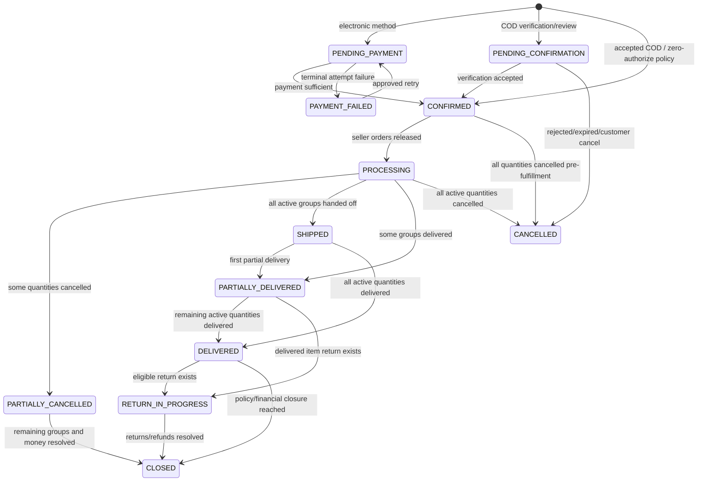
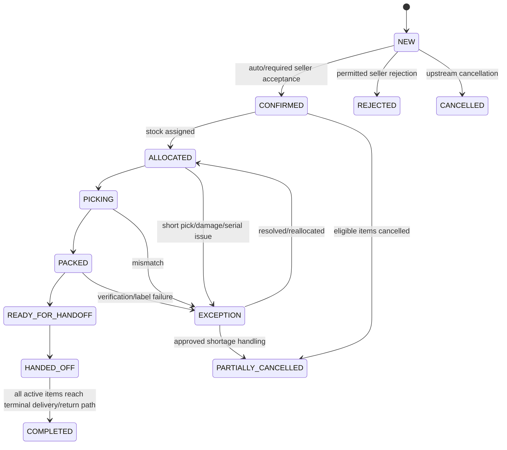
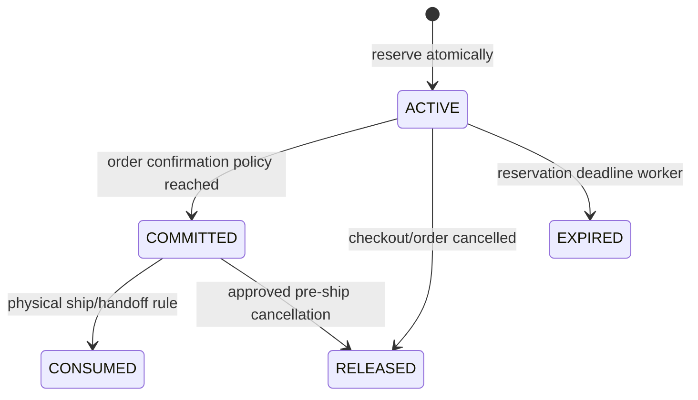
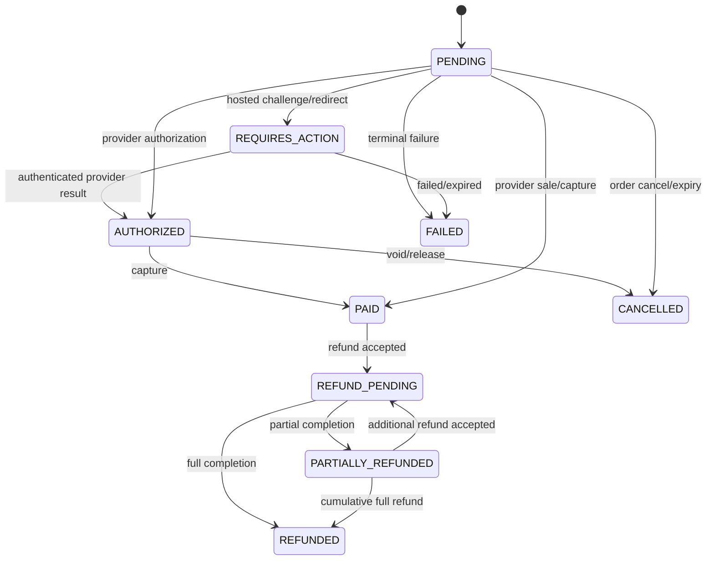
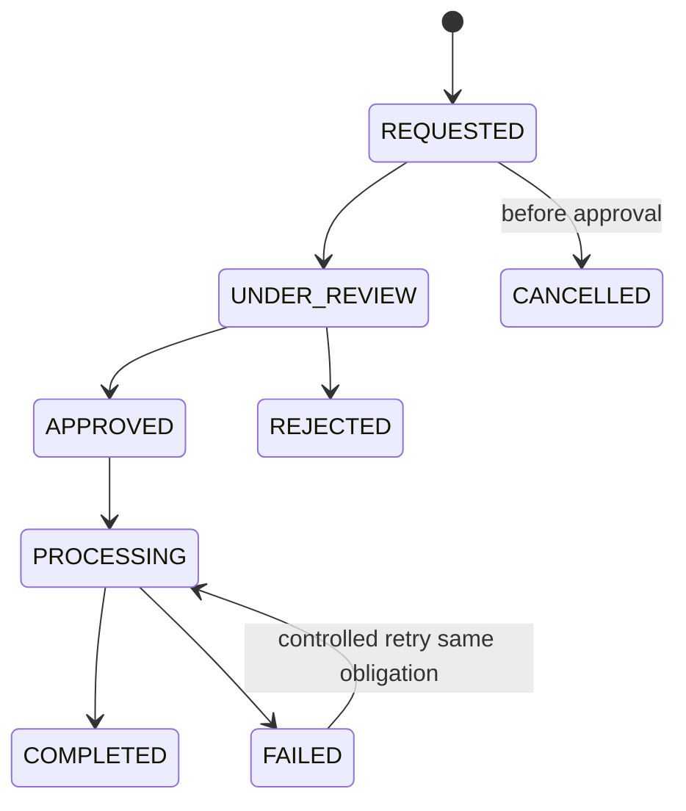
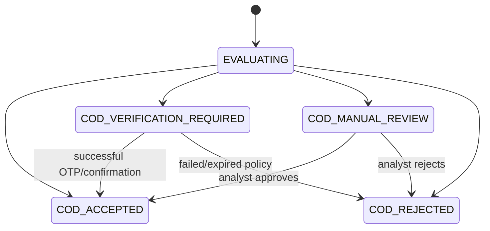
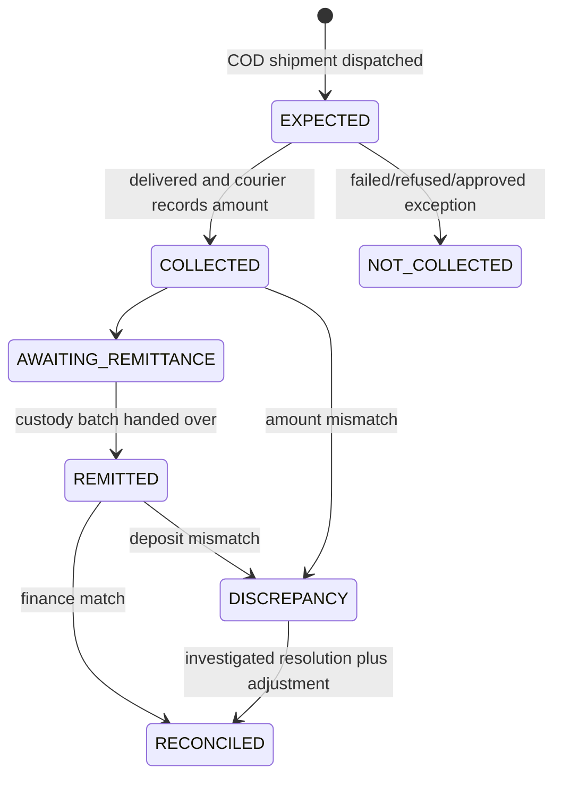
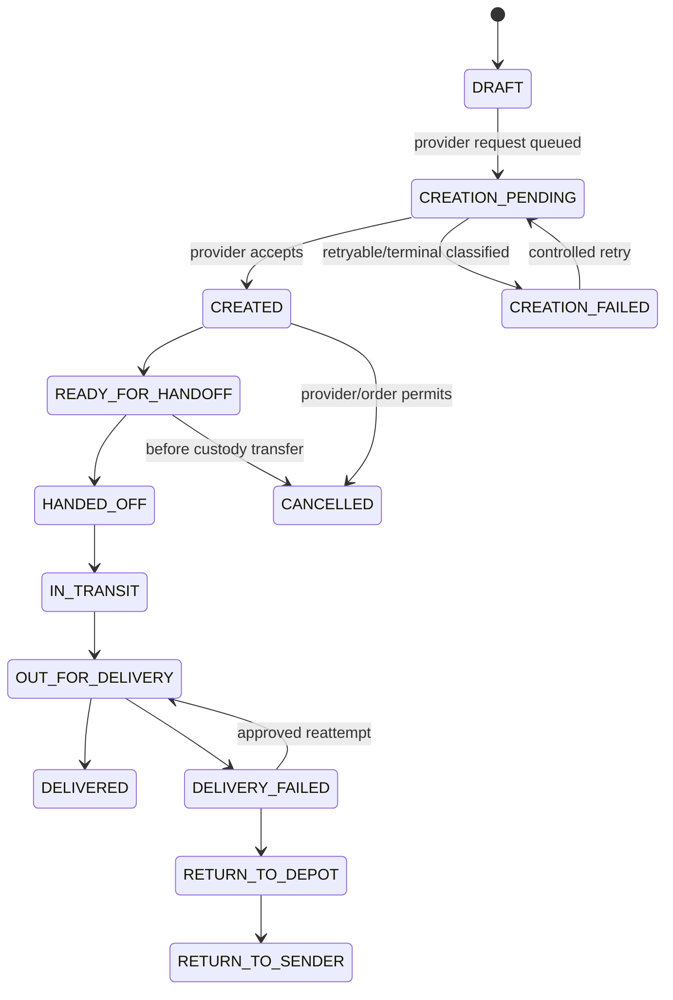
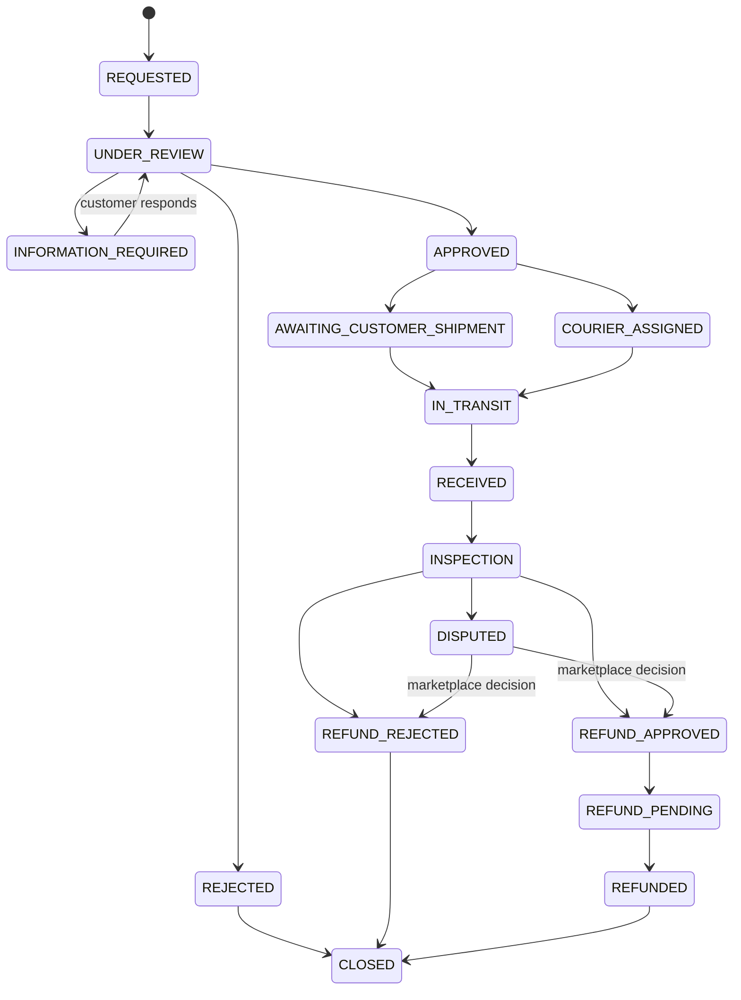
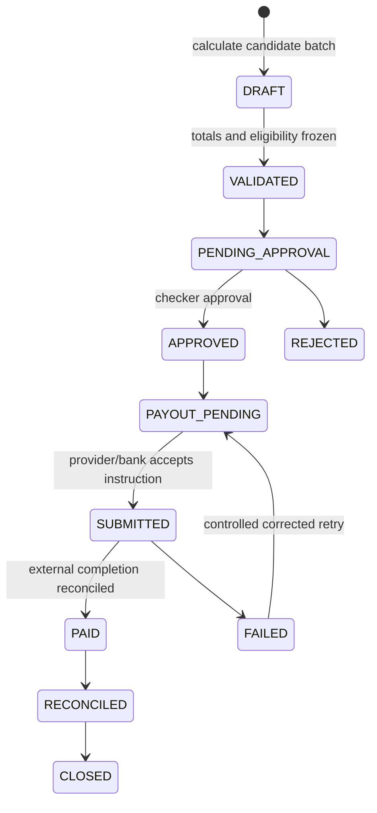

# Domain Lifecycles and State Machines

Scope amendment (2026-10-06): [ADR-011](../decisions/ADR-011-seller-fulfilled-marketplace.md) and [revised scope](22-scope-phasing.md) control this historical baseline. Warehouse, fleet, platform-owned stock, platform goods/COD custody, and unconditional settlement requirements are OUT_OF_SCOPE. Seller stock reservations, seller order processing, delivery visibility, and applicable controls remain required. Authorized safe implementation may proceed; excluded capabilities and older blanket implementation stops do not create release blockers.

## State-machine contract

Each aggregate owns its state. Transitions occur only through an application/domain service that validates current state, actor permission/scope, entity version, policy/config version, idempotency key, invariant, reason/evidence, and side effects. The same transaction appends domain state/history and an outbox record. Consumers are idempotent and cannot edit another aggregate directly.

History records contain aggregate/entity ID, previous/new state, command, actor type/ID, source, reason code/text, policy/config version, correlation/causation/idempotency IDs, safe metadata, and timestamp. Corrections append facts; they do not rewrite history.

## 1. Aggregate separation

| Aggregate                  | Owns                                                                                 | Does not own                                             |
| -------------------------- | ------------------------------------------------------------------------------------ | -------------------------------------------------------- |
| Marketplace Order          | Customer contract, totals/snapshots, derived overall status, seller-order membership | Courier state, provider payment truth, return inspection |
| Seller Order               | Seller-specific items, acceptance and preparation                                    | Other sellers, provider payment, courier event truth     |
| Fulfillment Order          | Warehouse/seller tasks: allocate, pick, pack, handoff                                | Customer contract, payout                                |
| Inventory Reservation      | Quantity hold for SKU/location/owner                                                 | Physical shipment or payment                             |
| Payment Intent/Transaction | Provider attempts and money authorization/capture state                              | Order status directly                                    |
| Shipment                   | Packages, provider assignment, tracking and proof                                    | Payment/cash ledger                                      |
| COD Collection             | Expected/collected/remitted/reconciled cash custody                                  | Order price editing                                      |
| Return/RMA                 | Eligibility, authorization, reverse movement and inspection                          | Provider refund completion                               |
| Refund                     | Amount/method/provider attempts                                                      | Return inspection decision                               |
| Seller Ledger              | Immutable seller financial facts/holds                                               | Mutable “balance” field                                  |
| Settlement/Payout          | Frozen eligible ledger entries and payout lifecycle                                  | Recalculation of historical entries                      |

## 2. Marketplace order lifecycle

The marketplace order is created only after checkout revalidation. Its visible status is a projection of payment/COD, seller-order, shipment, return, and refund facts; commands never set arbitrary status strings.

`DELIVERY_FAILED`, `RETURN_TO_SENDER`, `DISPUTED`, `REFUND_PENDING`, `PARTIALLY_REFUNDED`, and `REFUNDED` remain explicit shipment/return/refund/payment states and contribute badges/derived order substatus. They are not allowed to collapse unrelated aggregates into one mutable field.

### Order creation transaction

1. Lock/version-check cart and requested offers; resolve current SKU/offer/seller/fulfillment ownership.
2. Validate customer/phone/address/serviceability, quantity limits, restricted-product eligibility, and seller status.
3. Atomically reserve inventory with expiry; fail the whole checkout or follow explicitly approved partial-order policy (MVP default: no silent partial placement).
4. Calculate item, promotion/funding, tax, fee, shipping, and total using named rules/config versions.
5. Persist marketplace order, seller orders, items, fulfillment groups, address/policy/price/commission snapshots, consent acceptance, COD/payment intent link, history, and outbox.
6. Return the same result for a repeated customer/idempotency key and semantically identical payload; reject key reuse with a different payload.

### Cancellation transitions

| From                         | Command/outcome                           | Authority              | Required side effects                                                      |
| ---------------------------- | ----------------------------------------- | ---------------------- | -------------------------------------------------------------------------- |
| Pending payment/confirmation | Cancel/expire                             | Customer/system        | Release reservation; cancel intent; notify                                 |
| Confirmed, not allocated     | Cancel eligible quantity                  | Customer/system policy | Cancel seller item; release stock; void/refund; ledger reversal if posted  |
| Allocated/picking            | Request cancellation                      | Customer               | Operations decision task; do not lie that cancelled                        |
| Packed, not handed off       | Approve/reject request                    | Operations with policy | Unpack/restock or explain rejection                                        |
| Shipped                      | Reject cancellation, offer refusal/return | System policy          | Preserve shipment; create support/return path                              |
| Partial order                | Cancel selected eligible lines            | Customer/operations    | Recalculate only derived remaining/refund facts; preserve unaffected lines |

## 3. Seller-order and fulfillment lifecycle

Seller sees only its seller order/items/customer delivery data required for fulfillment. Customer contact/address access is time/purpose bounded and logged according to policy.

## 4. Inventory reservation and movement lifecycle

Invariant per owner/SKU/location: `available = on_hand - active_or_committed_reserved - safety_stock`, with database locking/conditional update so available never becomes negative. Inventory movements are append-only types such as RECEIVE, PUTAWAY, RESERVE, RELEASE, PICK, SHIP, RETURN_RECEIVE, RESTOCK, DAMAGE, COUNT_ADJUSTMENT, TRANSFER. Serial-controlled SKUs additionally enforce one active custody location and one sale shipment per serial.

## 5. Payment lifecycle

Payment intent is the business obligation; payment attempts/transactions record provider interactions. Multiple failed attempts may belong to one intent, but confirmed paid amount cannot exceed approved payable amount except through an explicit overpayment case.

### Provider interaction rules

- Generate provider idempotency key from internal payment command; persist request hash before call.
- Store only allowed provider reference, status, amount/currency, timestamps, safe error code, and redacted response envelope where permitted.
- Browser/app return is never sufficient proof. Verify signed/authenticated webhook or provider status through server channel.
- Persist raw webhook safely where lawful, authentication result, normalized event, processing outcome, and provider event ID; duplicate events return success after matching prior outcome.
- Out-of-order events compare provider sequence/timestamp and legal transition graph; they do not regress terminal state.
- Reconciliation compares provider settlement/report to internal transactions and creates discrepancy cases rather than mutating facts silently.

### Refund lifecycle

Refund amount is bounded by refundable captured amount minus completed/pending refunds, adjusted for item/fee/promotion/tax policy. Approval and provider processing are distinct. COD refund method is a configured, legally/accountingly reviewed process and is never marked complete before money-transfer evidence.

## 6. COD decision and cash lifecycle

### COD risk decision

Risk decisions persist rule versions, contributing signals/reasons, prohibited-feature check, reviewer where applicable, and expiry. Customer-facing copy gives an actionable outcome without disclosing exploit-enabling internals.

### Cash custody and reconciliation

Expected amount is copied from the immutable shipment/order collection obligation and is read-only to courier. Every handoff records from/to custodian, amount, batch, time, evidence, and signatures/identifiers. Adjustments are separate balanced records with maker-checker approval.

## 7. Shipping lifecycle

### Shipment invariants

- A shipment contains items from one compatible fulfillment origin/owner and preserves item quantities.
- Provider create/cancel/webhook operations are idempotent and mapped to internal reason/state vocabulary.
- Handoff requires manifest/package scan and custody timestamp.
- Proof of delivery is immutable; corrections append supervisor-reviewed records.
- Delivery estimate stores range, calculation inputs/version, calendar, and confidence class. Customer display updates only through policy and never promises an unsupported exact time.
- Partial shipment/delivery updates the order projection by quantities, not simplistic booleans.

### Delivery attempt outcomes

| Outcome              | Evidence                                      | Next action                                                 |
| -------------------- | --------------------------------------------- | ----------------------------------------------------------- |
| Delivered            | Required proof + timestamp + assignment       | Finalize attempt; COD collection if applicable              |
| Customer unavailable | Attempt timestamp/location and contact result | Reattempt/reschedule policy                                 |
| Customer refused     | Reason, package condition                     | Return-to-depot/sender; COD not collected; risk signal      |
| Wrong address        | Reason and safe notes                         | Support/address-resolution workflow; no silent address edit |
| Damaged package      | Evidence and custody                          | Quarantine/claim/return path                                |
| Partial delivery     | Package/item quantities and proof             | Close delivered packages; preserve remainder                |

## 8. Return lifecycle

### Eligibility snapshot

Return evaluation stores order/item/quantity, delivery timestamp, request timestamp, category/product/offer/seller, condition/reason, policy/version accepted at purchase, computed deadline, evidence references, and decision reasons. Policy changes cannot retroactively reduce a purchased right without explicit lawful rule.

### Inspection and disposition

Inspector records package condition, item condition, quantity, accessories, serial/IMEI match, damage, evidence, and quality result. Disposition is one of RESTOCK, REFURBISH, RETURN_TO_VENDOR, DISPOSE, or QUARANTINE. Restock creates an inventory movement only after inspection; refund approval is a separate command. Disposition cannot erase seller/customer dispute rights.

## 9. Seller ledger and settlement model

### Ledger principles

- Ledger entries are immutable, append-only, currency-specific, and linked to source entity/event.
- Reversals reference original entries; no update/delete of posted money.
- Each business posting creates a balanced entry set in an internal chart of accounts appropriate to marketplace accounting design; final accounts require accountant approval.
- Projections calculate pending, available, reserved/disputed, and paid. Projections are rebuildable from entries.
- Entry types include SALE, COMMISSION, PAYMENT_FEE, SHIPPING_FEE, FULFILLMENT_FEE, SELLER_FUNDED_PROMOTION, MARKETPLACE_FUNDED_PROMOTION, REFUND, RETURN_ADJUSTMENT, HOLD, HOLD_RELEASE, MANUAL_ADJUSTMENT, PAYOUT, and PAYOUT_REVERSAL.

### Eligibility

An entry becomes available only when configured conditions are true: delivery confirmed; COD/payment reconciled as required; return/dispute hold window elapsed; seller active/eligible; no legal/risk/negative-balance hold; source not reversed; and effective settlement policy version permits it.

Settlement batch freezes included ledger-entry IDs, seller, currency, gross/fees/refunds/adjustments/net totals, policy version, bank-destination version, hold exceptions, creator, and checksum. An entry belongs to at most one non-cancelled settlement. Maker and checker differ. Payout `PAID` requires external evidence and reconciliation, not merely a successful API request.

### Seller statement reconciliation

Statement provides opening balance, each source-linked entry, holds/releases, batch totals, payout reference, closing projections, and dispute window. Sum of entries must equal statement movement and payout net; automated invariant failures block approval and page finance on-call.

## 10. Synchronization and derived order status

The order read model consumes versioned facts:

- Payment sufficient + COD accepted → eligible for order confirmation.
- All active seller orders cancelled → order cancelled; some cancelled → partially cancelled.
- Any shipped quantity and remaining active → shipped/partially delivered projection as quantities progress.
- All non-cancelled quantities delivered → delivered.
- Active return/refund adds customer-facing substatus without reversing delivered facts.
- Closed means every item is in a terminal fulfillment state and every required payment/refund/COD/settlement-side obligation is resolved or explicitly transferred to a governed dispute.

Projection lag never authorizes commands. Command services read authoritative aggregate state/version.

## 11. Failure and concurrency tests required

- Two checkouts compete for the final unit.
- Customer double-submits checkout with same and different payload/idempotency key.
- Payment webhook duplicates, arrives before browser return, arrives out of order, or arrives after cancellation.
- Seller updates stock while order reserves it.
- Shipment provider times out after accepting creation.
- Courier submits offline delivery twice and later sends a conflicting failure.
- Partial delivery and partial cancellation occur across seller groups.
- Return requests duplicate, exceed quantity, use wrong serial, or arrive at policy boundary.
- Refund worker/process/provider callback duplicates or completes partially.
- Settlement batch generation races ledger posting or another batch.
- Payout provider times out after accepting instruction.
- Configuration/policy changes while checkout/return/settlement is in progress; snapshot/version rules must decide consistently.
